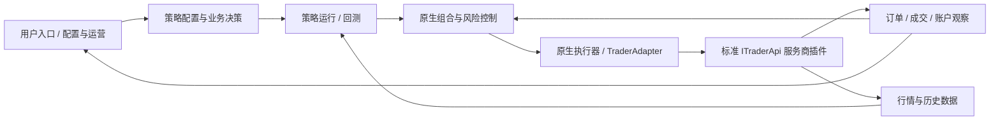

# 系统架构与事实边界

类型：架构正文。权威范围：逻辑职责、主要执行链与源码模块入口。实现状态、环境与版本见[当前事实](../roadmap/CURRENT.md)，具体协议见对应规格和接口声明。

## 系统职责

WT独立运行发行单元拥有QMT通信、行情采集/历史、策略及交易。观衡是独立部署的只读观察服务；WT的安装、启动、日常运行和关闭不依赖观衡。职责及进程边界以[ADR-0016](adr/0016-independent-wt-runtime-and-observer.md)为准。

这是系统逻辑图；节点可以由进程内模块或独立服务承担。部署位置、通信机制和支持环境由运行手册及相应规格声明。观衡业务入口、策略配置和保留页面的源码由本仓库`apps/guanheng`拥有，与原生底座独立打包发布，通过明确接口连接；服务分开运行时仍保持本仓库源码与制品归属。

## 主要执行链

1. 数据源接入并规范化，明确证券身份、来源时间、单位和有效性，经存储或内存缓存提供给消费者。
2. 策略按照所属运行时的时钟读取数据并输出信号或目标；组合与原生风控按配置确定执行范围。
3. 原生执行单元经 `TraderAdapter` 调用标准 `ITraderApi.orderInsert/orderAction`；插件按真实账户和终端接口执行，通过 `ITraderSpi` 返回委托、成交及查询事实。WT 委托号、用户标签与柜台订单号分别保持关联，查询与实时回报交接归插件。
4. 业务界面展示各层事实与连接、登录、查询、故障等运行状态；持久记录支持审计与恢复，缓存按声明的来源重建。测试及交付结论记录在验证文档，不转化为额外产品资格等级。

QMT内置来源的执行方式由配对生命周期显式选择，见[SIO规格](../specs/qmt-source-runtime.md)。策略回调驱动沿同一原timer非阻塞推进认证运输，各账户、交易、历史准备和行情owner继续保持原业务状态、请求身份及截止；默认线程路径保留。等待与并行计算放在WT管理的终端外进程，观衡仅消费公开结果。运行方式改变与金融能力、交易权限及事实所有权分别配置、验证。

## 事实所有权

策略所需外部辅助事实由WT侧适配取得，唯一业务模块派生，经原分析窗口交策略/回测；字段、时钟、缺口和日志合同见[SDO](../specs/strategy-data-and-observability.md)。观衡消费只读结果，运行诊断和数据更新归WT生命周期。

| 事实 | 所有者类型 | 消费规则 |
|---|---|---|
| 外部实际持仓、资金及柜台结果 | 对应账户服务商；接入层保存观察证据 | 标注账户、会话、时间和完整性 |
| 策略理论持仓、目标和内部状态 | 对应策略运行上下文 | 与实际账户观察分别命名 |
| 策略预算与风险参数 | 明确配置及所属策略/原生风控模块 | 复用原生执行，不增加资金账本或逐单人审工作流 |
| 通信命令提交阶段、持久受理和恢复依据 | 该路由唯一通信 owner | 内部身份自动生成并用于防重；保留原WT委托关联，未知结果沿原身份核查，用户无需逐单审批 |
| 行情数据集、覆盖、修订和质量 | 数据模块 | 快照与修订版本可追溯 |
| 展示缓存和统计投影 | 对应消费者 | 标记派生来源、延迟与重建方式 |

标准交易目标复用 WT 原生执行与风险规则、正常写开关、账户配置和终端运行模式；接入层负责来源认证、字段转换、通信防重与恢复。当前 QMT 工厂使用的 `ManagedTrader` 仍拒绝标准委托/撤单，其私有签名授权、生产可信等级和同水位四快照前提待重构退出，具体差额见[执行模块](../modules/execution.md)。

新增事实先指定所有者、持久边界和恢复入口。责任迁移通过 ADR 和切换规格记录；同一条交易路由具有明确的活动执行入口。

原生行情和运行状态与观衡独有业务事实依[ADR-0003](adr/0003-native-runtime-and-business-state.md)划分。数据库、服务进程和消息链按职责需要选择；旧实现形态不构成新的持久化要求。

## 源码导航

| 模块 | 当前源码入口 | 详细说明 |
|---|---|---|
| 公共接口与源端插件 | `src/Includes`、`src/Parser*`、`src/Trader*` | [服务商接入](../modules/providers.md) |
| 行情处理、存储及读取 | `src/WtDtCore`、`src/WtDataStorage`、`src/WtDataStorageAD` | [市场数据](../modules/market-data.md) |
| 策略及组合运行 | `src/WtCore`、`src/WtUftCore`、`src/WtRunner` | [策略运行](../modules/strategy-runtime.md) |
| 通道适配与执行单元 | `src/WtCore/TraderAdapter.cpp`、`src/WtExeFact` | [交易执行](../modules/execution.md) |
| 数据回放与模拟上下文 | `src/WtBtCore`、`src/WtBtRunner` | [回测](../modules/backtest.md) |
| 观衡业务与界面 | `apps/guanheng/guanheng_app`、`apps/guanheng/console`；独立SDK位于`integrations/guanheng_market_client` | [业务集成](../modules/business-integration.md) |

源码位置是导航事实；入口存在只证明对应代码存在。运行支持矩阵、依赖版本、命令和证据在[构建手册](../runbooks/build.md)和 CURRENT 维护。

产品功能排除项由[ADR-0004](adr/0004-core-trading-product-scope.md)定义；Grafana、新闻和研究服务不属于上述业务决策节点，也不进入运行或发行拓扑。
