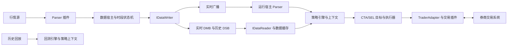

# WonderTrader 原生框架与并发模型

类型：长期架构说明。适用源码基线：`08b230dd05facf6d650d949bfe51054115a2ecb1`。升级时按实际差异复核。本文描述原生框架，模块细节见[插件](../modules/wondertrader-plugins.md)、[存储](../modules/wondertrader-storage.md)、[交易执行](../modules/wondertrader-execution.md)。观衡的业务职责另见[系统架构](overview.md)。

## 运行单元与职责

完整支持范围和选择条件从[开发能力目录](../development/wondertrader-capabilities.md)进入。该目录区分固定上游、可选官方子项目、自有适配及未实现路径；本页侧重框架分工和并发模型，不能单凭本页模块名称推断所有宿主均已完整接通。

WonderTrader 由宿主程序、引擎、上下文和插件组成。部署按实际使用的运行单元组合；C++ 宿主可以直接运行原生策略，wtpy 是可选语言封装。`WtRunner` 加载行情、交易、策略和执行组件；`WtBtRunner` 使用回放引擎；数据宿主保存行情；`WtExecMon` 提供独立执行入口。目录分类见固定版本的[源码地图](https://github.com/wondertrader/wondertrader/blob/08b230dd05facf6d650d949bfe51054115a2ecb1/src/README.md)。

| 层 | 原生模块 | 负责的事实或行为 |
|---|---|---|
| 宿主 | `WtRunner`、`QuoteFactory`、`WtBtRunner`、各 Porter | 装配配置、插件和引擎，决定进程及调用生命周期 |
| 数据接入 | `IParserApi/IParserSpi`、ParserAdapter | 行情连接、订阅、字段与合约归一、向宿主送入回调 |
| 数据落地 | `WtDtCore`、`IDataWriter`、`WtDataStorage` | 时段准入、实时 tick/基础分钟线、历史归档、广播 |
| 数据读取 | `WtDtMgr/IDataReader`、`WtDtServo` | 策略所需切片、周期组合、历史与实时读取、研究查询 |
| 策略引擎 | `WtCore` 的 CTA/SEL/HFT；独立 `WtUftCore` | 策略调度、上下文、理论头寸及相应引擎的执行方式 |
| 目标执行 | ExecuterManager、执行器、`ExecuteUnit/IExecuterFact` 工厂 | 将目标与交易通道观察值结合，形成具体执行行为 |
| 交易接入 | `ITraderApi/ITraderSpi`、TraderAdapter | 登录、查询、报单、撤单、回报、通道投影及连接状态 |
| 回测 | `WtBtCore`、历史回放器、回测上下文 | 用回放时钟和撮合规则运行策略，记录结果 |

行情与交易是两个接口。插件支持哪种回调线程、查询范围、重连方式，须以对应 SDK 与实现为准。

图中目标执行链针对 CTA/SEL；HFT 可以通过上下文直接管理订单，UFT 使用自身路径。数据宿主与运行宿主的 ParserAdapter 是不同类，阅读同名文件时必须确认目录。

## 策略目标、账户观察和本地状态

CTA 策略上下文维护理论持仓，组合引擎汇总目标，执行器按交易通道状态执行。券商查询反映账户实际持仓；策略理论头寸、策略用户数据和委托标签具有各自含义，无法仅凭账户总持仓重建。官方[框架简介](https://wtdocs.readthedocs.io/zh/latest/docs/intro.html)描述理论部位独立保存与目标合并；该滚动文档部分存储说明较旧，接口以固定源码为准。

原生 `CtaStraBaseCtx` 已有 `load_data/save_data`、`load_userdata/save_userdata`，以及交易、信号、资金等输出。它们记录策略运行状态和研究结果；交易插件还有委托身份关联缓存。这些状态属于框架原生机制。具体保存格式或保存动作本身不代表跨券商、引擎和文件的共同事务。源码：[策略状态](https://github.com/wondertrader/wondertrader/blob/08b230dd05facf6d650d949bfe51054115a2ecb1/src/WtCore/CtaStraBaseCtx.cpp#L221-L650)。

## 并发组织

WT 使用分工线程、输入队列、局部锁、调度屏障和会话状态控制并发。应逐个模块核对这些保护覆盖的状态。CTA 引擎配置中的 `poolsize=0` 只关闭该引擎的策略回调线程池；执行器有各自的同名配置，数据 SDK、计时器、交易回报和执行线程仍可能存在。

| 模块或线程 | 原有执行方式 | 已有保护与适用边界 |
|---|---|---|
| Parser/Trader SDK | 回调由具体 SDK 或插件安排；公共 adapter 多为直接调用 | 插件必须明确回调是否串行、是否会重入、调用结束后数据是否有效 |
| CTA 行情与分钟调度 | 行情触发 tick，ticker 同时有计时线程补触发分钟闭合 | ticker 在分钟闭合处理中使用 `_mtx`；该锁的存在不能外推为整个 engine 的全局锁 |
| CTA 策略线程池 | `poolsize>0` 时按上下文派发；缺省为 0 | `on_schedule` 等待所有策略计算完成后再收集目标；tick/bar 派发也有 pool wait。屏障约束该批任务，不约束另一路 SDK 回报 |
| SEL 定时任务 | 达到计划条件后创建线程调用上下文 `on_schedule` | 需要单独评估任务重叠与上下文共享；CTA 的线程池屏障不能直接套用 |
| HFT | 事件沿 HFT 上下文转发，使用 HFT ticker | 延迟敏感路径的回调次序与线程由具体接入链决定 |
| 实时 writer | `async=false` 在调用线程处理；true 使用任务队列 | 队列串行处理输入，cache 锁保护缓存，块锁保护数据块；checker、归档、退出另有生命周期约束 |
| 收盘与归档 | StateMonitor 改变 session 状态后触发归档 | 接收准入屏蔽已关闭 session；`allday` 配置不启用这套时段状态机。writer checker 在检测到归档线程后退出。状态门和锁各有职责 |
| 交易与执行 | 查询串联、回报更新投影、执行器按 ready 状态行动 | 插件可能有自身 IO 队列、流恢复和去重；MinImpact 计算使用互斥锁，WtOrdMon 订单监控使用递归锁。具体保护范围见交易模块 |

固定源码依据：

- [CTA 线程池配置](https://github.com/wondertrader/wondertrader/blob/08b230dd05facf6d650d949bfe51054115a2ecb1/src/WtCore/WtCtaEngine.cpp#L108-L123)、[先计算再汇总](https://github.com/wondertrader/wondertrader/blob/08b230dd05facf6d650d949bfe51054115a2ecb1/src/WtCore/WtCtaEngine.cpp#L241-L310)、[tick/bar 等待](https://github.com/wondertrader/wondertrader/blob/08b230dd05facf6d650d949bfe51054115a2ecb1/src/WtCore/WtCtaEngine.cpp#L610-L654)。
- [CTA 行情与计时线程](https://github.com/wondertrader/wondertrader/blob/08b230dd05facf6d650d949bfe51054115a2ecb1/src/WtCore/WtCtaTicker.cpp#L55-L240)、[SEL 调度线程](https://github.com/wondertrader/wondertrader/blob/08b230dd05facf6d650d949bfe51054115a2ecb1/src/WtCore/WtSelEngine.cpp#L309-L320)。
- [原生锁与线程类型](https://github.com/wondertrader/wondertrader/blob/08b230dd05facf6d650d949bfe51054115a2ecb1/src/Share/StdUtils.hpp#L24-L61)：`StdThread` 为 `std::thread`，unique/recursive mutex 各有用途，condition_variable_any 用于条件等待。

共享对象的引用计数解决对象存活问题；对象字段仍需相应同步。`thread_local` 保护线程本地数据，无法保护另一个共享 map。进程内锁也不自动成为跨进程 mmap 的锁；实时文件的发布次序和读取一致性需要沿 reader/writer 的格式协议核查。

## 引用计数与对象池

[WTSObject](../../src/Includes/WTSObject.hpp)使用原子引用计数；普通对象最后一次release会delete。WTSPoolObject<T>另在创建线程持有thread_local对象池及池锁，实例记录所属池和锁。最后一次release调用所属池的destroy：先执行对象析构，再将槽位还给池。

[ObjectPool](../../src/Share/ObjectPool.hpp)使用boost::pool管理后备块。对象归还后，池可以保留后备内存供同线程同类型对象复用；池内对象数、尚存引用和系统堆分配块数是不同指标。检查资源释放时分别核对象引用/析构、池缓存和本轮独立分配，记录计量从冷启动还是初始化完成后开始。

池锁保护构造和归还；引用计数管理实例引用。跨线程借用或释放还须保证创建池的线程仍存活，实例retain不会延长thread_local池的生命期。异步适配可跨线程传独立值，在明确存活的对象owner线程创建和回收WT对象。异常和内存故障的传播范围还应逐个核对API的noexcept及分配器边界。

## 连接恢复与原子性的分层

交易系统存在多个不同范围的“原子性”：单个字段更新、进程内临界区、单份文件发布、SDK 流恢复、券商订单处理。断线恢复跨越网络、查询和回报，须依靠身份、状态转换和补发规则建立一致性。

原生 CTP 有登录后查询链，XTP 有保持连接数据连续性的恢复路径。它们使用不同的 SDK 契约。公共 TraderAdapter 的查询与回报更新不构成覆盖四项账户查询的数据库事务。接入模块应遵守实际回调串行约束、快照边界和重复消息规则；不能以“加一把锁”替代语义核对。详见[交易模块](../modules/wondertrader-execution.md)。

## 生命周期与扩展原则

宿主决定谁负责创建插件、停止输入、等待回调、释放数据和卸载 DLL。原有进程退出、DLL 对象释放、同进程重新初始化、有界停止是不同运行条件。接入文档必须声明所支持的条件，再沿每条路径核实线程终止与对象生命期。

新增源优先实现 `IParserApi/ITraderApi`；历史转换使用原生 helper，读取/输出目的地扩展使用已有 loader/dumper 或 reader/writer 接口。公开接口附带的生命周期、数据所有权和时序要求与函数签名同样重要。业务层和插件可独立发布，二进制 ABI 与配置契约须配套验证。

并发审查以以下完整证据形成结论：

1. 标出所有线程、入口、回调及共享状态，说明谁拥有对象。
2. 写清锁、队列、会话门、查询状态机和 join 各自保证什么。
3. 用正常配置和官方宿主路径检查触发条件，再单列额外宿主能力。
4. 以原样源码、固定工具链和隔离输入复现；记录竞态检测或确定交错的证据。
5. 区分已发生故障、静态可达风险、SDK 约束和新增需求；压力测试通过仅覆盖实际执行过的调度。

框架修改遵循[上游维护规范](../development/upstream.md)，先解释最小必要范围与替代方案。详细缺陷、实验数据和修订决定进入专项证据，长期模块文档维护当前版本的真实行为。

当前下游提供明确启用的[受管CTA运行模式](../specs/native-cta-shutdown.md)。它沿原ticker.stop、pool.wait、插件stop扩展与原对象所有者完成关闭；任务队列在关闭准入后排空。运行模式的支持范围、信号入口和析构顺序见[策略运行](../modules/strategy-runtime.md)。原回测的stop_backtest与实时Porter的release属于各自入口，应按各自实际实现核对；实时Porter release当前只停止日志。

## 闭合分钟、数据准备与屏障

原Ticker调用IDataReader.onMinuteEnd，默认Reader扫描已缓存证券的DMB，以结束时间和每证券游标送出未读bar；DtMgr先收集通知，再统一调用Engine.on_bar，Ticker随后触发on_schedule。线程池分别等待bar回调和策略计算完成，然后汇总目标。具体入口与固定来源见[数据能力](../modules/wondertrader-data-capabilities.md)。

Writer生成DMB、写后广播与策略Reader消费组成完整数据链。只推送策略侧tick无法代替采集落地。快照采样的OHLC、供应商已形成分钟、原时钟闭合及策略计算次数需分别标识。多证券通知不自动提供所有输入同一分钟到齐的强一致快照。

定时器闭合当前已观察分钟，缺源时不生成不存在的行情。恢复时Reader可批量回补bar，一次调度仍有自身计算语义；研究逐条回放使用原回测路径，实盘恢复采用明确的输入和交易触发规则。外部可靠业务确认属于接入边界，原内存游标只承担其自身消费位置。

公开IRdmDtReader工厂允许宿主显式管理Reader的创建与删除，默认实现删除时等待其检查线程。回调数据与映射借用生命周期先结束，再销毁Reader和sink；异步任务需先排空。该公开生命周期与Servo C ABI是否暴露释放是分别核实的两层能力。
