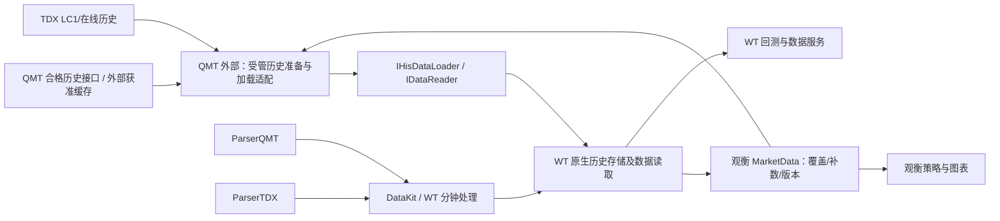
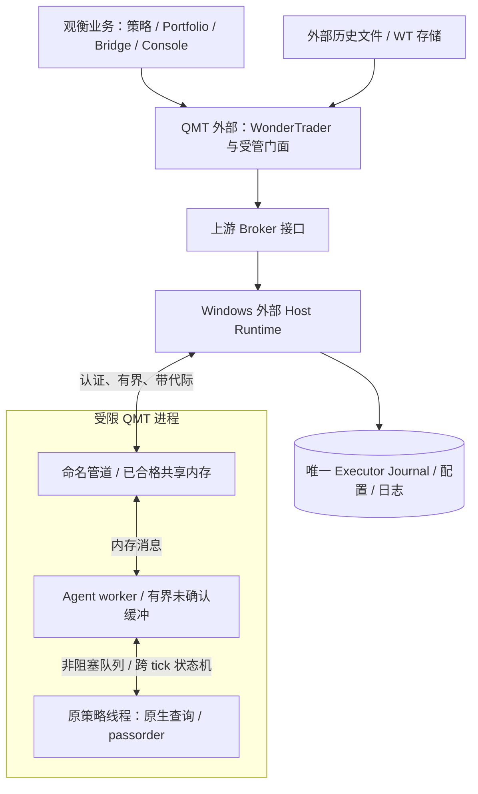

# 观衡量化系统接入 WonderTrader 原生底座方案

2026-11-05完整主线按[数据、诊断与日志并行收敛](mainline-data-observability-20261105.md)及[SDO最终规格](../specs/strategy-data-and-observability.md)推进：补辅助数据持续更新、逐角色/回测诊断、有界日志及发布后真实业务检查。WT拥有数据/交易运行，观衡独立只读；原100万元含持仓状态及模拟账户保持。下文早期阶段保留历史语境，当前实施以TARGET及该后继方案为准。

> 源码交付范围：本页标注的外部历史/待归仓路径用于追溯原记录，未随本次源码提交。其旧通过记录不授当前入口可复现资格；当前构建与运行以对应永久源码及正式安装手册为准。

当前完整交付按[三会话并行交付与实盘就绪计划](parallel-system-delivery.md)推进：A行情/历史/通信、B交易/策略原生运行、C观衡业务/操作平台，分别登记模块验收、统一候选集成与实盘授权验真。该计划承接用户2026-10-28三会话要求；局部探针通过不替代完整系统交付。

当前范围按[ADR-0004](../architecture/adr/0004-core-trading-product-scope.md)：Grafana、新闻、研究的功能与界面全部退出WonderTrader目标；下文旧范围中对应迁入和验收承诺已被本决定取代。保留核心行情/策略/回测/账户/交易、配置、必要运维和独立市场观察。清理新仓库专属实现及依赖，旧工程/历史资料与冻结证据不改。

## 最终仓库归属与旧工程退役

2026-10-22用户再次明确：旧QMT项目将全部废弃，观衡全部移植到WonderTrader。此决定约束下文各项实施与验收，优先于旧工程继续持有服务和发布链的阶段描述。

- 全部后续实现、适配、测试、制品和发布流程归本仓库；旧QMT仓库仅保留迁移参考和原始证据，停止新增开发与合入。
- WT已经提供的行情存储、查询、周期、策略运行、回测、交易通道与状态能力经核实后完整复用，退出重合的旧实现；观衡独有业务在本仓库适配并独立受管发布。
- 券商QMT终端继续提供行情和交易能力。必要的终端脚本、通信客户端及接入宿主归本仓库接入模块，逐项迁入已核实契约与必要安全能力，避免带入旧业务运行框架。
- 最终系统启动、测试、构建及发布不依赖旧QMT源码树、旧Console、旧策略制品登记、旧开发门禁或旧服务进程。既有固定旧源测试只保留其历史隔离资格，由本仓库接入端验收替代。
- 切换前保留现有运行、账户事实、数据和其他对话修改；未合入候选只读保留。退出旧项目沿具体切换验收完成，不以继续修旧工程治理作为迁移前置。

HTTP先行、共享内存与WT绑定暂缓、通达信交易暂缓，以及框架源码修改须批准的边界继续适用。当前真实行情验收只使用QMT，通达信实数采集与对照继续暂停。

当前实施范围（2026-10-21 用户已确认）：先实现并测试显式 HTTP 模式；共享内存与 WT 绑定和通达信交易暂缓；QMT 主来源、TDX 可选辅助；观衡服务独立受管发布并逐项适配。具体要求与当前模式边界见[HTTP 增量规格](../specs/qmt-http-market.md)和[业务适配地图](business-adaptation-map.md)。下文 R13 继续约束后续受限 QMT 模式，当前 HTTP 测试不提升其 IPC 资格，也不自动从受限模式退回 HTTP。

用户补充约束（2026-10-21，含后续澄清）：开发以适配 WonderTrader 既有架构为边界，优先复用 Parser/Trader、IHisDataLoader/IDataReader、原生历史格式及策略接口。确需修改上游框架源码时，先向用户说明必要性、现有接口不足、替代方案、修改范围、风险、验证与回滚方式，取得明确批准后实施；批准前框架文件保持只读。已有 12 个上游文件差异冻结，单独核查归属、必要性和可外置方案，提出保留或退出建议供用户决定，现状记录与架构认可分别登记。用户正在国信 QMT 下载历史分钟数据，首批历史接入以该已下载数据为来源，通过外部导出/导入适配进入 WT 原生存储；格式、时间、量额和复权以实际导出样本核验。策略侧维持统一历史读取、实时行情与分钟订阅目标，下载和缺口处理由数据适配层封装。

文档类型：移植方案草案
权威范围：保留观衡系统，在 WonderTrader C++ 底座接入 QMT/通达信行情及交易的目标架构、阶段与验收
有效性：Proposed；用户已选定 WonderTrader 和原生底座方向，确定模块已获用户授权按[实现规格](../specs/guanheng-native-adapters.md)开发，待定项集中后续决策；原生工具链实现由[独立规格](../specs/native-build-automation.md)及其证据确认

## 目标与事实基线

保留观衡量化交易系统的策略业务、组合与资金政策、配置、页面、审计、账户归属及受控交易链。WonderTrader 承接可复用的数据接入、原生行情结构、历史读取、分钟处理、回测与通道能力；接入通过 C++ Parser/Trader 插件和受管主机运行时完成。

wtpy 是可选应用层与示例参考库，不是本次移植入口或兼容前置条件。本次不将观衡改写成 wtpy 应用，不因 wtpy 依赖版本而阻塞原生 Parser/Trader 方案。

### 复用优先与记录范围

依用户进一步明确的“框架已有能力直接复用”，账户查询及缓存、策略/组合运行状态保存、委托与成交日志首先使用 WonderTrader 现有实现。本方案不新增观衡独立的真实持仓数据库、持仓增减引擎或与 WT 持仓副本相互对账的服务。当前源码中 TraderAdapter 具备 `savedata` 控制的 `rtdata.json`、`orders.csv`、`trades.csv`，CtaStraBaseCtx/WtEngine 具备策略与组合状态保存；实际交易持仓继续以合格券商查询与回报为依据。

观衡现有历史审计、审批与框架尚未承接的业务归属记录保留原件，页面优先读取 WT 的已验证输出；仅对已有业务功能确实需要且 WT 不提供的字段做接口映射。已迁移能力逐项登记旧实现的退出条件，避免新旧持仓管理与对账长期并行。迁移期间的原所有权保护不作为最终同时运行两套记账逻辑的要求。

QMT 外部 Host 的命令接收、一次性许可及可靠事件确认复用另一对话的现有交付。这些记录证明跨进程提交阶段及重启恢复，与 WT 策略运行文件和通道 CSV 的语义分别验收；本仓库不另外实现一套 Journal。未来若发现上游与 WT 职责重叠，先核实等价能力与恢复证据，再在切换规格中收敛唯一实现。

| 项目 | 已准备的固定身份 | 当前证据 |
|---|---|---|
| WonderTrader fork | `fr4ngou/wondertrader`；上游 `wondertrader/wondertrader` | GitHub parent 已核对 |
| C++ 源码基线 | `08b230dd05facf6d650d949bfe51054115a2ecb1` | 本地 HEAD；已登记的工具链兼容差异见[上游差异清单](../maintenance/upstream-overrides.md) |
| 本地工作分支 | `codex/qmt-migration-plan` | 仓库为 `E:\workspace\wondertrader` |
| 可选 wtpy 参考 | `fr4ngou/wtpy`，HEAD `9fd4cd98feaa6fa2ea084741b3bb2adbe2b6bd78` | 独立仓库 `E:\workspace\wtpy`，不作为本方案运行依赖 |
| 观衡原项目 | `D:\workspace\qmt`；此前独立研究 worktree 位于 E 盘 | 当前业务代码、运行事实和权限保留 |

仓库使用 shallow/partial clone 与源码稀疏检出，已经取出 C++、构建描述、配置和文档；未下载大体积预编译库、SDK 二进制与历史数据。实际构建前按 R11 冻结并取得匹配依赖。远程 fork 已创建，本轮新方案仅保存在本地分支。

QMT 通信改造是本方案的上游依赖，由另一个对话“查找通知应对方案并审视限制”负责。受限 QMT 策略运行配置从冷启动起禁用主动 HTTP/TCP/UDP、本地文件读写、文件配置/日志和 SQLite；可信启动参数从内存注入，持久化放在 QMT 进程外的 Host。WonderTrader 消费该对话交付的 Broker/Transport/Journal 契约及资格，不另造通信框架。实际券商终端允许的 IPC 能力须由真实环境证明；共享内存的设计或存在不能单独证明符合限制。详见 R13。

## R1 保留观衡并明确事实所有者

| 行为/事实 | 唯一所有者 | WonderTrader 的位置 |
|---|---|---|
| 策略运行、理论持仓、意图和执行目标 | WT策略/执行上下文承接通用运行；业务算法和扩展状态逐字段适配 | 统一回测和实盘底座，最终目标只有一个活动发布者 |
| 策略预算、原生规则、理论归属与账户准入 | 原生策略/组合/执行及明确配置 | 观衡提供配置与投影；复用WT原生资金/风险，不新增逐单人工审批或独立资金账本 |
| 认证命令、投递尝试与未知结果 | 外部Host/原命令责任owner及WT执行接入 | 保持命令身份及未知结果核查；接入认证不新增逐单人工审批流程 |
| 订单成交观察与基础运行记录 | WT交易模块接收券商查询及回报 | 观衡读取展示，CSV按实际推送覆盖范围使用 |
| 原始行情、数据集修订、来源资格与覆盖 | WT数据存储及其接入/读取适配 | 观衡按需读取同一数据，不以PG行情副本为前置 |
| 用户补数任务、回测制品和配置历史 | 对应观衡业务模块 | 保存必要业务状态与制品引用，进程和后端按功能决定 |
| 柜台受理、原生委托/成交、账户状态 | 对应券商/交易端 | Trader 插件归一并回传证据 |
| 原生提交阶段和持久去重 | 原接入路由的唯一 Executor Journal；受限 QMT 由外部 Host 持有 | WT ID 映射为派生索引，避免第二份提交权威 |
| 页面、监控与审计展示 | 观衡 Console / Operations | 投影 WT 数据/通道健康和原权威事实 |

职责收敛依[ADR-0003](../architecture/adr/0003-native-runtime-and-business-state.md)和[业务地图](business-adaptation-map.md)实施。当前生产owner在切换验收前保持；原服务进程、SQL表与消息链不作为最终必须保留的架构。WT理论持仓、回测成交和柜台实际账户事实分别标识。存储是否必要先按用户功能证明；若需要数据库，按[Windows原生条件方案](../specs/windows-native-database.md)部署。

## R2 四个原生插件与共享接入实现

| 拟新增 C++ 工程 | 实现接口 | 职责 | 当前状态 |
|---|---|---|---|
| `src/ParserQMT` | `IParserApi` | QMT 证券订阅、快照/实时行情、源时间与连接状态 | 原生工厂与可注入前端已实现；实际 Broker 绑定及来源资格待验 |
| `src/TraderQMT` | `ITraderApi` 及股票扩展能力 | 已授权委托/撤单、账户/持仓/委托/成交查询及可靠回报 | 原生工厂、受管授权/回报与恢复前端已实现；真实 Host 默认 unavailable |
| `src/ParserTDX` | `IParserApi` | 通达信行情订阅/轮询及来源归一 | 原生工厂与可注入前端已实现；实际在线来源绑定待定 |
| `src/TraderTDX` | `ITraderApi` 及股票扩展能力 | 匹配券商与终端能力的交易接入 | 同一受管前端已实现；真实后端与权限待证实，默认 unavailable |

直接沿用上游 `IParserApi/IParserSpi`、`ITraderApi/ITraderSpi`、工厂导出与 CMake 布局；以 ParserXTP/TraderXTP 的工程组织为骨架，源端 SDK 调用与字段映射由对应插件实现。框架内使用 WTSTickData、WTSBarStruct、WTSEntrust、WTSOrderInfo、WTSTradeInfo，不再引入另一套 vn.py 运行对象。

插件前端是 C++；仅有 Python/终端内 API 的源端可以放到独立受管 Host Runtime，再经既有有界协议接入。此 Runtime 是源端适配实现，与 wtpy 无依赖。行情、交易分别具备资格和启停开关；Parser 连接成功不证明 Trader 可用。

新公共代码仅提取真实共性：既有有界消息客户端的 C++ 绑定、请求关联、生命周期、单位/时间校验、身份映射及回报投递。协议、Transport 和 Journal 的业务规则由上游接入层统一拥有；C++ 绑定须通过同一契约套件。QMT 与 TDX 的 SDK/权限、登录方式、原生 ID 和字段语义保留在各自 Adapter 内，不新增万能 `execute(function, args)` 入口。

## R3 历史分钟、实时数据与 WT 原生存储



- 历史读取接 `IHisDataLoader::loadRawHisBars/loadFinalHisBars` 或适用的 IDataReader；实时接 IParserApi。历史 OHLCV 不能伪造为 tick 后交 Parser 重采样。
- 首选复用 WT DataKit、WtDataStorage、WtDtHelper/WtDtServo 的原生能力；长期存储以固定版本验证的 WT 历史格式和实时格式组织。Parquet 作为离线分析/导出或冻结副本的可选格式，不再先建设完整独立冷热行情引擎。
- 十年 QMT 历史作为可导入来源，先分证券/时段校验实际覆盖，再转换 WT 结构。文件导入只在获准访问缓存的外部数据 Runtime 进行；受限 Agent 不打开源缓存或 WT 文件。若通过原生历史 API 取数，须先核实该操作在受限终端内获准，并通过上游注册 operation 调用；不能以间接 API 读取替代权限验收。TDX LC1 和网络历史分别标记来源。
- 观衡继续管理请求、完整性、来源、数据集清单与分段任务。外部服务先查已有 WT 数据；仅对确认缺口使用已合格的 QMT/TDX 历史能力，再按源资格补齐。缺少历史/下载能力时明确 pending/unavailable，由预热任务准备完成后重试，禁止阻塞核心策略/行情线程。
- 覆盖依据交易日历、上市/退市、时段和源端停牌/无成交规则；空返回、每日固定根数或首尾文件区间不能单独证明完整。保留缺口、unknown 与不适用原因。
- 明确 WT 时间编码、UTC 与交易所时间转换、分钟左/右端、量/额单位、复权和因子版本；T+0/T+1 按证券元数据判断，ETF 不按名称统一假定交易制度。
- 原生格式文件可能可变，冻结回测需建立受控副本/快照与哈希清单，绑定历史与获知截止；数据下载或源端修正不能在一次回测中改变输入。
- 新数据、缓存、临时文件、构建产物、日志与证据使用受控 E 盘路径；保留现有 QMT 缓存、PostgreSQL 和共享 Docker 数据盘，按单独任务处理物理迁移。

## R4 ParserQMT 的源端接入

- 复用上游 BrokerClient/Host 注册且通过资格验收的行情、证券资料及历史读取 operation；逐项检查 capability，缺项保持 unavailable。只读 IPC 成功不推导出动态订阅、下载或历史操作全部可用。QMT 原生调用继续遵守其指定策略线程，worker 负责 IPC 收发且不阻塞该线程。未来可验证独立 xtquant 实现，单独登记版本、权限和隔离进程。
- ParserQMT 在外部 WT 进程运行，连接 Host 的公开 Broker 接缝；具体 Host→QMT 通道由上游选定认证命名管道或已合格 SHM。若选择 C++ 直连同一 IPC，先由上游冻结接口及唯一绑定规则，再用 golden bytes 和跨语言测试验收；不得为 Parser 新开 QMT 网络监听或文件交换目录。
- 以实际能力选择原生订阅或有界轮询。向 IParserSpi 发送连接/断开、证券列表和已校验 WTSTickData，明确累计量/增量量与 `procFlag`，通过真实样本证明不重复累计。
- 原生时间缺失、行情过期或会话不一致时保留 unverified/stale/unavailable；接收时间不能重新授予旧行情新鲜度。休市、午休、停牌独立展示。
- 与观衡数据接口建立共享订阅引用、租约、背压和重新订阅机制；断线后的分钟缺口由历史加载链补齐。WT 内部当前 bar、已结束 bar 与补发历史使用不同资格。

## R5 ParserTDX 的行情接入

- 支持本地 LC1 历史和已验证的网络行情来源，分别配置端点/目录与能力；已有样本只证明可以读取，不代表全市场深度或盘中延迟已验收。
- 优先使用有契约与许可的源接口。若复用已有 Python 协议实现，放到受管数据 Runtime，经统一消息传到原生 ParserTDX；若移植 C++ 协议，先冻结协议、依赖许可和原始样本，再运行同一规范化测试。
- 快照/逐笔能力、订阅/轮询模式、最大历史深度、成交量单位、价格精度和源时间分别声明。报价快照合成分钟数据只能作为带标记的观测数据，不授完整源端 OHLCV 资格。
- 来源切换由观衡 source profile 显式控制；QMT/TDX 混合区间保留来源分段和质量。交易前报价的权威来源仍由执行政策指定。

## R6 TraderQMT 的交易接入

当前职责复核：下图及其Host ACK/Bridge游标描述的是已有受管候选和受限源端机制，作为切换期事实保留。最终以WT原生策略/执行器/Trader ABI承接重合能力，审批、签名与未知结果等独有语义适配到唯一owner；不固定保留原Strategy/Portfolio/Bridge进程或PG布局。先按[原生能力目录](../development/wondertrader-capabilities.md)核实再修订完整接线，当前功能开发暂停。共享内存仍暂缓，当前HTTP模式按独立规格。

```text
观衡 StrategyIntent/目标 → Portfolio 审批/预留 → Bridge 签名 OrderCommand
→ 受管 WT 接入门面 → TraderQMT → 外部 Broker Host / 唯一 Journal
→ 上游认证 IPC（命名管道或合格 SHM）→ 受限 Agent 原策略线程 → 柜台
→ Agent 有界回报缓冲 → Host 持久化后 ACK → WT 映射与 Bridge → Portfolio/Console
```

- 复用既有审批、签名、command_id、账户/环境/route_epoch、持久受理与查单/对账；QMT 最终 passorder 调用继续由已授权 qmt_agent 策略线程执行，C++ 插件不越层直接调用未授权交易入口。
- `orderInsert/orderAction` 为 WT 侧入口形状，必须存在由受管门面验证的签名授权上下文，并与该次 WT 委托、实际价格/数量及账户身份绑定。任意来自 WT 策略的无授权委托不得借此绕过观衡 Portfolio。
- 原始签名字节只运输不重写；WT 字段与签名命令不一致时拒绝提交。原 command_id、WT 本地委托号、源端委托/成交 ID、路由与时间域通过适配器关联，优先使用已有字段及原 Journal 索引；映射为派生事实，不新增独立订单账本或原生提交权威。
- 复用上游外部 inbox、prepared/native 参数冻结、intent 和一次性许可协议；Agent 在实际执行回合重检报价、风险、授权及参数哈希。参数变化沿上游撤销/未调用证明流程处理，WT 不重签许可、不自行重定价后重用旧许可。上游命令 RPC、原生接线和恢复资格未就绪时 TraderQMT 保持交易不可用。
- ITraderApi 返回值只证明对应调用/受理阶段，柜台结果依赖 onRspEntrust/onPushOrder/onPushTrade 与原生查询。WT 状态模型不能完整表达 submission_unknown 时，经受管状态通道保留原状态并阻止新写，禁止误映射为失败后重试。
- 账户、可卖量、持仓和订单快照保留一致性边界与分页覆盖。Agent 仅在 Host 事务提交连续事件和对应状态水位后释放已确认内存，Bridge 消费游标继续独立持有。溢出、缺口、会话变化或摘要冲突阻断同步/新单资格，较新快照本身不能抹去遗失回报。回报按原始身份去重与归约；断连或暂停新单期间继续摄取回报。
- 开发隔离期间真实交易保持关闭；目标架构采用合格的WT原生执行能力，原生算法的每个实际子动作满足相应授权及总量/风险约束。原执行能力重合部分退出，所需业务批准语义通过薄适配保留。生产启用按具体授权与整链验收执行。

## R7 TraderTDX 的交易能力与证据门槛

- 为 TDX 交易保留独立原生 Trader 工程、能力描述及相同授权/回报契约，源端需取得与实际客户端、券商、账户和位数匹配的可靠接口契约。
- 本机先前静态检查没有发现文章所述 TcApi.dll/TcSdk 导出，也未证实当前安装具备 TdxQuant 接入；其他 DLL 导出名不构成可安全调用的 ABI 或柜台资格证明。交易能力当前保持 unavailable。
- 可采用后续核实的官方/券商 SDK、受管终端接口或合格交易桥作为后端；逐项证明登录、订单类型、数量/价格语义、撤单、委托/成交查询、账户一致性、幂等限制和断线补查。
- ParserTDX 与 TraderTDX 分别准入。交易通道缺失或资格未通过时保留通达信行情正常使用，执行仍可显式选择已合格 QMT 路由；禁止把交易超时自动路由到另一券商。
- 本方案不把模拟点击、键盘自动化或未知 DLL 调用作为已经可用的生产交易实现。若后续需要评估这类后端，单独定义可靠回报、幂等、权限和失败恢复验收。

## R8 保留观衡入口与版本化适配

- 在观衡与 WT 之间增加薄的受管接入门面，处理数据查询/事件、已签名命令、进度、回报和健康。原观衡页面及业务 Interface 保留，通过 Adapter 切换底座实现。
- 数据接入与交易接入独立配置；Control 管理执行账户/路由和启用，MarketData 管理来源、覆盖和数据资格。端点、密钥引用和路径来自各自权威配置。
- 复用上游 BrokerClient、Transport 与 ExecutorJournal 契约，具体实现根据 Windows ABI、线程和可靠持久化需求选择进程隔离。受限 QMT 侧只用获准的本机 IPC；Host 外部是否使用 HTTP 由平台部署配置决定。受限侧通道失败保持不可用，禁止自动退回 QMT 内 HTTP、文件或 SQLite。
- 外部模型与 WT 原生结构通过集中转换函数完成，原始响应作为只读证据保留。未知市场、证券类型、价格模式和枚举明确拒绝；扩展字段必须有类型和资格，禁止任意厂商参数透传交易 SDK。
- 保留范围的日线策略、订单事实和图表接口逐项适配；新增源端或底座切换先 shadow 比较，再逐路由受控启用，避免新旧引擎同时管理同一生产订单与资金。新闻、研究和Grafana按ADR-0004退出实现与兼容要求。

## R9 同一策略逻辑的回测与运行

- 第一阶段保留观衡现有策略业务，通过标准行情与目标/意图接口使用新底座；不先重写所有策略。
- 后续从一项现有 ETF 策略提取纯计算核心，使用小型运行上下文映射 WT CTA/SEL 的时钟、历史窗口、事件、目标及状态；C++ 或其他应用层可接入，wtpy 不作为必需条件。
- 回测以 WT 的回放时钟为唯一策略时间，运行模式以源事件/交易所时间为依据；预热与补发历史不能重触发过期交易意图。冻结输入、策略版本、规则和成本模型再比较两端信号及目标。
- 上游 CTA 回测已有 T+1 冻结与日切释放逻辑；仍需对实际股票/ETF元数据、涨跌停、排队、部分成交、资金限制、费用、复权、除权和重启恢复逐项验收。框架支持交易与策略类复用不构成真实成交等价证明。
- WT 模拟持仓/成交、观衡目标和生产账户事实独立标记。迁移通过标准是相同输入下可解释的一致信号、目标和风险决策，成交差异有明确模型与证据。

## R10 能力注册、扩展与资源约束

每个插件描述 provider/instance/role、契约及 SDK/ABI 版本、市场与证券类型、行情/交易权限、订阅和历史上限、订单/价格模式、单位与精度来源、恢复能力和错误语义。支持能力、连接状态、账户登录与业务 ready 分别展示。

使用稳定身份与依赖注入；新接入只增加 Parser/Trader/数据加载 Adapter 与同一契约测试，避免核心策略或 Portfolio 内追加源端分支。行情可以 QMT/TDX 任意合格组合，交易路由保持单命令固定。

原生线程不执行无界网络/历史导入；任务和 I/O 使用受限队列、截止时间、优先级和背压。临时故障可以重试只读读取；交易提交存在副作用歧义时保留 submission_unknown，查询/对账后再决策。插件卸载、断线、源重启和旧代际回报都需 fencing 与生命周期验证。

## R11 构建、ABI 与依赖准备

1. 固定本仓库提交、操作系统/架构、编译器、C++ 标准、CMake、Boost、原生库和源端 SDK，登记许可证及下载校验；沿上游插件 CMake 组织，不先大改 WtCore。
2. 新插件首次构建先使用不连接真实账户的 Fake backend 验证工厂导出、接口生命周期和结构布局。Windows x64 C++ 层与可能的 32 位终端组件通过独立 Runtime 隔离，禁止跨位数直接加载。
3. sparse checkout 当前故意排除了预编译大文件。需要构建时按固定来源补齐对应 SDK/运行库；取得失败明确阻断构建，不替换为未知版本二进制。
4. QMT 原生运行环境、观衡 Python 环境与 C++ 构建工具链分别维护。仅当明确选择 wtpy 作为某个测试应用时才验证其 Python/原生库组合，不将其旧 pandas 依赖加入观衡共享环境。
5. 原生插件派生源码保留 WonderTrader MIT 版权与许可；第三方行情/交易 SDK 与数据使用资格分别登记。代码接口存在不授账户或行情转发权限。

## R12 实施顺序、验收与回滚

| 阶段 | 交付 | 验收与停止条件 |
|---|---|---|
| P0 仓库与规格 | 本 fork、固定基线、原生接缝、上游通信契约依赖清单及映射计划 | 方案可审阅；依赖区分设计、开发、实机及生产资格；代码、配置和账户保持原样 |
| P1 原生 Fake 接缝 | 四类插件的受测生命周期/既有 Broker 契约前端，交易未支持能力明确拒绝 | 不连接账户；工厂导出、跨语言原字节、背压、超时、身份和重复消息测试 |
| P2 行情与历史 | ParserQMT/ParserTDX、原生历史加载、WT存储与观衡 MarketData Adapter | 已下载历史分段、覆盖、数量/时间/量额、断点/去重/源切换验真 |
| P3 观衡接入与回测 | 原页面及策略入口消费 WT 数据，一项策略同输入回放/shadow | 决策/目标与风险依据对照；时钟与复权无未来数据泄漏 |
| P4 TraderQMT | 保留原授权/外部 Journal/许可的订单查询、可靠回报及命令映射 | 先通过 R13 的冷启动、命令 RPC、单执行权与恢复依赖门槛，再按独立授权运行受控模拟/实盘 |
| P5 TraderTDX | 可靠后端契约与相同执行能力 | 当前外部前提待证实；通过接口/权限/回报/恢复后再独立启用 |
| P6 逐策略/路由切换 | 单活动底座与观衡完整业务链 | 排空旧写、未知提交归零、账户和未终结委托对账；保留回报摄取与可逆路由 |

必要异常验收包括：历史页截断、缓存变化、午休/停牌/上市前、重复/乱序行情、源时间缺失、磁盘水位、队列满、进程退出、WT委托号与签名不符、原生返回后持久化失败、重复/乱序成交、跨日ID复用、旧路由复活和账户分页不完整。

回滚先停止新增命令准入、排空原生调用并处理未知提交，再恢复原底座路由；已有账本、资金事实、映射和证据持续保留。禁止重置数据库或删除生产委托来获得干净状态。当前开发授权覆盖隔离实现与验证；账户登录、真实委托/撤单、自动执行启用和线上部署按独立授权及资格执行。

## R13 与受限 QMT 通信改造的依赖及职责



图中 Host 的配置、日志、数据库及历史文件均在受限 QMT 进程外；IPC 内核对象的使用须通过终端权限验证。共享内存采用上游批准的内存对象机制，禁止用磁盘文件轮询模拟受限侧通信。QMT 客户端自身加载策略及与柜台连接属于终端边界，策略代码从模块导入、启动、配置更新到重启恢复全程接受禁止能力拦截验证。

### 上游交付与本仓库消费边界

| 层 | 上游通信改造负责 | 本仓库负责 |
|---|---|---|
| Broker 业务契约 | 原命令/operation、账户/事件模型、错误与资格、版本兼容 | WT 数据/委托/回调映射；保留签名原文与原事实 ID |
| Transport | 认证、帧、ring/同步、ACL、容量、代际、唯一活动绑定及断连恢复 | 复用客户端或受测 C++ 绑定；不重定义帧布局/密钥/超时事实 |
| Host / Journal | 外部持久化、owner 锁、inbox/intent/许可、事件 ACK、旧账本迁移 | 保留 WT ID 派生映射；消费 durable receipt/事件游标 |
| 受限 Agent | Python 3.6.8 标准库、可信内存 bootstrap、原生线程、无文件/网络启动和原生回调 | 通过既有 operation/命令接缝使用能力；不在 Agent 加载 WT 库 |
| 资格与恢复 | 原生快照、账户日初/备注归属、unknown 恢复、单执行权、实际终端验真 | 分开呈现 Parser/历史/Trader ready；上游缺项向观衡透出原因 |

### 已观察的开发状态

以下保留 2026-10-20 的历史观察。2026-10-21 早先刷新确认 committed SHM，控制 RPC 当时仍为 dirty 只读/观察范围；本轮收尾再次只读核对，QMT 主干已为 `1f564b6496b0942545783567acb0003ebf19b245`，通信候选为 `d425cc97541e707bef5c5ed7fb22ddc0c1b297e2`，控制 RPC 已合入主干。该次刷新两者工作树干净；最终快照另记录主干原会话的过程文档改动，保持原样。现行契约仍限定读取、观察与绑定查询，明确未增加命令 HTTP/RPC，Host `order_ready=False`。当前观察摘要见收尾刷新（外部历史/待归仓路径：`../evidence/guanheng-native-2026-10-21/upstream-refresh.json`）和最终工作树快照（外部历史/待归仓路径：`../evidence/guanheng-native-2026-10-21/worktree-identity.json`）。

upstream-contracts.json（外部历史/待归仓路径：`../../integrations/guanheng/upstream-contracts.json`）继续保存本轮固定的依赖基线及早先控制 RPC 观察；后者排除在运行依赖外。本轮实际使用的原业务、Broker 类型/客户端按逐文件 SHA 核验，在新主干仍匹配。主干进展与实际终端/交易资格分别登记。

观察基线为另一对话 worktree `C:\Users\frangou\.codex\worktrees\broker-transport-spec\qmt` 的 `1b296b2de0913b4cbe30ebdb83ab801e845db3a1`，观察日期 2026-10-20；本方案只读取其规格与源码身份，不修改其工作区、不将其开发分支当作生产版本。

- BrokerClient 边界、认证命名管道只读链和 Host Journal 已有开发交付；账户状态与可靠事件流已有 Accepted 规格及开发代码。
- 外部命令账本与一次性许可内核已有 Accepted 规格及开发代码；该切片明确把真实命令 HTTP/IPC 路由、原生回调/启动接线、迁移与恢复列为后续工作。其开发验证不能授予 TraderQMT 实盘 ready。
- SHM/第二 Transport 已在后续 committed `9b42f9f606e5d87f0945f67e1191d24e50ae9356` 达到开发交付；收尾刷新确认该能力及只读控制 RPC 后续已集成到上述主干。完整受限原生启动、可靠命令端到端接线、旧账本迁移与真实终端/用户入口验真继续按各自资格门槛登记。订单和撤单 RPC 路由尚未开放。
- 早先观察记录过上游“只做开发，禁止镜像构建、发布、向 master 合入”的当时会话边界；本仓库持续只读消费其资料。后续集成由原对话完成，本次没有修改、合入、构建镜像、部署或变更其运行配置。

### 接入前必须冻结的依赖包

上游完成适用切片后，以固定提交和契约文件 SHA-256 接入，包含：Broker 包络及 capability 清单、原字节/golden fixtures、Transport profile 与 bootstrap 字段、身份/代际、预算/ACL、状态/事件游标、Journal/许可及恢复语义，以及相应契约测试和实机资格回执。当前观察身份与文件摘要写入 repository-baseline.json（外部历史/待归仓路径：`repository-baseline.json`），仅用于设计追溯，不能替代上游正式冻结与验收。

历史读取、实时订阅、账户查询、订单查询、可靠回报与交易分别登记 `contract_ready / development_verified / native_verified / production_qualified` 及缺项。各项先获适用资格再开放，不以健康、管道握手、单项查询或 Fake 成功授予整条链 ready。

联合验收补充：从新解释器导入起阻断策略文件/网络/SQLite；可信启动与配置更新；Host/Agent 单独重启；事件持久化前后 ACK 丢失与缓冲溢出；许可提交、消费、原生调用及结果落盘窗口；旧绑定/旧许可迟到；WT 重连不重复下单；旧 Journal 切换单权威；同一命令跨管道/SHM 原字节和去重空间一致。缺口、unknown 或资格丢失保持失败关闭，继续提供诊断和已存回报领取。

## 已查证的原生源码入口

- Parser Interface 与行情回调：`src/Includes/IParserApi.h`。
- Trader Interface、委托/成交和查询回调：`src/Includes/ITraderApi.h`。
- 历史原始/最终 Bar 加载：`src/Includes/IDataReader.h::IHisDataLoader`。
- 插件组织参考：`src/ParserXTP/`、`src/TraderXTP/` 及对应 CMakeLists.txt。
- 历史与实时读取：`src/WtDataStorage/WtDataReader.cpp`。
- T+1 源码：`src/WtBtCore/CtaMocker.cpp` 的冻结仓约束、开仓冻结与日切释放；不据此推广为所有股票/ETF规则已验收。

以上均以本仓库固定 HEAD 为依据。此前观衡独立研究的原始证据继续留在原 worktree，不将私人账户、密钥、数据库或生产配置复制到公开 fork。


## 新系统启用的数据范围（2026-10-26）

旧历史交易记录不导入，按新系统启用；当前券商账户事实继续查询，历史K线继续导入。唯一范围正文及验收界限见[GBW-R9](../specs/guanheng-business-workspace.md#gbw-r9-新系统启用与历史数据范围)。原有数据保留，用户没有授权清理。
