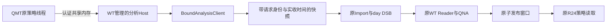

# 持续策略分析数据

类型：模块说明。所有者：WT 数据接入。行为要求见 [QAS](../specs/qmt-analysis-source.md)、[来源快照](../specs/qmt-analysis-window-provider.md)、[AWP](../specs/qmt-analysis-window-producer.md) 与 [WRI 装配](../specs/independent-wt-runtime.md#持续策略分析数据装配)。实现和实际资格沿[验证记录](../evidence/2026-10-30-analysis-source-and-window.md)分别核对。

## 职责与调用链

WT 持有来源通信和发布者；观衡、执行策略只读取发布结果。模块补足持续读取和发布，原生 Import、Helper、Reader、QNA 和策略计算继续复用。框架内的分钟采集、历史存储和回测不由本模块重写。

## 源码和数据结构

| 接缝 | 源码入口与职责 |
|---|---|
| 日线/因子 | `connectors/qmt_shm/agent/guanheng_qmt_shm_agent/analysis_reads.py`，v7 原线程 SDK 读取；日线为证券→日期→OHLC/volume/amount，因子保留时间戳→七列数值 |
| 原请求恢复 | `apps/analysis_window_producer/guanheng_analysis_window_producer/source.py`，先保存 UUID/绑定/原 envelope；已尝试请求只查询同一个身份 |
| 来源快照 | 同文件的 `AnalysisSnapshotProvider.capture`，每个 capture 固定绑定，保存八证券原日线、因子及 none/front_ratio 参考和实际接收时间 |
| 原生处理 | `pipeline.py`，沿原导入和 Reader 生成 QNA，保存原候选，核原生读回 |
| 持续发布 | `runtime.py`，一轮一 Job、串行刷新、原子替换，提供 start/status/request_close/close |
| WT 生命周期 | `apps/wt_runtime/guanheng_wt_runtime/analysis_window_process.py`，适配原 owner 到 WRI，依赖 analysis_host，执行停止后关闭 |
| 策略消费 | 原 `execution_market_window.py` 的 `MarketWindowFile.read`，读取完整一代并核时间及新鲜度 |

八证券集合来自当前唯一策略的输入需求，来源读协议按合法证券和来源能力读取。单项行数/字节数由部署资源预算确定；本层不新增证券补齐允许清单。

## 时间、修订和故障

辅助事实接入及完整性按[SDO](../specs/strategy-data-and-observability.md)实施。价格发布、辅助捕获、派生合并和策略消费分别标识；成功发布价格不表示全部策略输入完整。数据更新由WT管理，页面刷新只读。

`basis_date` 是八证券最新共同闭合日；上海 15:00 前排除当日，再按实际观测日期求交集。原始 OHLC 不在运输层复权或补值，复权由原 WT Reader 按原因子处理。同日价格/量额或因子修订也产生新的来源及发布身份。

`source_oldest_received_at` 用于来源年龄判断，`source_received_at` 表示快照全部收齐；`generated_at/published_at` 是计算和发布时刻。发布窗口的 known_at/current_view.received_at 对应实际收齐时间，重新计算不会刷新旧源时间；历史数据首次可知时间仍未知，不能据此宣称历史时点可得性。

来源暂缺或过旧保留最后成功窗口及其时间；未确认读取继续原 capture 和请求 UUID。发布者 ready 与已有数据分别呈现，执行仍核原窗口年龄。关闭沿 WT 整套截止取消新轮、回收原 Native Job 并 join 原线程，再关闭分析通信；回收未证实明确返回失败。

普通安装由固定 WT/producer/Host/Agent/core wheel 组合；两侧分别维护版本和原来源清单。实际 QMT 同正文组合及最终部署按对应运行证据验收，独立观衡无需管理这些进程。

## 辅助事实持续更新

辅助模块的最终行为遵循[SDO](../specs/strategy-data-and-observability.md)。`producer.auxiliary_directory` 启用WT原发布线程中的辅助更新；省略时保留原价格路径。`auxiliary_seed_directory` 可指向已核只读原件，新取得、修订和恢复状态全部写入当前辅助根。两个根须不同。配置进入原AWP配置身份，采用时选择新工作根及新发布位置，原工作根、原请求责任、原发布文件和金融状态保留供原版本恢复。

标准事实接口为 `guanheng_strategy_v1.auxiliary.AuxiliaryPublication`。来源采用优先国信QMT内已核字段，再以已核交易所来源补充的顺序；字段必须经原件、日期、单位及历史覆盖核实。当前此适配已实现交易所HTTP来源，QMT内字段实测及运行接线由唯一现场集成者负责。ETF当前流通份额、PCF、IOPV及融资账户数据各自保持原定义。

`official_auxiliary.parse_source` 唯一解释五类原件：上交所ETF总份额的万份转亿份、沪深股票成交额的亿元、沪深融资余额的亿元；融资余额取融资字段。市场汇总需要沪深两份有效原件，字段缺失保持空值。源未发布、请求失败、日期不符、单位/结构变化、已确认零值分别有稳定原因；错误正文不进入公开状态。

`AuxiliaryRefresh` 与AWP共用原线程和绝对截止，每轮最多10次、单请求最多3秒。新尾日缺口及近期五日修订优先，其后64日预热缺口和长历史缺口；近期成功日期每小时重核，旧日期每日重核。失败按60秒起、未发布按300秒起指数退避，最长一小时。`CONTINUITY.json`逐来源/日期原子保留重试状态，`COVERAGE.json`保存应查/已得日期、尾日和精确错误；启动和正常重启均沿原状态续接。有限CLI与常驻Owner复用WT `_InstanceLease` 互斥同一辅助根，AWP线程和Native资源确认关闭后释放。

`auxiliary_store`先完整写压缩原文，再原子提交版本回执和日期指针。`source/versions/date/body_sha256.json.gz`及同名JSON保存旧版；`source/date.json`为当前指针。相同原件重核保留首次实际取得和生效实收时钟，内容修订产生新时钟；来源失败保留当前有效指针。旧种子的`date.json.gz`布局只读兼容。已核缓存同时绑定回执及原文元数据，变化后重新核摘要和唯一解析结果。

`available_at=None`明确保留历史首次可知未知，实际合并用`received_at`作为已知上界。今晚补采的旧数值可计算原5日均值/60点分位，最多64个来源日；首个后继真实收盘前保持未生效。实际市场日历中间缺少份额日期时，多日累计差保持缺失。覆盖报告分别列原文数量、每字段已派生点数、实际生效行数、来源尾日及知晓时刻；`awaiting_real_close`与来源/预热缺失分别呈现。价格和Native因子仍由原QNA负责。

显式研究入口 `merge_auxiliary_research(observations, publications, *, data_sha256, derivation_sha256, strategy_id, strategy_version)` 返回研究行和版本化声明。它只对传入实际共同交易日采用`research-next-common-session-0925-v1`假设，不增加行情行，不改原publication时钟；每条研究行带`auxiliary-research:research-next-common-session-0925-v1`标记。声明绑定数据、派生代码、原件/实际时钟、策略及模型身份，真实历史首次可知仍未知，实时资格和历史因果资格固定False。实时拒绝与历史显式准入归V1消费模块，默认实时合并入口保持原规则。

验真根为`E:/workspace/wondertrader-qa/data-continuity-20261105-001`。`MAINLINE-PUBLISHED001.json`记录普通wheel安装、真实已存行情回放、原Native Import/Reader、公开辅助来源读取、AWP发布、实际`MarketWindowFile`读回6056行和正常关闭；该证据未调用QMT/账户，也未生成未来行情。旧历史没有回填，后继真实收盘的在线生效由Root采用后核实。专属回归入口为`tests/integration/analysis_window_producer/test_auxiliary_continuity.py`，覆盖修订原件、同内容时钟、写入失败恢复、只读种子、重启退避、停止、互斥、单位、64日前缀、份额缺日及显式研究时钟。最终制品和复核身份随模块交付记录核对。
