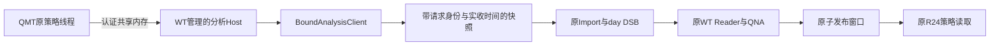

# 持续策略分析数据

类型：模块说明。所有者：WT 数据接入。行为要求见 [QAS](../specs/qmt-analysis-source.md)、[来源快照](../specs/qmt-analysis-window-provider.md)、[AWP](../specs/qmt-analysis-window-producer.md) 与 [WRI 装配](../specs/independent-wt-runtime.md#持续策略分析数据装配)。实现和实际资格沿[验证记录](../evidence/2026-10-30-analysis-source-and-window.md)分别核对。

## 职责与调用链

WT 持有来源通信和发布者；观衡、执行策略只读取发布结果。模块补足持续读取和发布，原生 Import、Helper、Reader、QNA 和策略计算继续复用。框架内的分钟采集、历史存储和回测不由本模块重写。

## 源码和数据结构

| 接缝 | 源码入口与职责 |
|---|---|
| 日线/因子 | `connectors/qmt_shm/agent/guanheng_qmt_shm_agent/analysis_reads.py`，v7 原线程 SDK 读取；日线为证券→日期→OHLC/volume/amount，因子保留时间戳→七列数值 |
| 原请求恢复 | `apps/analysis_window_producer/guanheng_analysis_window_producer/source.py`，先保存 UUID/绑定/原 envelope；已尝试请求只查询同一个身份 |
| 来源快照 | 同文件的 `AnalysisSnapshotProvider.capture`，每个 capture 固定绑定，保存八证券原日线、因子及 none/front_ratio 参考和实际接收时间 |
| 原生处理 | `pipeline.py`，沿原导入和 Reader 生成 QNA，保存原候选，核原生读回 |
| 持续发布 | `runtime.py`，一轮一 Job、串行刷新、原子替换，提供 start/status/request_close/close |
| WT 生命周期 | `apps/wt_runtime/guanheng_wt_runtime/analysis_window_process.py`，适配原 owner 到 WRI，依赖 analysis_host，执行停止后关闭 |
| 策略消费 | 原 `execution_market_window.py` 的 `MarketWindowFile.read`，读取完整一代并核时间及新鲜度 |

八证券集合来自当前唯一策略的输入需求，来源读协议按合法证券和来源能力读取。单项行数/字节数由部署资源预算确定；本层不新增证券补齐允许清单。

## 时间、修订和故障

`basis_date` 是八证券最新共同闭合日；上海 15:00 前排除当日，再按实际观测日期求交集。原始 OHLC 不在运输层复权或补值，复权由原 WT Reader 按原因子处理。同日价格/量额或因子修订也产生新的来源及发布身份。

`source_oldest_received_at` 用于来源年龄判断，`source_received_at` 表示快照全部收齐；`generated_at/published_at` 是计算和发布时刻。发布窗口的 known_at/current_view.received_at 对应实际收齐时间，重新计算不会刷新旧源时间；历史数据首次可知时间仍未知，不能据此宣称历史时点可得性。

来源暂缺或过旧保留最后成功窗口及其时间；未确认读取继续原 capture 和请求 UUID。发布者 ready 与已有数据分别呈现，执行仍核原窗口年龄。关闭沿 WT 整套截止取消新轮、回收原 Native Job 并 join 原线程，再关闭分析通信；回收未证实明确返回失败。

普通安装由固定 WT/producer/Host/Agent/core wheel 组合；两侧分别维护版本和原来源清单。实际 QMT 同正文组合及最终部署按对应运行证据验收，独立观衡无需管理这些进程。
