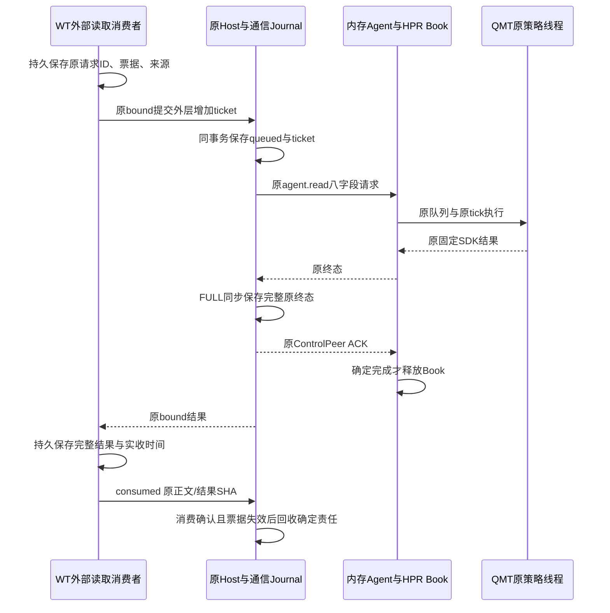

# QMT 已确认读责任回收

> 源码交付范围：本页标注的外部历史/待归仓路径用于追溯原记录，未随本次源码提交。其旧通过记录不授当前入口可复现资格；当前构建与运行以对应永久源码及正式安装手册为准。

类型：模块说明。适用范围：显式启用的独立只读/HPR 连接。要求见[RR1–RR7](../specs/qmt-read-retirement.md)，职责决策见[ADR-0018](../architecture/adr/0018-confirmed-read-responsibility-retirement.md)。工程证据与真实终端资格分别登记。

## 数据流和所有者

原 Host Journal 仍拥有派发及恢复事实；外部消费者拥有已保存的结果文件。源端 Book 只承担原调用身份的内存责任。WT Reader/Writer、策略算法和金融账户事实保持各自原职责。观衡读取公开状态，不管理该通信生命周期。

## 配置和接口

在独立连接配置中显式加入 `read_retention`，经原 `agent_settings` 和完整 profile 参与认证摘要。普通 `bootstrap.build_runtime/build_read_service` 与专用 `history_preparation_bootstrap` 根据此字段选择 `RetainedReadJournal/RetainedPreparationJournal` 和 `RetainedReadRuntime`；省略字段沿原类。使用新的专用通信存储，旧 Journal 和旧配对保留原样。

新增协议纯规则由 Agent 包 `read_retention.py` 唯一拥有。Host `read_retention_journal.py` 在原独占事务保存 ticket/consumed；`read_retention_runtime.py` 提供新外层及三个认证路由；`read_retention_client.py` 使用原签名 HTTP 运输，原请求/完整结果按先落盘后发送的顺序推进。

外部调用方传入既有 `BoundHistorySource`，调用 `RetainedReadClient.read(operation,arguments,slot,deadline=...)`。截止为原 monotonic 绝对秒，slot 为终端外持久文件。默认票据寿命为 3000 毫秒且受认证能力上限约束；HPR 严格使用参数原 deadline_ms。寿命需要覆盖原请求落盘、HTTP受理及调度开销，不能用极短测试值作为正式默认。结果保存 `request_id,requested_at,received_at,reply`，重读保持原实收时间。

同 capture 的原 `BINDING.json` 由业务owner固定保存；公共Client每个新slot重新GET当前binding，不读取或覆盖这个业务身份文件。显式 `expected_binding` 在新slot派发前核完整认证，差异抛 `RetainedReadBindingChanged`（Failure子类）。旧slot先沿原责任确认，未知继续Pending，已确认后才核业务期望。调用方配置若额外声明同一个 read_retention，需先核声明与认证 profile 相等，再交原运输；不同 epoch 不拼接为同一 capture。多个并发消费者分别拥有 slot；同一个 slot 由一个调用 owner 使用。

## 文件发布与快照读者

回执的单一写者先写完整独占临时文件，flush、fsync并关闭，再提交到固定slot。Windows已有目标使用`ReplaceFileW`；首次发布使用独占rename，POSIX沿原replace。合法只读观察器使用共享READ/WRITE/DELETE句柄并及时关闭：提交期间旧句柄仍可读取完整旧快照，后继打开固定路径读取完整新快照。原`os.replace`在Windows合法读者持有目标期间也可能拒绝替换，读者共享删除与发布原语需配套。

提交失败保留原目标、完整临时文件和原异常，原请求、结果及截止保持。持久化故障交回原调用owner处理；文件发布层不生成业务请求、不重发网络、不删除目标或修改权限。进度观察器只读已发布快照，不持有业务写权限。协议身份与消费顺序仍由本模块原Client管理。

## 恢复与边界

原请求一旦发送，网络未知后只查询原 ID。Client 将未知终态抛为 `RetainedReadPending`，确定失败为 `RetainedReadFailure`；Host 和消费者共用 `result_confirmed`。原结果未保存或消费者未确认时，Host 保留全部责任。unknown、queued、dispatching 持续计入容量，不能自动换 ID。HPR 调用完成只说明 call_returned，缓存覆盖需要原历史回读证明。

原 POST 的明确受理前 400 另存 `admission_rejection` 并抛确定失败，保留原 request ID 和正文 SHA，原生 result 仍为 null；原 ID 查不到时仍保持未知。新字段及固定错误码以 RR5 为准。每个客户端和其原运输由一个调用线程持有，并行消费者使用独立实例；capture 的 BINDING 和 slot 由其原业务 owner 管理。

票据将内容、截止与原 Host epoch 绑定；GetTickCount64 来源及 epoch 结束定义见 RR2。Host 重启保留原结果及原绑定，dispatching 恢复为未知。已消费且确定完成的旧 epoch 可回收；旧 ID 查询不存在或 410 仅表达责任不再保留，不授未执行。调用方已有完整结果时继续使用原文件；缺失结果时保持核查。

`GET /internal/v1/read-retention-status` 提供 Host 容量、逻辑预留字节及责任分类，并推进符合条件的维护回收；记录上限与逻辑字节上限都继续按原配置生效。`ReconnectingHistoryPreparationAgent.retention_status()` 为纯内存快照，不触发回收或 SDK，提供 Book 自身记录的高水位和确认计数。达到容量时区分未确认、未知、执行中与等待原票据结束，由运行 owner 据实际配置和原 ID 核查。

真实金融订单/撤单、bulk 页、QST 全推采集和 WT 框架均不进入本模块回收范围。普通安装/SDK 替身运行按验收入口（外部历史/待归仓路径：`../../tests/integration/qmt_read_retention/README.md`）核验；实际 QMT 和生产沿独立候选验收。
