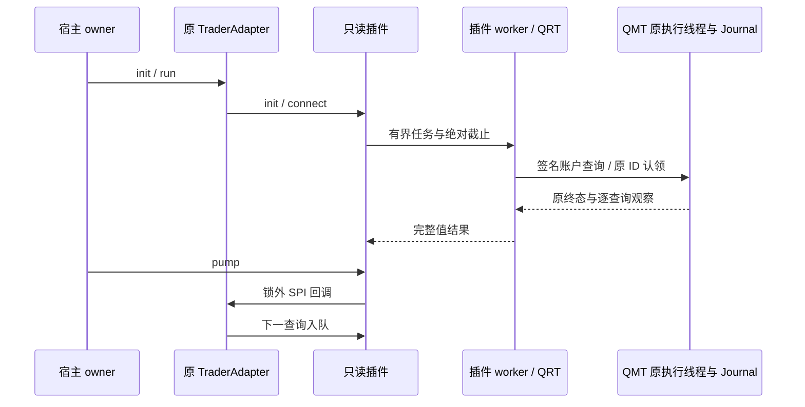

# QMT 原生只读通道

类型：模块说明。职责：将明确账户范围的QMT查询结果交给WonderTrader原生TraderAdapter，并提供逐批来源与可用性。当前共享内存接入以[QAR契约](../specs/qmt-shm-account-read.md)和[账户观察模块](account-observation.md)为准；[NQB](../specs/native-qmt-readonly-bootstrap.md)、[HTTP接线规格](../specs/native-qmt-http-bootstrap.md)保留旧兼容行为依据。新共享内存与旧HTTP实现资格分别见[当前账户证据](../evidence/2026-10-23-qmt-shm-account-read.md)及[历史HTTP证据](../evidence/2026-10-22-qmt-http-bootstrap.md)。

## 来源选择与测试入口

当前接入显式选择`qmt_shm_bound`/`qmt.read-profile.v3`，由终端外认证Host转共享内存，在QMT策略owner上调用固定三参数SDK；普通原生插件继续复用原TraderAdapter四查询、唯一金融mapper和既有Core请求身份/截止。宿主使用schema2/inspection3/IPC2，客户端仅保留活进程有限请求状态，不新增账户数据库或客户端恢复目录。其支持、编译、安装和真实来源资格按QAR分别验收。

下文HTTP/QRT特有流程用于解释保留的旧分支。终端HTTP已退役，当前来源不回退旧终端HTTP；旧`qmt-readonly-fixed` CI与外部旧QMT源码运行已退出支持范围，见[NQP历史契约](../specs/native-readonly-package.md)。现有schema1 runner不授schema2资格。

## 复用能力与边界

原生 API/SPI、四查询状态推进、持仓合计、订单/成交统计和资金通知由[WonderTrader 原生执行模块](wondertrader-execution.md)拥有。自有插件只负责来源协议校验、字段映射、有限队列和宿主线程交付。它不保存第二份持仓账本，不调用下单、撤单或目标执行器。

QMT 原执行线程、Queue 和 Journal 拥有实际账户绑定、请求身份、来源代际及终态；[QRT](qmt-read-transport.md)拥有签名、唯一 POST、原请求 ID 认领、截止和 WinHTTP 回调排空。四次查询分别有执行区间，逐批完整性不表示四批来自同一个柜台事务。

HTTP profile 限定人民币 SH/SZ 普通现金股票与 ETF。持仓只承诺合计数量 V、可用数量 A；映射 pre=V、new=0、availPre=A、availNew=0，保留 aggregate-only 标识。真实今昨、成本、冻结原因和价格类型各自按来源事实授予可用性。ABI 的中性承载值需要结合观察元数据读取。

## 完整调用链

原 Adapter 依次推进持仓、委托、成交、资金。历史成交使用查询回调；它与实时成交 push 的原生更新职责分别定义。HTTP 历史委托不提供本地策略管理标签，外部订单不会因此获得本策略委托身份。

## 线程与生命周期

创建实例的 owner 独占 init、run、pump、API/SPI、基础资料和视图读取。worker 独占 QRT 与网络资源，持锁只交换有限值；SPI 在锁外执行。重入 pump 拒绝，回调中触发下一查询只排队。

stop 关闭准入并请求停止。QRT 当前请求受剩余截止约束；worker 停止新 I/O 后等待实际 OS 回调结束，随后发布完成。owner 根据实际完成事件 join。空队列、worker 逻辑停止或一次等待超时分别只表示各自状态。

release 在 owner 的关闭预算内等待。超时保留 Closing、worker、DLL 和宿主依赖，后续由同 owner 再次 release。工厂仅在 Closed、drained、joined、无线程 joinable 且已退出回调栈时删除并清空引用。回调中只请求停止；回调退栈后完成关闭。宿主先完成原 Adapter 的 Close 通知，持续保留 API、Adapter、sink 与基础资料直至删除条件成立。

## 公共接口与观察

源码入口：[ReadOnlyTrader.h](../../src/GuanhengQmtBootstrap/ReadOnlyTrader.h)、[Factory.cpp](../../src/TraderQMTReadOnly/Factory.cpp)、[HttpMapping.cpp](../../src/GuanhengQmtBootstrap/HttpMapping.cpp)。

| 接口 | 约定 |
|---|---|
| createTrader / deleteTrader | 原 WT 工厂 ABI；delete 的返回需要通过引用是否清空及关闭证明判断 |
| findReadOnlyTrader | 按实例 ID 返回借用指针；release 开始注销 ID，查找不延长生命周期 |
| pumpReadOnlyTrader | 同 owner 交付有限事件；成功回调后发布该批观察 |
| waitReadOnlyTrader | R7定义的自有事件等待；同owner按固定截止阻塞，等待本身不pump/SPI或改变观察/删除资格 |
| stopReadOnlyTrader | 请求停止，实际排空与 join 沿 release 完成 |
| inspectReadOnlyTrader | 固定 v1 结构与秒级 UTC 投影 |
| inspectReadOnlyTraderView | v2 UTF-8 JSON 值拷贝；长度包括 NUL，探测与拷贝读取同一 owner 冻结视图 |

v2 概要保留逐批来源、请求 ID、原条数/交付数、执行区间、关闭证明和首因。行视图区分原事实的 present、unknown、invalid、not_applicable 与实际 ABI 投影。查询失败或 SPI 尚未正常返回的批次视图为 Unavailable；异常后原 Adapter 可能已经部分应用，该实例撤销观察资格并保留实际状态。

裸指针只在当前实例生命周期内有效；调用者负责串行所有权与依赖生命周期。删除后地址失效，接口没有跨地址复用的 ABA 身份承诺。

## 身份、容量和失败

委托与 RefOrder 保留券商原合同号。成交原 ID 与派生 WT TradeID 分别保留；派生键由市场、代码、事件日、原成交 ID 的版本化规范输入生成，跨订单仍保留原生同成交关系。去重只在已校验的整批内进行，不成为持久账本。

请求、整轮和关闭各自使用单调时钟截止；HTTP 体、源行数、JSON 结构及累计观察序列化分别有界。UTC 执行时刻与证券事件日期、券商交易日分别标识。失败保留领域首因、QRT 错误与源错误，关闭超时保留自身状态。

具体限额、映射字节协议、版本错误码和配置范围由唯一规格及版本化 schema 定义。模块当前提供一次性只读初始化接缝；持续 push、重连、真实交易及运行发布沿各自资格扩展。
