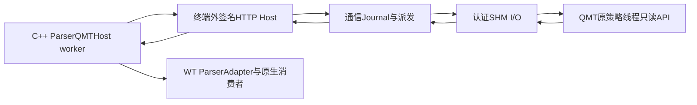

# QMT共享内存连接与原生行情接入

> 源码交付范围：本页标注的外部历史/待归仓路径用于追溯原记录，未随本次源码提交。其旧通过记录不授当前入口可复现资格；当前构建与运行以对应永久源码及正式安装手册为准。

类型：模块说明。所有者角色：券商接入维护者。状态：只读行情实现已存在；安装、合成环境、真实终端及生产资格分别登记。行为契约见[QSW](../specs/qmt-shm-wt-binding.md)，实际结果见[接入证据](../evidence/2026-10-22-qmt-shm-native-connector.md)。

源端按[未知委托契约](../specs/qmt-unknown-cancel.md)独立保存unknown_fenced、hard_fault和关闭状态，显式输出trade-source-status.v2；同一次SDK调用的预留与事件缺口发布共用短锁，SDK在锁外执行。未知事实与实际资源排空分别判定，原ControlPeer的真实CALL回复确认仍为关闭必要条件。源端替身回归及3.6.8兼容性见[限定证据](../evidence/2026-10-25-qmt-unknown-cancel-source.md)；Host及C++后继资格分别登记；[Standard后继证据](../evidence/2026-10-25-qmt-unknown-cancel-standard.md)覆盖原委托只读核查与定向取消，完整首次/重连和发行仍单独验收。

## 职责与原生复用

连接包负责受限QMT端的消息传输、原线程API调用、来源绑定、原请求核查及资源关闭。C++插件把合格行情沿标准`IParserApi/IParserSpi`交给WT；原`ParserAdapter`、ticker、策略调度与存储继续由WT拥有。

终端内Agent为Python3.6.8标准库实现，终端外Host独立发行。WT侧客户端、端点及`ParserQMTHost`工厂使用C++。观衡业务应用独立运行，不把Host、券商终端或策略计算合成一个发布单元。

源码的封闭操作及profile选择由[read_capabilities.py](../../connectors/qmt_shm/agent/guanheng_qmt_shm_agent/read_capabilities.py)统一拥有；源码识别、已安装版本和真实来源资格分别核实，不能从配置字段推断运行可用。

v4/control2账户descriptor显式选择policy_version=2.0时，沿原读取链返回batch.v2，order/deal增加原始m_strRemark、m_strOrderRef；旧版本保持batch.v1。版本、原文预算、原receipt恢复与完整交易内存准备已验证，详见[投影要求](../specs/native-qmt-standard-trader.md)及[运输证据](../evidence/2026-10-24-qmt-account-projection.md)。QmtAccountIdentity现复用唯一金融mapper及其source_to_output，在原D内核原委托关联后覆盖WT管理身份；external/unresolved保留真实金融批次和空管理身份，原金融views保持。见[身份覆盖证据](../evidence/2026-10-24-qmt-account-identity.md)；完整标准Factory/SPI与重启恢复继续验收。

完整原查询的单行输出使用`map_shm_account_row_v2`：先复用全批入口的封套与metadata准入，再由唯一金融mapper借用原数组中指定的一条委托或成交记录。返回包装分别持有原数组下标/总数与本地单行输出下标0，来源仍引用完整查询的原请求、结果摘要和执行区间。输入返回后可以销毁，输出独立拥有WT数组与值；异常由RAII回收。此入口只执行机械选行，调用者仍须检查完整查询中的唯一匹配、非法记录及来源关系，才能采用该行；完整事件补查和双来源交付的接线状态见[事件规格](../specs/native-qmt-standard-events.md)。

| 显式选择 | 允许的源码能力 | 资格依据 |
|---|---|---|
| 旧三字段profile，保持原bytes、不增加版本键 | 仅market.full_tick | [QSW接入证据](../evidence/2026-10-22-qmt-shm-native-connector.md)，按实际安装身份与来源范围使用 |
| qmt.read-profile.v2 | market.history_1m，可同时选择market.full_tick | [QH契约](../specs/qmt-shm-history.md)及[历史证据](../evidence/2026-10-23-qmt-shm-history.md)；合成安装与真实来源分别登记 |
| qmt.read-profile.v3 | 必须显式选择account.trade_detail，可组合上述两种行情能力 | [QAR契约](../specs/qmt-shm-account-read.md)；[Python内存策略实机四查询](../evidence/2026-10-23-qmt-memory-account-read.md)已验，原生业务入口按完整账户资格另验 |
| qmt.read-profile.v4，control2 | 账户读取与交易descriptor组合，可含上述行情；显式配置、源端服务、策略生成及Host组合运行器 | [QST](../specs/qmt-shm-trading.md)及[Host组合验证](../evidence/2026-10-24-qmt-trade-host-runtime.md)；开发端真实运输与SDK替身、标准候选完整字段事件至原Adapter已知基线归约已验，原委托unknown核查/定向取消已验；生产交接/缺字段补查/一般未知insert解除、独立安装与真实券商调用继续验收，旧工厂拒绝新配置 |

market.full_tick轮询表示最新行情快照，不证明完整逐笔、历史分钟OHLC极值完整或精确股数。历史读取、分钟订阅与真实交易的能力和资格分别授予；当前只读registry没有委托/撤单操作。WT已有共享内存广播与本模块的QMT认证消息协议分别使用。

历史一分钟扩展按[QH](../specs/qmt-shm-history.md)与[ADR-0005](../architecture/adr/0005-explicit-read-capabilities.md)实施：共用封闭能力准入、显式profile版本和同一原线程finalizer；C++历史消费者沿同一认证/codec，数据交原QMI/DSB。新历史能力及与实时行情并用资格独立登记。通信记录达到容量上限停止准入，持续运行保留政策另定，当前无自动删除或透明轮换。

正式 GuanhengQmtHistory 的 qmt.history-cli-config.v1 可选 read_profile_version 精确选择 qmt.read-profile.v2 / v3；省略保持原 v2。该 CLI 把显式选择交给现有 QmtHostHistoryClient，v3 接账户加历史的只读 profile，实际请求仍仅 market.history_1m。配置 SHA 绑定恢复，跨版握手拒绝且无降级。配置字段、回归和真实历史资格见 QH-R6.1 及正式 CLI 定向回归（外部历史/待归仓路径：`../../tests/integration/qmt_shm_history/native/CLI-PROFILE.md`）；配对清单版本与读取 profile 版本分别核验。

## 入口与调用链

| 部分 | 源码与公开入口 | 所有者 |
|---|---|---|
| 终端Agent | `connectors/qmt_shm/agent/guanheng_qmt_shm_agent/restricted.py`；`start/tick/request_close/close` | 原ContextInfo及策略线程拥有SDK调用；I/O线程拥有SHM资源 |
| Host与工具 | `connectors/qmt_shm/host/guanheng_qmt_shm`；`build_runtime/create_server/run_server`及模块CLI | 独立Host进程、Server/Runtime及各域worker |
| 原始通信事实 | `bound_journal.py` | Host通信请求、派发和原终态；内嵌SQLite，不是订单/资金/持仓账本 |
| 有界HTTP与绑定读取 | `src/GuanhengCommon/BoundedSignedHttp.*`、`QmtHostReadClient.*` | 客户端创建线程及完整异步回调owner |
| 行情映射 | `src/GuanhengData/QmtHostEndpoint.*`、`QmtTickMapping.*` | PollingParser的单worker |
| 原生工厂 | `src/ParserQMTHost/Factory.cpp` | 沿WT标准工厂加载，复用既有`QmtPollingParser`生命周期 |

Host的HTTP发生在QMT终端外；终端内只用认证共享内存与原线程API，不启用HTTP回退。C++插件必须明确选择新工厂；原ParserQMT的health/capabilities契约不同，不能靠更换URL兼容。

## 长窗历史快照接缝

`bulk_history_1m.BulkHistory1mAdapter` 绑定一证券长窗及原绝对截止，仅构造线程调用一次 SDK，并在同线程完成 Frame/NumPy 到独立内建 tuple 的复制。`bulk_snapshot.BulkSnapshot` 负责容量、纯值分页、同 bytes 重传、单未确认页、最终确认释放和真实在途关闭；与普通历史共用 `history_1m.validated_row` 数值/时间校验。工作线程只持快照，不借用 Context/Frame，后续页不依赖 QMT 每秒 tick。

合同见[BS/BA](../specs/qmt-bulk-history.md)，实现/验证见[限定证据](../evidence/2026-10-27-qmt-bulk-history-snapshot.md)。显式v5源端已接入下述服务/控制入口；普通历史、profile/default和已装终端保持。开发配对、Host最终Journal交接、自有C++ artifact入口与真实长区间原生存储已接通，见[股票及ETF实证](../evidence/2026-10-27-qmt-bulk-real-full.md)。正式系统发行、多证券作业、策略读取与完整库存继续推进；进程总体内存峰值仍未单独测量。

### 显式长窗源端服务

`bulk_capabilities`与`bulk_configuration`仅准入显式qmt.read-profile.v5/control3.0，market.history_1m.bulk使用独立bulk_profile；普通操作保持原描述。容量联合核完整REPLY及base64，首次queue/total以共享uptime及原控制monoD收紧，后续页或重复open不续期。

`bulk_service.SourceBulkHistoryService`在原线程认领一次BA采集，绑定实际generation及range/snapshot身份；I/O只分页纯值。构造、SDK、页、编码、发布和终态查询都保服务工作责任，close先冻结，drained等真实返回。编码完成后再核原D，过期结果转固定终态；clock故障不在BS锁内递归close。BS6小metadata供页数上限使用，避免解码完整页。

`control_bulk_agent.BulkAgentControlLoop`在原I/O完整receive后消费BC1收据，真实ACK才推进页。open完成订阅按各自原控制D退休，只丢订阅引用，原服务future/SDK继续持有；在途订阅有原max_pending_calls上限。`bulk_agent.RestrictedBulkReadAgent`与`reconnecting_bulk.ReconnectingBulkReadAgent`是显式入口，复用原运输和常驻状态机；前代I/O关闭及bulk drained共同成立才创建新代。旧重连默认validator/factory保持原行为。

接口与回归见[BP/BQ/BG/BS6](../specs/qmt-bulk-history.md)及[源端服务证据](../evidence/2026-10-27-qmt-bulk-source-service.md)。现代与国信3.6.8各46项证明服务、内存peer和FakeAgent重连责任。后继已在实际安装正文中贯通真实SHM、Host终态、C++取产物和WT原生回读；两证券实际范围与限制见[长区间证据](../evidence/2026-10-27-qmt-bulk-real-full.md)，跨实际断连恢复与生产另验。

### 控制版本与回复确认

显式control3.0通过公开bulk差异定义生成，只增加host发起的open/page/status，复用原base1.0的封套、窗口和预算；trade2.0保持独立。构建侧共用原生成器，默认trade输出字节保持；终端运行只导入静态grammar。旧read profile继续拒绝control3.0，grammar通过与bulk业务能力准入分别验证。

`ControlPeer.observe_reply_ack(call_seq, payload)`只为当前匹配的成功缓存创建小收据，绑定generation、call_seq、request_sha256和reply_sha256。源端receive完整验证该包后，与ACK退休同锁发布acknowledged；close使仍待确认的收据abandoned。收据不持payload或peer，不创建历史队列；未申请的原路径不分配收据。分页owner仍调用原snapshot.ack并消费原D，确认事实不续期。接口和限定验证见[BC1/BW1](../specs/qmt-bulk-history.md)与[控制确认证据](../evidence/2026-10-27-qmt-bulk-control-ack.md)。Host必须先按自己的域契约持久保存；该收据只证明匹配回复确实得到对端ACK。

### Host分页历史文件

`bulk_history_files.BulkHistoryFiles` 在单domain线程将固定身份的页写入独占私有CSV目录，实文件SHA/身份核同后给中间确认资格；非空终页直接封原QMIv2 chunks，复用原Importer与WT存储。最终receipt仍要求原Journal terminal提交，收集器不自己ACK。empty不造可导入清单，失败保partial及原首因；未确认stream/security资源通过私有owner保留。

`private_files.write_private_durable_new` 仅显式入口执行文件flush并确认原D/关闭；普通材料写入保原行为。接口、预算和恢复界限见[BF/HP](../specs/qmt-bulk-history.md)，同机57项及原DLL往返见[证据](../evidence/2026-10-27-qmt-bulk-history-files.md)。运行registry、Host域派发和共享内存业务确认仍待接线，该组件存在不代表已开放bulk服务。

## 交易配置开发接口

Agent的`trading_configuration.validate_trade_configuration`与Host的`trade_bootstrap.validate_trade_launch`是显式v4准入入口。它们复用原读配置预算、policy和运输布局逻辑，核读写账户、私有绑定摘要、完整命令base64/结果/事件页开销及原期限。公开值排除私有交易绑定、密钥和部署写请求，私有规则只返回副本。旧`validate_read_configuration`、`validate_launch`和`build_runtime`保持旧版本边界。

原控制窗口按角色分固定份额，连续退休前沿前的gap继续占额。配置至少保留四个Host槽，允许两个较早请求未退时，完成一次事件页持久保存和业务ACK；后续轮询仍检查真实额度并背压。运行owner必须管理在途类别和原截止，配置不能替它保证长期悬挂前缀下的无限进展。

`validate_trade_journal_configuration`与实际`HostTradingJournal`构造共用规范存储身份及逻辑额度，Host另外检查至少容纳一条最大命令的预留。该内嵌存储只保存通信事实。纯配置成功不创建Journal、SHM或SDK，也不改变运行中的策略；`writes_enabled`表示部署请求，实际交易准入继续核来源、权限、unknown、回报完整性和WT消费状态。

## Host组合交易运行

分析日线及原生因子沿[QAS](../specs/qmt-analysis-source.md)的显式v7只读连接。源码[analysis_reads.py](../../connectors/qmt_shm/agent/guanheng_qmt_shm_agent/analysis_reads.py)只复制SDK原值，复用原准入、结果、同一截止和原线程编码。配对生成/核验按该profile选择原timer驱动，常驻连接沿既有退休与重认证；它与账户/交易权限分别配置，正式QMT运行及安装资格按对应证据登记。

显式`trade_bootstrap.build_trade_runtime`构造`HostTradingRuntime`，复用原读Runtime的Session、绑定锁、I/O循环、finally和一个有界域worker；`HostTradingControlLoop`沿原读控制循环增加命令与回报调度。工厂先核配置、凭证快照、完整profile及联合预算，再取得唯一通信Journal。构造不启动网络、SHM或SDK；原只读工厂继续维持其版本边界。

`HostTradeRequest`在HTTP线程池排队前固定接收时刻，提交、查询、发布锁及结果编码都消费同一I/O截止。命令另携同Windows启动时钟域的原业务截止，入库和派发不重授TTL。同ID/原字节返回原记录，未知结果保留原身份供查询，不再次调用SDK。WT标准委托、成交、账户与持仓仍由WT及券商拥有。

`HostTradingJournal.events`借用原文件、事务与锁，保存原回报字节、连续持久前沿及源端确认意图。它不计算订单、资产或持仓状态；源ACK成功也不删除Host原文。容量耗尽拒绝新持久页并保留原事实，当前没有自动删除或透明轮换。源状态、事件页、持久保存、业务ACK和确认保存按有限窗口串行推进；状态查询与新命令分开，unknown不阻断回报保存。

写就绪取决于正常部署开关、认证连接、源状态和实际通信记录，没有逐单人工审批或实盘等级。源结果发布后至原线程tick收尾前，completed与executing可合法重叠；Host按源生命周期核实计数。关闭先停止新受理，完成已捕获交接；较早空页在后续交易事实出现时失效，不能据此提前停止。原截止到达仍未确认的交接保留owner并报告失败。

认证HTTP开放trade-status、trade-commands、trade-events、trade-order-lookup及trade-cancel-lookup，沿既有HMAC/nonce/容量入口；终端内保持builtin-shm。断连的当前源状态为null，原命令与已保存事件仍可按原身份查询。原委托关联由同一通信事务保存，使用完整原token、账户及实际回报证明，撤单要求当前观察来源；早到未知事件不会在重启时追认。HTTP保存成功、SDK返回、柜台受理和WT消费分别表达；标准候选已知基线后的SPI及原Adapter持仓/未成交归约有[真实SHM替身组合证据](../evidence/2026-10-25-qmt-standard-shm-events.md)；源ACK仍只证明源运输确认，生产首次/重连覆盖和进程退出应用未知另须闭合。精确DTO、路径与预算见[QST-R19–R21](../specs/qmt-shm-trading.md)。

原生`QmtHostTradeClient`复用同一`BoundedSignedHttp`与`QmtHostCodec`，复制WT委托字段后自动生成通信身份，一次提交后只按原ID查询。发送前确定失败、可能已执行及远端已保存阶段分别表达；完整HTTP冲突引用与原回报字节保留。账户客户端显式选择v4/control2，原默认v3/control1保持。来源币种精确空串沿账户契约保留为未知，不补写CNY。接口、期限及标准Trader插件的剩余范围见[原生交易客户端](../specs/native-qmt-trade-client.md)。

显式认证续接产品的事件页采用`qmt.persisted-trade-events.v2`：Host 在核准当前连接的同一 Journal 事务内，给出当前连接与原事件流的认证关系；原 receipt 和事件字节保留。Common 消费端同时校验当前请求摘要、原收据摘要、业务 session/binding 及完整证明字段。默认单连接继续使用 v1 精确绑定。生产者和消费端须同批交付；源码实现与当前正式安装分别登记，验收及剩余范围见[STQ-P25](../specs/native-qmt-standard-trader.md#stq-p25-整套重启后的事件认证续接proposed隔离验证中)。

原生客户端的 prepare_event_read_context(originalD,out)在同次真实准备成功后，以独立值发布来源、原profile、已验descriptor、账户结果上限及实际Host事件页上限；失败保留原out。它用于首个事件请求的合法容量选择，复用原prepare两次GET，不取事件、不授写许可。事件金融入口另沿唯一mapper与owner/worker三阶段处理，保持原事件provenance；Standard完整字段消费者、SPI与有限去重已实现并限定验收；缺字段补查和生产query/live交接继续按[事件规格](../specs/native-qmt-standard-events.md)及[读取配置证据](../evidence/2026-10-24-qmt-event-read-context.md)分别验收。

## 订阅与同步回报

生成交易入口先构造并发布Agent，再在原初始化线程执行subscribe_account，随后注册timer并启动I/O。set_account返回前的同步成交回调可进入已经存在的SourceTradingService；捕获阶段保留固定字段的自有值，运输交由I/O owner推进。回调到达无需等待I/O线程启动，重复订阅由原Agent状态控制。源码入口为[pair.py](../../connectors/qmt_shm/host/guanheng_qmt_shm/pair.py)、[trading_agent.py](../../connectors/qmt_shm/agent/guanheng_qmt_shm_agent/trading_agent.py)和[trade_service.py](../../connectors/qmt_shm/agent/guanheng_qmt_shm_agent/trade_service.py)。

停止先关闭准入，已捕获且尚未ACK的事件继续占有原资源；实际消费者完成对应交接后，ACK推进释放。local_drained表示源端本地排空，Host持久保存、I/O物理关闭和WT应用各有独立证据。订阅顺序的本地回归（外部历史/待归仓路径：`../../tests/integration/qmt_shm_trading/test_r8_subscribe_reentrant.py`）使用真实生成回调及内存owner，实际运行范围见[订阅窗口证据](../evidence/2026-10-26-qmt-subscribe-window.md)；券商查询与实时回报的联合覆盖另按恢复契约验证。

查询结果与实时回报的本地sequence分别描述各自事实；当前接入尚未取得券商P/O/D共同覆盖标记。历史查询的分组时间标签、统计数量及多次相同查询分别按来源含义保留，不能直接作为“该持仓已包含这些成交”的证明。来源覆盖确认前，完整启动/重连交接保持待验。指定全局get_*_callback_cache接口具有读取并清空缓存的消费语义，使用前须核实际版本、调用线程及所有者，不能把它作为被动观察；名称相近的ContextInfo包装另行识别。来源及验证边界见[研究登记](../evidence/2026-10-26-qmt-subscribe-window.md#官方来源后继研究)。

## 无文件策略与运输边界

`transport_profile.py`统一准入旧shm及显式qmt.builtin-shm.v1。`builtin_shm.py`仅使用内建mmap与内存依赖，Host-only的`builtin_shm_native.py`负责对象创建/私有ACL及资源owner；旧Win32协议与新布局分别认证。运输类型不扩大读取或交易权限。

终端外`memory_runtime.py`冻结实际Agent、CPython3.6.8标准库、内建模块清单和许可，`pair.py`生成v2完整正文并在verify重建。私有加载器在模块执行前核源摘要；warnings可变状态独立，加载线程采用CPython借用线程记录，owned工作线程保持正常join。原始源码、生成器、发射正文与安装材料身份分别保存。目标环境的文件限制、实际制品发布顺序和真实运行资格沿[QSW-R12](../specs/qmt-shm-wt-binding.md#qsw-r12-受限终端无文件启动)及[证据](../evidence/2026-10-23-qmt-memory-entry.md)核实。

## 身份、事实与预算

来源采用认证control绑定、完整运输代际及原请求字节。接纳、派发和结果绑定分别保存，不能把旧终态重新标为新Host来源。该运输身份不代表券商登录会话、账户授权或行情新鲜度。

未知结果保留原UUID与原请求，后续只GET核查；同ID不同字节拒绝。原SDK结果字节与其摘要保留，元数据和结果在同一通信事务持久化后才确认。它补足通信可靠性，不替代WT原生订单及成交记录。

R10/R11定义完整字节、Journal逻辑预留、HTTP并发、接收期限与关闭期限。各预算分别计量，逻辑负载限额不等于SQLite物理体积、TCP总连接数或进程RSS。量额换算、epoch毫秒和累计口径使用显式profile，无隐含100倍换算；真实单位另取来源证据。

## 线程、退出与恢复

QMT的`tick()`只在原策略线程推进一次允许的SDK读取；I/O与终端外持久化分别由自己的worker处理。控制回调只请求停止，不在SPI或策略回调内join。

C++端复用原PollingParser单worker；网络、端点调用和SPI投递在控制锁外。宿主接收的tick沿原引用计数保活，不能因parser worker结束而释放宿主仍持有的对象。WinHTTP最后回调退出前持续保留客户端及DLL；外层stop可以报告超期，确认排空及join后才允许销毁。

listener认领状态只持短锁，导入/构造/映射/close都在锁外；跨线程停止只发布共享Event，不等待构造/close锁或调用WinAPI。原I/O线程拥有回收，SecurityResources在API分配前登记token/SID/descriptor/file handle输出slot，释放返回成功才清空。失败owner随对象或固定去敏异常保留；线程已join与资源实际关闭分别核实。

Host停止开始即撤销ready与业务准入，HTTP排空、lifespan及Runtime关闭沿一个总截止。未回收时保留Journal/channel owner，明确失败或未完成，不以窗口消失、stop请求已发或一次200替代退出确认。

物理关闭时，尚未成功交付的状态、页或ACK观察可以本地退休；该动作不推进源确认或授予源已排空。已领取成功页、ACK与域事务仍沿各自原截止保存。原I/O finally撤销连接准入后，先由同一I/O owner调用finalize_interrupt，在原域队列仍可受理时完成已知交易责任，再关闭域与运输。已收到的成功回报优先保存，结果未知按原命令ID中断；已建任务保原payload和截止，新收尾沿首次中断截止。管理close先join原I/O与唯一域线程，仅观察既有Future和回收物理资源；交易持久化失败继续保留原异常、结果和owner。父读链的独立失败保留其原原因，不阻断先前I/O中的交易交接。

断连或来源变化终止本代际资格。新配对/新实例重新认证，旧请求仍按原身份核查；本模块不自行重发未知操作，不切换到旧终端HTTP，也不放开写入。

## 配置、验证与运维

配置及离线工具的权威说明见[连接包README](../../connectors/qmt_shm/README.md)；国信[操作](../runbooks/guosen-qmt-operations.md)、[维护](../runbooks/guosen-qmt-maintenance.md)和[排障](../runbooks/guosen-qmt-troubleshooting.md)分别说明步骤与证据范围。

验证入口为`tests/integration/qmt_shm_package`、`tests/integration/qmt_shm_builtin_transport`及`tests/integration/http/test_qmt_host_read.py`、`test_qmt_host_installed.py`。覆盖协议/绑定、原ID/原字节、容量、真实Win32 SHM、线程、晚回调、慢body、关闭竞争、独立安装和原Adapter/CTA消费。真实终端加载、实时源单位、账户与交易按各自实际证据授资格。

### Host长窗调度与C++消费者

bulk_bootstrap.build_read_service 显式构造 bulk_runtime 常驻服务。bulk_host_control 在原 Host 控制链派发长窗并消费页；bulk_file_domain 将文件写入交给独立域线程，复用 BulkHistoryFiles 和既有通信 Journal。中间页落文件后推进，最终产物先保存原 Journal 终态再确认源端最后一页。bulk_pair.create_pair 复用原内存正文生成器；QMT 内保持标准库与命名共享内存，不依赖旧 QMT 工程的文件或 HTTP 服务。

src/GuanhengHistory/QmtBulkHistoryMain.cpp 的 GuanhengQmtBulkHistory 接收四字段单证券请求；首次 POST 前保存 receipt，后续仅查询该 ID，并将已核本机 QMI 路径与 SHA 交给既有 Importer。恢复继续使用原 ID；数据存入 WT 原生 DSB。该入口只处理历史读取，不携带下单/撤单能力。配置及操作见[历史手册](../runbooks/qmt-shm-history.md#长区间批量入口)，实际单月及长区间源数据已逐行回读。
