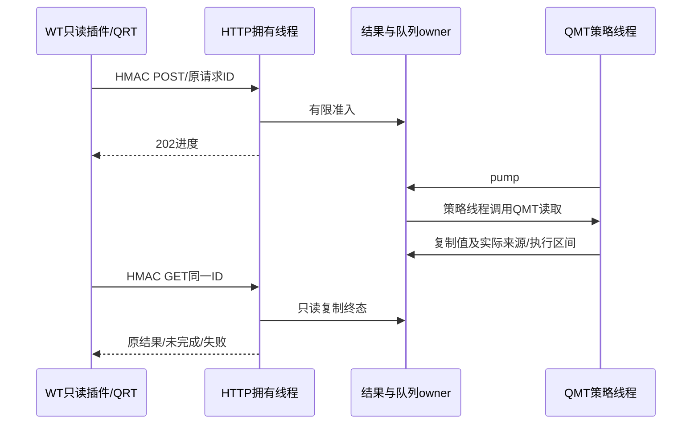

# QMT终端读取源

状态：历史HTTP来源参考，终端内HTTP交付路线已退役。本文保留原包的数据转换、队列和签名协议设计；当前终端内通信采用[SHM连接包](../../connectors/qmt_shm/README.md)，运行步骤沿[国信QMT手册](../runbooks/guosen-qmt-operations.md)。WT访问QMT外部Host的HTTP接口属于SHM产品的外部传输，不在终端内监听或建立网络连接。原记录不作为当前终端部署入口或共享内存回退路径。

类型：模块说明。所有者角色：券商接入维护者。职责：在QMT策略线程执行受限读取，向WT插件提供签名HTTP结果。行为要求见[QTS规格](../specs/qmt-terminal-readonly-source.md)，运行资格另见证据。

## 源码与职责

源码位于`connectors/qmt/guanheng_qmt`。`ReadOnlyTerminal`拥有绑定、代际、请求身份、有限队列及只读结果保留；`operations`集中声明可用操作、参数与供应商调用；`encoding/account_query`维护字段转换及逐查询来源；`auth`维护HMAC和重放检查；`StandardHTTPServer`拥有传输、收包预算及监听线程。

终端运行依赖Python3.6.8标准库，现代构建工具只用于开发主机。包导入不启动服务，配置与读取函数显式注入；调用者负责按终端策略生命周期创建、泵送和关闭。

原生WT承担行情存储、周期转换、策略运行、账户映射与执行。该源端不维护持仓账本，不执行交易、订阅或下载；源结果保留仅用于已受理读取的原ID认领，不能作为跨重启交易幂等依据。

## 调用链与线程

绑定、原生调用及最终解绑由创建owner执行；HTTP线程不调用QMT对象。共享锁只保护准入与值状态，原生调用和Future回调在锁外。代际在执行前后核对，来源失效不能授本批资格。

停止先关闭新准入，策略owner结束排队并失效绑定；网络实际关闭和线程join分别确认。原生调用超时不承诺打断供应商函数；保留结果未知及关闭中的真实状态。

## 数据与边界

账户查询保留合计持仓、可用数量及源实际字段的缺失语义，四批各有自己的请求、来源和执行区间。查询完整不表示四批是同一事务；未知交易日与未知字段保持显式不可用。快照和分钟读取按`operations`固定参数调用，分钟读取强制关闭订阅和自动填充。

HTTP协议的health/capabilities、202受理和原ID结果认领由源端提供；原生客户端继续使用[QRT](qmt-read-transport.md)及[只读通道](qmt-readonly-trader.md)。结果保留数量、字节、窗口、待办和传输限制由本模块配置及协议常量统一约束，容量满保持背压，保留期内不驱逐身份。

## 验证与发行

本仓库`tests/integration/qmt_terminal_source`覆盖转换、身份、签名、并发与关闭；真实原生DLL组合和实际QMT装载分别取得证据。`scripts/qmt_connector.py`复用哈希锁定构建后端，提供独立wheel与源ZIP，核分发白名单、源码身份及静态3.6准入。安装和运行配置按明确终端环境另行验证，不由构建命令替换活动策略。

具体命令、制品检查和分层资格见[连接包手册](../runbooks/qmt-terminal-source.md)，已验输入见[开发证据](../evidence/2026-10-22-qmt-owned-terminal-source.md)。
