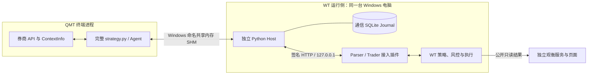

# 新电脑配置 QMT 通信与生成策略正文

类型：入门操作手册。范围：理解现有通信架构、填写脱敏配置、在 Windows 新安装上生成并离线核验账户查询入口。本文复用现有协议与工厂，模板关闭下单和撤单；完整系统的行情、历史及策略执行按各自手册另行装配。

## 通信架构

QMT 内的 `strategy.py` 是券商接入脚本。交易策略计算、资金分配和目标执行由 WT 运行侧承担；接入脚本在 QMT 原策略线程调用券商 API，把查询结果与回报送回 WT。



| 部件 | 运行位置与责任 | 入口 |
|---|---|---|
| QMT Agent | 在 QMT 内运行完整生成正文，核对配对与权限，原策略线程调用 SDK；依赖源码和参数已嵌入内存 | [Agent 源码](../../connectors/qmt_shm/agent/guanheng_qmt_shm_agent/)、[来源运行模式](qmt-source-runtime.md) |
| SHM | 同机进程通过 Windows 命名内存对象交换认证消息、请求、结果和回报；映射名、Windows 会话及密钥必须匹配 | [连接规格](../specs/qmt-shm-wt-binding.md) |
| Host | QMT 外部的独立 Python 进程，拥有认证 HTTP 接口、共享内存对端和通信恢复；生命周期由 WT 管理 | [Host 源码](../../connectors/qmt_shm/host/guanheng_qmt_shm/)、[托管步骤](qmt-trade-host-product.md) |
| Journal | Host 保存请求身份、派发阶段、结果、回报和未知责任的 SQLite。资金账和策略账继续由各自业务模块拥有 | [交易规格](../specs/qmt-shm-trading.md) |
| WT | 原生 Parser/Trader 对接 Host；策略和执行器消费行情、生成目标、处理风控及委托回报 | [执行模块](../modules/execution.md)、[行情插件](../modules/qmt-polling-parser.md) |
| 观衡 | 独立部署的只读消费者，显示 WT 提供的事实 | [职责决策](../architecture/adr/0016-independent-wt-runtime-and-observer.md) |

HTTP、磁盘配置、包文件及 Journal 都在 QMT 外部处理。QMT 正文运行时使用内存加载与共享内存，遵守终端的外部文件和网络访问约束。本文的同机 SHM 连接需要把 Host 部署在运行 QMT 的电脑上。

一次账户查询沿“WT → 签名 HTTP → Host → SHM → QMT 原线程调用 SDK → 原路返回”完成。获准交易时，委托沿同一路径进入 SDK，柜台回报再返回；HTTP 成功受理、SDK 返回、柜台接受和实际成交是分别可核查的阶段。发生超时或结果未知时，保留原命令身份，查询原命令与柜台事实，恢复规则见[交易通信手册](qmt-trade-host-product.md#停止恢复与回退)。

常驻 Host 等待 QMT 上线，运输断开后按原生命周期清理旧连接并重新认证。WT 重启后的新连接仍须核对新 binding、递增心跳及真实业务读取；Host 的 ready 只表示监听就绪。旧未知委托继续沿原身份核查。

## 准备安装和材料

需要 Windows、Python 3.10+ 的 Host 环境以及与目标 QMT 相符的 CPython **3.6.8 / 64 位** SDK。当前 [SDK 准入](../../connectors/qmt_shm/host/guanheng_qmt_shm/memory_runtime.py)固定检查该版本、二进制、标准库与许可证；更换版本需要适配和验证。

从可信的同一源码版本安装 Agent 和 Host。已有正式安装时沿[运行时安装手册](python-runtime.md)核对版本；研究新安装可以在独立环境安装仓库项目及其锁定依赖：

```powershell
# 以下路径均为示例；程序、私有材料和配对目录分别管理。
$Repo = 'E:\workspace\wondertrader'
$HostPython = 'D:\software\qmt-host\Scripts\python.exe'
$Private = 'D:\qmt-private'

py -3.12 -m venv D:\software\qmt-host
& $HostPython -m pip install "$Repo\connectors\qmt_shm\agent" "$Repo\connectors\qmt_shm\host"
New-Item -ItemType Directory -Path $Private
Copy-Item "$Repo\connectors\qmt_shm\examples\qmt-trade-config.example.json" "$Private\qmt-trade-config.json"
Copy-Item "$Repo\connectors\qmt_shm\examples\qmt-operation-policy.example.json" "$Private\qmt-operation-policy.json"
```

主配置为 [qmt-trade-config.example.json](../../connectors/qmt_shm/examples/qmt-trade-config.example.json)，其操作策略为 [qmt-operation-policy.example.json](../../connectors/qmt_shm/examples/qmt-operation-policy.example.json)。JSON 使用 UTF-8、无 BOM，说明放在本文中，JSON 内保持标准语法。

`--config` 指向填写后的主配置。现有配对的 `deployment.json` 是包含凭据的部署快照，整个文件的格式与主配置不同；新账户使用本模板及新的独立状态目录。

## 填写主配置

模板的账户标识为虚构的 `SYNTHETIC`，只开放 `account.trade_detail` 查询，`writes_enabled=false`。交易协议和事件存储字段仍须完整存在，供正式交易配对校验器检查；这些字段存在不授予下单权限。模板使用当前支持的 `qmt.trade-binding.v2`，证券交易规则由 WT 与券商处理。

| 字段 | 含义、示例值与实际影响 |
|---|---|
| `trade_binding.account_id` 和 `operation_profiles["account.trade_detail"].limits.account_binding.account_id` | 两处同时填写新账户在 QMT 中使用的标识；必须一致 |
| `trade_binding.account_type`、两处 `account_environment` | 示例为股票账户 `stock` 与实际账户环境 `live`；应与目标账户相符；环境声明和写开关分别校验 |
| `trade_binding.binding_id`、`strategy_name` | 本次账户绑定及 SDK 调用归属名称；与本次部署约定一致 |
| `route.route_id`、`executor_id`、`route_epoch` | 连接路由与执行端身份及代次；示例身份只适合独立验证实例 |
| `transport.name`、`windows_session_id` | 本实例独立的共享内存名，以及 QMT 所在 Windows 会话 ID。用 `Get-Process XtItClient | Select-Object Id,SessionId` 核对；模板的 `1` 须按现场填写 |
| `transport.kind`、`schema_version` | 示例使用 `builtin-shm` 与 `qmt.builtin-shm.v1`，对应受限终端内存入口 |
| `listen_host`、`listen_port` | 示例监听 `127.0.0.1:18159`，供同机 WT 访问；端口须空闲，消费者使用相同地址 |
| `journal_path` | 新实例专用的通信 SQLite 绝对路径，示例为 `D:/qmt-private/communication.sqlite`；换账户使用独立新文件 |
| `operation_policies_path` | 第二份 JSON 的绝对路径，默认复制位置为 `D:/qmt-private/qmt-operation-policy.json` |
| `ipc_secret_env`、`http_secret_env`、`http_key_id` | 两个环境变量名及 HTTP 密钥 ID；主 JSON 保存引用，实际密钥在配对进程环境中提供 |
| `read_profile_version`、`read_operations`、`operation_profiles` | 当前 v4 组合协议，仅声明账户读取；账户结果按 `CNY / cny_cash_shsz_v1` 解释，policy 版本 `1.0` 是基础查询投影，费用/身份增强投影沿对应规格另配 |
| `trade_profile.schema_version`、`clock_schema`、`operations`、`binding_sha256` | `qmt.trade-profile.v1`、同机 Windows 启动毫秒时钟及协议支持的下单/撤单操作集合；摘要绑定完整 `trade_binding`，写入实际受 `writes_enabled=false` 阻断 |
| `trade_profile`、`trade_binding.max_commands`、`max_trade_bytes` | 完整协议及通信记录预算；模板保留最多 16 条交易命令、每条正文/调用结果各 4096 字节、有效期 5000 毫秒、交易域逻辑预算 200000 字节；写开关仍关闭 |
| `max_records`、`max_journal_bytes` | 读取记录上限 64、逻辑预算 1048576 字节；容量满拒绝新工作，保留已有记录，后续按[读取保留规格](../specs/qmt-read-retirement.md)选择正式保留方案 |
| `max_frame`、`max_result_bytes`、`max_http_inflight` | 帧 262144 字节、单读取结果 16384 字节、HTTP 在途上限 4；示例用于连接验证，大账户结果可能超额拒绝 |
| `connect_seconds`、`io_seconds`、`control_profile` | 连接 5 秒、I/O 2 秒；control2 中 CALL 8192、REPLY 32768、保留 300000、单周期 8 条/65536 字节、调用上限 10 秒及 4 个在途调用槽，联合预算由原校验器验证 |
| `transport.poll_seconds`、`max_mapped_bytes`、`control_profile.poll_seconds` | 共享内存和控制调度间隔 0.005 秒，映射预算 4194304 字节；影响通信调度与内存容量 |
| `event_storage`、`event_poll_seconds`、`trade_profile.limits` 中事件字段 | 源缓冲最多 8 条/单条 1024/合计 8192 字节/页 4096 字节；Host 存储最多 4 条流、32 条事件、60000 逻辑字节，每 0.2 秒轮询。容量不足会阻断业务推进，不能自动删库续跑 |
| `writes_enabled` | 示例固定 `false`；要接正式策略执行时先按目标账户确认完整配置、运行状态和执行权限 |

操作策略 JSON 对账户查询提供排队 1000 毫秒、SDK 执行 1000 毫秒、响应余量 1000 毫秒、总计 3000 毫秒，只尝试一次、并发 1。`retry_backoff_initial_ms/max_ms=0`、空的 `retryable_error_codes`、`checkpoint_scope=none`、`terminal_proof_window_ms=0` 表示此示例未声明重试、分段检查点或额外终态窗口。它描述该读取请求的预算，不代替交易重试规则。表内容量均为独立连接验证的显式示例值；投产时按业务规模评估并联合验证，保持原状态和未知请求。

修改 `trade_binding` 后，用安装包的同一规范化算法重算摘要：

```powershell
& $HostPython -I -B -c 'import json,sys,hashlib; from pathlib import Path; from guanheng_qmt_shm_agent.protocol import canonical; p=Path(sys.argv[1]); c=json.loads(p.read_text(encoding="utf-8")); c["trade_profile"]["binding_sha256"]=hashlib.sha256(canonical(c["trade_binding"])).hexdigest(); p.write_text(json.dumps(c,indent=2)+"\n",encoding="utf-8")' "$Private\qmt-trade-config.json"
```

## 生成认证材料和 SDK 清单

在执行配对的同一 PowerShell 窗口创建两份独立随机密钥，直接存入配置引用的进程环境变量。以下命令不打印密钥：

```powershell
$env:QMT_EXAMPLE_IPC_SECRET = & $HostPython -I -B -c 'import secrets; print(secrets.token_hex(32))'
$env:QMT_EXAMPLE_HTTP_SECRET = & $HostPython -I -B -c 'import secrets; print(secrets.token_hex(32))'
```

IPC 密钥用于 Host/Agent 共享内存认证；HTTP 密钥用于终端外请求签名。配对生成物含凭据，保存到访问受控的私有位置，WT 客户端须使用匹配的 HTTP 密钥。券商登录仍由用户在 QMT 中完成。

[SDK 采集工具](../../scripts/qmt_sdk_manifest.py)由目标 SDK 的解释器在 **QMT 终端外**运行，读取自身版本、内建模块和二进制身份，不导入券商 API：

```powershell
$SdkPythonw = 'D:\software\your-qmt\bin.x64\pythonw.exe' # 替换为目标 QMT 配套 SDK
$arguments = @('-I', '-B', "`"$Repo\scripts\qmt_sdk_manifest.py`"", '--output', "`"$Private\sdk.json`"")
$process = Start-Process -FilePath $SdkPythonw -ArgumentList $arguments -WindowStyle Hidden -Wait -PassThru
if ($process.ExitCode -ne 0 -or !(Test-Path "$Private\sdk.json")) { throw 'SDK清单采集失败，请核目标解释器和输出位置' }
```

采集只创建新文件，已存在的清单保留原件；换新文件名后重新采集。`--stdlib-license` 使用该已核 CPython SDK 对应的完整许可文本，放在例如 `D:/qmt-private/CPYTHON-LICENSE.txt`。已有相同 SDK 的已核配对可复用其中的许可证。当前生成器按固定 SHA 核验许可；新安装缺许可时从该 SDK 发行材料准备并核对，任意改名的文本无法通过校验。清单里写有 SDK 的实际绝对路径，搬迁后需重新采集和配对。

## 生成并核验完整正文

当前[正式配对实现](../../connectors/qmt_shm/host/guanheng_qmt_shm/trade_pair.py)要求 `--output` 是 **E 盘中尚不存在的目录，且父目录已存在**。此项是现有工具约束；在没有 E 盘的机器上需先解决工具适配，再进行本流程。

```powershell
$Pair = 'E:\qmt-private\pair-001' # 先准备 E:\qmt-private；pair-001 由生成器独占创建
& $HostPython -I -B -m guanheng_qmt_shm.trade_cli pair `
  --config "$Private\qmt-trade-config.json" `
  --memory-sdk-manifest "$Private\sdk.json" `
  --stdlib-license "$Private\CPYTHON-LICENSE.txt" `
  --reconnect-seconds 0.2 --source-mode strategy_tick --output $Pair
if ($LASTEXITCODE -ne 0) { throw '配对失败，保留输出并检查输入材料' }

$Agent = & $HostPython -I -B -c 'from pathlib import Path; import guanheng_qmt_shm_agent as a; print(Path(a.__file__).resolve().parent)'
& $HostPython -I -B -m guanheng_qmt_shm.trade_cli verify --directory $Pair --installed-agent $Agent
if ($LASTEXITCODE -ne 0) { throw '配对核验失败' }
```

`0.2` 是本示例确认采用的断连重试间隔（秒），作用于此配对，接受范围为 0.1～60 秒。`strategy_tick` 显式采用原策略回调驱动，具体线程要求见[来源运行手册](qmt-source-runtime.md)。

成功后生成 `strategy.py`、`host.py`、`deployment.json`、`policy.json`、`manifest.json`、`CPYTHON-LICENSE.txt`。`pair/verify` 只生成/读取材料，保持 Journal、共享内存、HTTP 服务和 QMT SDK 调用未启动。核验成功证明材料一致性；真实连接、业务数据和交易能力要在对应环境分别验证。

本模板产生账户查询接入正文。完整系统需要按[组合账户手册](qmt-account-composed-source.md)及[交易托管手册](qmt-trade-host-product.md)另行配置行情、历史准备、分析、证券资料与执行通道；已有运行正文应保留原件，按完整能力组合生成后再替换。

## 启动、验真和故障定位

1. 按[独立 WT 手册](wt-independent-runtime.md)及[交易 Host 手册](qmt-trade-host-product.md#wt-一次启动)登记此安装的 Python、Agent、配对目录和摘要，WT 管理 Host；隔离直启只用于明确的验证实例。
2. 在 QMT 登录目标账户，加载匹配的完整 `strategy.py`，按[国信操作手册](guosen-qmt-operations.md#策略保存与执行方式)保存、运行并核实际入口身份。
3. 先核本代 Host 监听，再核认证 binding、来源心跳及账户查询实际成功。签名请求由正式客户端构造，`/health` 和进程存在分别只表示中间状态。
4. 换账户使用新路由/绑定、密钥及独立通信库和策略账。旧库、旧未知委托及原始回报保留在原账户归属下。

| 现象 | 检查 |
|---|---|
| 缺少 config | `--config` 必填；将示例复制为私有 JSON，确认它和 `operation_policies_path` 指向的文件均存在 |
| `admission_or_operation_failed` | CLI 统一错误码。依次核文件绝对路径、两个密钥环境变量、账户两处一致性与摘要、容量联合约束、SDK 原件、许可证以及 E 盘新目录条件 |
| Host ready、QMT 未连接 | 核实际策略运行、Windows SessionId、映射名、配对身份和认证；继续按[SHM 排障手册](guosen-qmt-troubleshooting.md)检查 |
| 账户查询成功、行情未就绪 | 本模板声明账户查询；沿完整组合流程加入所需行情能力并验真 |
| 离线 verify 成功、真实终端报错 | 保存该配对身份和脱敏错误，核券商 SDK/回调和实际解释器兼容性；实机加载与离线核验分别验收 |

仓库回归入口：`python -B tests/integration/qmt_shm_trading/test_config_examples.py`（需 Host 锁定依赖）。配置准入测试不启动服务；设置 `QMT_EXAMPLE_SDK_MANIFEST` 与 `QMT_EXAMPLE_LICENSE` 为已核材料路径后，还会在 E 盘临时目录验证真实 CLI `pair → verify`，使用合成账户和测试密钥，不调用券商 SDK。
