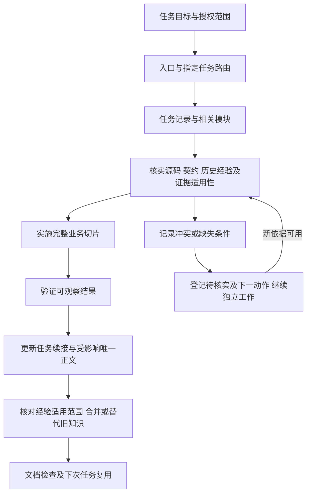

# AI 原生项目知识与持续演进方案

类型：工程工作流设计。状态：proposed。需求前缀：AKN。所有者角色：项目维护者；模块知识由对应模块维护者负责。日期：2026-11-07。

用户已确认 AI 原生方向。本页定义结合当前仓库的具体采用方案；本轮交付为方案重整、来源更正和导航接入。下文规范、模板、工具及行为验收均按阶段实施状态分别登记。

## 目标与根因判断

目标是使后续 AI 在新会话中找到正确职责与源码、续接指定任务、应用已经验证的经验，并在交付时更新相关知识。完成标准以这些实际行为及其验证为依据。

现有 [AGENTS](../../AGENTS.md)、[文档路由](../README.md)、[模块导航](../modules/README.md)、[开发流程](../development/workflow.md)、[文档规范](../development/documentation.md)和[缺陷记录规则](../runbooks/incidents.md#开发缺陷记录与检索)已经覆盖唯一正文、职责、验证及回写。下表为治理前共享旧分支的调查快照，当前实施状态沿各阶段及后继证据核对：

| 实际入口或资料 | 已有能力 | 影响 AI 执行的缺口 |
|---|---|---|
| `AGENTS.md` | 39 行、约 1615 字符，规则和任务指针较短 | 任务读取的完成条件、相关经验回写与收敛入口需要明确 |
| `docs/README.md` 与模块导航 | 约 5300 / 3950 字符，已有按任务读取条件 | 目录范围、任务类型与所属模块之间的定位依据需要补齐 |
| `docs/roadmap/CURRENT.md` | 当前事实及证据入口 | 约 9.9 万字符，长期按时间追加；当前事实与旧事件需分层 |
| `docs/roadmap/TARGET.md` | 用户目标及确认约束 | 约 4.2 万字符；需明确当前有效约束及后继关系 |
| `scripts/project.py start` | 输出 README 和 NOW 最近三条，每页上限 6000 字符 | 缺少指定任务选择；最近插入的条目可能属于其他任务或已经完成 |
| `.agents/skills/manifest.json` | 技能来源登记工具可用 | 当前 `skills=[]`，项目维护技能尚未建立 |
| `project.py check` | 本地目标、导航和技能清单完整性 | 任务续接、锚点、经验适用性及 AI 实际使用效果尚无该命令的证明 |

根因判断：已有规范缺少按指定任务组织的读取、续接、回写和失效处理闭环。原 134 项静态问题已按后继恢复关闭，原统计及处理见[分类审计](../evidence/2026-11-07-documentation-health.md)。字数和行数属于本次观察，后续以实际文件核实。

## 关键决策与边界

1. 项目知识继续由仓库文件和其所属源码、契约、测试及证据承担。保留现有目录与唯一正文，沿需要修改实际涉及的模块。
2. 入口承载简短执行规则与条件指针；模块正文承载职责与稳定经验；任务记录承载阶段状态；证据承载特定输入下的观察。每类事实保持一个所有者。
3. 采用 [Codex 项目指导、记忆和技能实践](https://developers.openai.com/codex/concepts/customization)与[简短入口及反馈回写实践](https://developers.openai.com/codex/learn/best-practices)。[AGENTS.md](https://agents.md/)提供开放指令入口；[Claude Code 记忆机制](https://code.claude.com/docs/en/memory)用于比较指令与经验的分工。工具实际加载语义分别核实。
4. 项目文件是共享协作依据。客户端个人记忆可辅助找回线索，项目中的要求、行为和证据沿其权威来源核实；本方案实施范围限于仓库知识与工具。
5. 规则回写对应已确认需求和已验证经验；需求、职责、权限及恢复语义变化沿现有规格和 ADR 流程。业务代码、交易策略、账户授权及生产操作沿原有职责和授权执行。
6. 传统文档方法继续辅助人类阅读、版本管理和审阅；AI 执行的主要设计依据改为上下文路由、任务续接、适用性与反馈机制。来源定位见[研究说明](../research/2026-11-07-documentation-standards-lifecycle.md)。

## 知识分层与唯一归属

| 层 | 现有位置 | 读取触发与完成条件 | 更新触发与所有者 |
|---|---|---|---|
| 执行入口 | `AGENTS.md`、`docs/README.md` | 开始任务；找到适用规则、模块和任务记录后进入对应正文 | 路由变化或跨模块稳定规则变化；项目维护者 |
| 模块知识 | `docs/modules/`、对应规格与 ADR | 涉及该模块；确认职责、不变量、原生接缝、调用者和最小验证 | 接口、职责、关键假设或稳定经验变化；模块维护者 |
| 任务续接 | `docs/roadmap/NOW.md` 与唯一任务记录 | 明确指定任务；确认目标、状态、代码身份、证据和下一动作 | 关键决策、验证结果、阶段结束或交接；该任务负责者 |
| 当前项目事实 | `CURRENT.md`、`TARGET.md` | 涉及当前采用状态或用户约束；定位适用条目并核实关联依据 | 采用状态或已确认约束变化；相应事实负责者 |
| 缺陷与证据 | `docs/incidents/`、`docs/evidence/` | 同类故障、验证复用或结论溯源；判断原输入与当前适用性 | 事件或验证发生；原记录负责者 |
| 可复用执行流程 | 既有 runbook；成熟后采用 `.agents/skills/` | 实际任务符合流程触发条件；按输入、步骤和完成条件执行 | 重复流程经验证后封装，按来源登记；流程维护者 |

文件被普通 Markdown 链接引用时，由代理按条件主动读取。[Codex 的目录指导发现](https://developers.openai.com/codex/agent-configuration/agents-md)与普通链接读取分别处理。嵌套指导按源码职责确有差异时引入，并实际验证生效范围。

## 读取、执行与回写主流程



读取阶段完成时，代理应能指出负责模块、相关契约、关键约束、原生扩展位置和适用验证。文档与实现冲突时，分别核实需求意图和实际行为，登记缺口与影响，修正负责该信息的来源。必要条件缺失时写明负责者和下一核实动作，相关验收标记 pending-verification，并继续不依赖该条件的工作；有新依据或输入变化后再复核相应分支。

交付按[实际影响选择文档维护量](../development/documentation.md#按影响选择维护量)，沿已有载体记录必要验证结果；知识事实变化时更新所属正文，导航或续接状态变化时同步相应入口。并行的跨会话任务各自维护唯一记录，共享路由按最新快照增量更新。

## 任务续接的具体结构

### 活动任务路由

`NOW.md` 的当前区拟改为任务导航，包含稳定任务 ID、范围、状态、续接记录与证据链接。历史区保留追溯入口。指定任务以其 ID 或唯一链接定位；存在多个候选时依据用户目标缩小范围，必要时明确需要选择的信息。

短任务默认沿已有提交、PR 或交付答复保留结果；已有 NOW 条目需要续接时更新原项。跨会话或多阶段任务优先沿用已有独立任务记录；缺少适用记录时，才在现有 `docs/roadmap/` 新增 `<task-id>.md`，由 NOW 登记。功能规格继续维护预期要求与验收，任务状态留在 roadmap 或既有任务记录中。

### 续接记录字段

| 字段 | 必要内容 |
|---|---|
| 任务身份与负责范围 | 稳定 ID、负责者角色、相关规格、模块及明确授权范围 |
| 目标与完成条件 | 可观察结果、当前确认约束和验收入口 |
| 输入与代码身份 | 提交、相关未提交差异或摘要、依赖及需核实的运行输入 |
| 当前状态 | 已开发、已验证、已合入、已交付及已部署分别记录 |
| 已成立结论 | 简短结论与匹配的证据链接 |
| 缺口与未知 | 缺少的行为或证据、影响及核实动作 |
| 下一动作 | 可执行动作、前置条件和停止条件 |
| 受影响知识 | 需要读取或更新的模块正文、规则和历史经验 |

阶段结束、验证结果改变或交接时更新记录。新会话先核对代码、配置和运行输入是否漂移，再决定哪些证据可复用，按下一动作推进。临时命令尝试保留在工作记录，续接正文保留有效结论。

`CURRENT.md` 维护当前采用事实，`TARGET.md` 维护当前有效目标与约束。历史分层迁移需逐项核对原文、用户决定、输入身份和后继关系；完成等价核对后更新入口。当前快照治理切片的采用范围与证据见下节，其余实施阶段分别登记。

### 当前快照治理采用切片

用户进一步要求处理 CURRENT/TARGET 的文档腐化，本切片已获范围授权。两份入口按主题更新当前结论，迁移前内容在同目录保存为原字节历史文件；以逐文件 SHA-256 和主题来源表核对历史完整性及关键约束保留。当前运行结论明确记录其证据时间与复核范围。

维护工具在 `config/project.json` 的可选 `document_snapshot_limits` 中声明受保护快照及字符预算。本切片为两份当前入口配置每份 6000 字符，与原启动摘要单页预算一致；规则同时检查以日期开头的段落或列表流水。历史归档沿普通链接检查，不受当前快照预算和流水规则约束。既有无该配置的项目保持原检查行为。

验收覆盖：原文与归档逐字节相同；当前主题对应原约束或后继证据；两份当前入口均在预算内；原日期追加触发检查失败；历史长文仍可保留；原静态错误按问题身份比较。该检查只证明体积和日期流水约束，事实有效性沿证据核实。完整 AKN-R07 的其他迁移与新会话行为仍按各阶段单独验收。实施证据见[快照治理记录](../evidence/2026-11-07-roadmap-snapshots.md)。

### P2 前置的任务解析契约

NOW 的拟议机器读取区使用唯一二级标题 `## 当前任务`，到下一二级标题或文件末尾结束；区内只有一张下述固定列表格。历史区使用 `## 历史索引`。复杂叙述沿链接进入任务记录，表格单元格保持单行。

以下为拟议格式示例，其中路径表示后续创建并登记的任务实例：

```markdown
## 当前任务

| 任务ID | 范围/负责者 | 状态 | 续接记录 | 证据 | 下一动作 |
|---|---|---|---|---|---|
| DOC-20261107-001 | 文档方案/项目维护者 | in-progress | [任务](DOC-20261107-001.md) | 待核实 | 完成模块路由演练 |
| DOC-20261107-002 | 单条链接/文档维护者 | planned | 本行 | 待核实 | 核实目标文件 |

## 历史索引
```

- 任务 ID 使用大写英文/数字分段格式，规则为 `[A-Z][A-Z0-9]*(?:-[A-Z0-9]+)+`，在当前任务区唯一。ID 持续标识同一任务，归档后保留原身份，后续新任务使用新 ID。
- 状态沿现有流程使用 `planned`、`in-progress`、`pending-verification`、`done`。其他列保持非空；已完成任务关联实际证据。状态与记录冲突时报告具体位置。
- 续接记录为一个 Markdown 链接或字面值 `本行`。后者用于短任务，选取时输出本行目标、范围、状态、证据和下一动作；需要续接字段承载更多信息时采用独立任务记录。
- 任务链接相对 NOW 解析，目标限 `docs/roadmap/` 或原已有任务资料目录 `docs/migration/` 中的 Markdown；原件和可选锚点须存在。证据列使用维护范围内的仓库文档链接，尚缺证据时填 `待核实`。外部受控依据通过仓库内脱敏记录引用。
- 路径规范化并解析最终目标后核对仓库边界和允许目录；未知或重复 ID、区块重复、缺列/缺字段、非法状态及目标/锚点缺失均返回明确错误。解析阶段只读取文档并输出结果。

该格式在 P1 模板演练后固定为 P2 输入契约，并用有效任务、短任务、重复/未知 ID、失效目标与路径越界等正反例核对解析器。当前 NOW 和工具仍使用原格式与原行为。

## 模块知识与经验持续演进

模块模板拟补充：任务触发与源码范围、关键不变量、原生扩展接缝、权威依据、最小验证入口和失效触发。现有接口、生命周期及恢复章节继续复用。只记录通过单个源码或工具查询难以理解的职责、理由与约束；可直接查询的配置事实指向源定义。

关键经验采用轻量字段：适用范围、结论、依据/回归入口、复核触发和后继关系。普通说明维持现有结构；这些字段优先用于影响修改位置、正确性或恢复语义的知识。

| 输入 | 回写位置与处理 | 提升、合并或失效条件 |
|---|---|---|
| 单次症状、未证根因 | 任务或缺陷记录，标注观察及假设 | 形成可复现证据后再提炼稳定结论 |
| 已验证模块经验 | 原模块正文的对应语义位置，链接回归 | 接口、依赖、环境或原假设变化时复核 |
| 跨模块反复适用的规则 | 原开发规范；入口只添加必要触发指针 | 先核实适用范围和冲突，合并等价旧规则 |
| 已验证的重复操作流程 | 原 runbook；确有复用收益后封装项目 skill | 验证触发、输入、执行结果及来源登记 |
| 过时或冲突知识 | 原所有者更新当前结论，导航指向后继 | 正式历史记录保留原身份，追加更正或替代关系 |

每次回写同时检查重复、冲突和失效项；改动日期与事实复核日期分别表达。复核成功后更新依据，条件缺失时标明适用性待核实。经验回写既更新内容，也核对后续任务能否经路由找到并执行。

## 文件级修改清单

以下为后续实施清单，本轮只交付方案及其导航和验证记录。

| 文件或既有目录 | 具体修改 | 验收输出 |
|---|---|---|
| `AGENTS.md` | 补任务定位、读取完成及交付回写的短指针，沿用现有根因与授权规则 | 根入口保持简短，相关任务可进入正确正文 |
| `docs/README.md` | 开发任务路由优先可达，专项操作步骤沿 runbook 披露 | 代理能按任务选路径并说明选择依据 |
| `docs/modules/README.md`、`TEMPLATE.md` | 补任务触发、源码范围及关键知识字段；先迁移实际涉及模块 | 模块定位、职责、不变量和回归入口可核实 |
| `docs/roadmap/NOW.md` | 当前区改为活动任务路由，历史有独立入口 | 指定任务不受最近其他任务插入影响 |
| `docs/roadmap/CURRENT.md`、`TARGET.md` | 按事实或约束主题维护当前有效内容，历史迁移保留身份 | 原用户约束、采用事实及后继关系逐项等价 |
| `docs/roadmap/` 中任务记录；必要时增加模板 | 按本页续接字段维护复杂任务 | 新会话正确区分各完成层级并执行下一动作 |
| `docs/development/documentation.md` | 统一知识归属、适用性、读取触发及合并/替代规则 | 各类信息只有一个权威位置 |
| `docs/development/workflow.md` | 开始阶段核对任务，阶段结束与交付阶段完成续接和知识更新 | 实施与回写处于同一任务闭环 |
| `docs/runbooks/incidents.md`、故障及证据模板 | 补经验提炼、同类任务触发与失效条件，复用既有记录字段 | 结论关联证据，后续相似任务可找到相应经验 |
| `docs/development/skills.md`、`.agents/skills/manifest.json` | 成熟流程按现有来源规则登记，并验证实际触发 | skill 的文件、加载和执行证据分别登记 |
| `scripts/project.py` | 后续增量加入任务选择、锚点及任务结构检查，保留原 start/check | 工具输出与覆盖范围可重复验证 |
| `config/local-ci.json` 与现有本地 CI | 复用已有文档检查，软件阶段纳入快照回归 | 本地检查及合入结果绑定最终内容；托管自动化沿独立需求 |

`config/project.json` 已声明文档范围和入口；后续仅在确需配置时扩展，复用路由与任务记录的唯一来源。现阶段保持 `skills=[]` 的真实状态。

## 工具接口与能力边界

现有可执行接口为 `python -B scripts/project.py start`、`start --full` 和 `check`，以及原技能来源登记命令。`check` 已增加本页采用切片的快照预算与日期流水核对；本地 CI 原有文档阶段直接调用该命令，软件阶段同时运行快照回归。它们的当前行为以源码及审计为准。

拟议接口：`python -B scripts/project.py start --task <ID>`。后续实现时从 NOW 当前任务区的唯一 ID 解析原记录链接，输出任务身份、适用规则、模块与续接路径，保留摘要范围说明；代理按这些路径读取正文。未知 ID 返回明确错误和可用任务，重复 ID 或无效链接拒绝选取；缺少必要状态时指出缺失项。普通链接仍由代理主动读取。

检查按两层交付：机械检查覆盖引用、标题锚点、任务 ID/必要字段和技能清单；行为检查覆盖代理实际定位、续接、采用经验与回写结果。知识适用性与业务语义由源码、契约、证据及评审共同核对。

原 134 项问题已按[后继修复](../evidence/2026-11-07-documentation-health.md#后继修复与合入核对)分类关闭：共享旧分支恢复主干原件及引用依赖，外部历史 QA 资料归受控材料目录，研究正文补入所属索引。后续新增问题沿同一所有者处理；审计明细维持追溯用途，所属索引维持正式导航。

## 需求与验收映射

| ID | 场景与要求 | 验收入口及通过条件 |
|---|---|---|
| AKN-R01 | 新任务按条件获取上下文 | 场景 S1；定位模块、契约、原生接缝及验证，读取路径有依据 |
| AKN-R02 | 入口、模块、任务、证据及流程知识分别归属 | 文件审阅及 S6；权威正文唯一，其他位置链接 |
| AKN-R03 | 指定任务具有独立续接身份 | S3、S5；相关结论和下一动作可恢复，其他任务原样保留 |
| AKN-R04 | 证据与当前源码/配置适用性先核对 | S3、S4；输入漂移时标明重验范围和未证项 |
| AKN-R05 | 修复经验通过原模块供后续任务使用 | S2；匹配适用范围，选择能覆盖原触发条件的回归 |
| AKN-R06 | 回写包含合并、替代与失效处理 | S6；重复规则收敛，旧结论与后继可追溯 |
| AKN-R07 | 当前事实与历史分层保持原信息身份 | 迁移前后逐项核对；用户约束、事实、原依据及后继关系完整 |
| AKN-R08 | 技能源于已验证的重复流程 | 登记与独立触发实验；输入、结果和完成条件有证据 |
| AKN-R09 | 任务选择与检查失败明确可观察 | 隔离工具用例；未知/重复 ID、缺字段、失效链接及锚点分别报告 |
| AKN-R10 | 原生加载规则与主动读取分别验证 | 按实际 Codex 指导发现核对，行为记录说明真正读入的文件 |
| AKN-R11 | 变更携带文档影响及回写结果 | S4、S6；原知识所有者、导航、任务与证据一致 |
| AKN-R12 | 自动化能力与运行效果分别登记 | 各阶段证据明确 planned/implemented/verified 范围及限制 |

### 行为验收场景

| 场景 | 冻结输入与执行方式 | 必须观察到的结果 |
|---|---|---|
| S1 新任务定位 | 给出仓库及“日线字段转换”目标，从入口开始 | 找到统一日线 owner 与实际消费者，核实单位/身份及最小验证，记录读取轨迹 |
| S2 同类缺陷复用 | 冻结已修缺陷、适用经验与一份未证假设，执行相似任务 | 读取适用经验及回归；假设保持未证状态，修改定位到责任层 |
| S3 中断续接 | 会话 A 写入任务记录；独立新会话 B 仅获仓库和任务 ID | 区分开发/验证/合入/部署，核实输入变化，推进记录中的下一动作 |
| S4 知识失效 | 在隔离样本修改接口或验证入口，保留旧知识 | 机械检查或代理指出具体差异，沿权威来源更正，核实后更新依据 |
| S5 多任务隔离 | NOW 同时存在文档、数据、交易任务，并插入无关最新条目 | 指定任务稳定定位，其他任务状态与授权原样保持 |
| S6 知识收敛 | 提供重复经验、失效规则和已验证后继结论 | 原模块或规范合并/替代，入口保持简短，历史身份与后继完整 |

行为实验冻结任务、仓库快照和必要工具环境，记录读取文件、定位结果、执行与回写差异，以及通过/失败/未知。审查逐项覆盖场景要求；一次成功支持该次输入，发现变化或失败后重验受影响场景。当前这些场景尚未执行。

## 分阶段实施与状态

| 阶段 | 目标与步骤 | 验证标准 | 当前状态 |
|---|---|---|---|
| P0 原件和活动路由基线 | 按审计追查活动任务依赖，恢复原件及所属导航，保留缺失证据范围 | 活动链目标可达；全仓既有问题逐项登记，依据可追溯 | 已完成：原件及依赖恢复、历史材料归档、研究索引修复 |
| P1 人与 AI 可直接执行的文档闭环 | 更新入口、流程、模块模板和任务续接；从一个真实模块与任务做完整切片，再按范围分层迁移历史 | 人工/代理完成 S1 至 S6，AKN-R07 历史等价及 AKN-R10 指导加载独立验收；切片分别登记 | 部分实施：CURRENT/TARGET 快照切片；其他待实施 |
| P2 最小工具接线 | 按原维护工具扩展任务选择、必要字段和锚点检查，接入适用 CI | 隔离正反例及同输入检查通过，实际覆盖有据 | 部分实施：快照预算与日期流水检查；其他待实施 |
| P3 稳定流程提炼与持续核验 | 经实际使用后封装必要 skill；按真实反馈改进触发与去重 | AKN-R08 与受影响行为场景通过，来源和运行证据可核实 | 待实施 |

P0 的原完整性问题已关闭，P1 继续按具体活动链推进。CURRENT/TARGET 的完整历史迁移按专门等价核对实施，保留共享工作区的其他任务内容。工作量按每个模块/任务切片、工具增量和实际迁移规模评估，当前不承诺未经验证的自动化效果。

### 总体完成条件

方案实施完成时，AKN-R01 至 R12 逐项关联输入匹配的执行证据，S1 至 S6 各有实际结果。AKN-R07 另附历史迁移前后等价核对，AKN-R10 另附实际工具指导加载检查。P2 的机械正反例与 P3 的技能独立触发结果分别登记。

阶段或单个任务切片通过只支持其已验范围；整体要求中未实施、未验证或失败项继续登记为未完成，并指出影响及下一动作。本轮设计交付以方案完整性和文档检查验收，行为与工具验收留在各实施阶段。

## 风险与下一动作

- 原件来源缺失会限制结论复用：从当前活动任务依赖优先追查，缺失处明确证据边界。
- 路由或任务记录重复会造成错误续接：任务 ID、唯一记录和共享索引变更需共同核对。
- 经验过度提升会增加上下文及冲突：沿模块适用范围先验证，跨模块稳定规则再进入公共规范。
- 历史分层可能遗漏已确认约束：迁移按原文与后继逐项等价验收。
- 工具静态通过只证明机械覆盖：行为场景独立运行，保留失败和未知项。

下一实施切片：选择一条已有实际任务链，确认 owner、任务记录和证据，完成 P1 的读取—执行—回写演练，再据其真实缺口安排 P2。

## 参考与证据

AI 工具一手资料已在本次对话读取，适用日期：2026-11-07。具体产品能力采用前沿官方文档复核。

- [Codex 自定义机制](https://developers.openai.com/codex/concepts/customization)：指导、记忆、技能、渐进读取及纠正回写。
- [Codex AGENTS.md](https://developers.openai.com/codex/agent-configuration/agents-md)：指导发现与目录作用域。
- [Codex 最佳实践](https://developers.openai.com/codex/learn/best-practices)：简短准确入口、反馈与可复用流程。
- [AGENTS.md 开放约定](https://agents.md/)：面向编程代理的项目指令。
- [Claude Code 指令与记忆](https://code.claude.com/docs/en/memory)：指令与经验分工及适用范围。
- [本次设计验证](../evidence/2026-11-07-ai-native-documentation-plan.md)：实际修改、静态检查与未执行范围。
