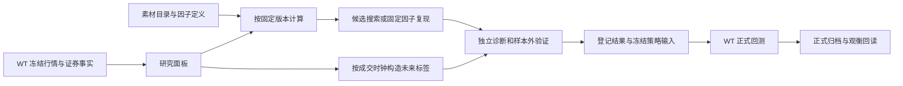

# 观衡因子素材库与研究全链路方案

状态 `proposed`。本方案定义日频因子研究的资料、计算、搜索、验证和交付接口。已登记首个外部素材来源 py-alpha-lib。具体研究门槛随实验预先确定，依赖采用与策略资格以实测和对应决定为准。方法见[因子研究流程](../research/2026-11-11-factor-research-workflow.md)，本机结果见[Windows 验证](../evidence/2026-11-11-factor-library-windows.md)。

## 目标和职责

每次研究从一个可检验的问题开始。因子素材库保存来源与可用零件，因子定义保存如何计算，实验保存当时用什么数据以及得到什么结果，策略版本保存如何把因子变成持仓目标。一个因子可以先后参加多个实验，得到不同市场、频率和时期的证据。

| 所有者 | 公开接口和事实 |
|---|---|
| WT 统一日线数据模块 | 只读快照提供行情、证券资料、交易日历、来源、单位、版本、时点资格与缺口。研究固定其公开身份后导出面板。 |
| 因子研究模块 | 读取素材和冻结数据，计算固定定义，登记生成候选，执行独立评价并产出可回读的实验包。校验、标签隔离、缓存与错误原因集中在同一入口。 |
| WT 策略与回测模块 | 消费已冻结的因子定义、因子值或信号，拥有持仓、资金、撮合、成交及原生完成凭证。策略拥有组合、退出和风险规则。 |
| 观衡报告模块 | 通过既有列表及详情读取 WT 正式归档。因子研究报告通过实验身份追溯至因子和数据。 |

离线研究沿[产品范围 ADR-0004](../architecture/adr/0004-core-trading-product-scope.md)和[独立 WT/观衡 ADR-0016](../architecture/adr/0016-independent-wt-runtime-and-observer.md)。行情与复权复用 WT-D05/D09 和[统一日线](../modules/unified-daily-data.md)。股票截面策略按 WT-S02 核实可用宿主，ETF 时序按适用 CTA/SEL 接口。WT-B01/B02 承接正式回放和撮合，WT-B04 的既有参数优化用于固定策略试参。新增职责集中在候选生成和研究证据，引用[原生能力目录](../development/wondertrader-capabilities.md)及[策略编写入口](../modules/strategy-runtime.md#策略编写入口)。

## 素材入库、定义及保存

| 对象 | 建议保存位置和必备内容 |
|---|---|
| 素材 | Git 中的[因子素材目录](../research/factor-materials.md)保存稳定素材 ID、作者/论文、上游 commit、许可、支持字段、公式定位、已知口径差异。论文假设、已知公式、算子和跨市场参考均可登记。 |
| 因子定义 | Git 中保存稳定 `factor_id`、不可变版本、上游素材和父因子、适用市场/频率、公式或已审查实现、输入字段和单位、预热、缺失/停牌/并列语义、可用时点、依赖锁和手算样例。窗口、缺失规则、方向、计算引擎或输出语义有变化时发新版本。 |
| 研究面板和因子值 | 受控研究数据根中的不可变 Parquet 按数据快照、频率和日期分区。键为交易日和证券 ID。保存版本、数值、缺失原因、时点与输入摘要。按需要保留可重建缓存，实验引用与已交付证据随研究保留规则处理。 |
| 实验及诊断 | 同一受控根以实验 ID 保存只读输入清单、候选全集与去重映射、样本切分、基线、评价口径、候选配置与种子、原始日志、淘汰记录和结果。第三方得分保留其计算口径。 |
| 策略采用记录 | Git 中的策略版本固定因子 ID/版本和消费方式，受控归档保存正式报告 ID、完成凭证与数据/制品身份。旧策略和旧报告可以用原版本回读。 |

实现时建议由仓库内离线研究入口管理因子定义与实验。源代码、素材索引和依赖锁归 Git。行情、因子值及实际账户材料遵守各自来源权限，使用仓库外研究数据根。首轮使用文件和清单，按 ID/版本查来源、试验结果和正式报告。全 A 扩容以实测决定分片和缓存。按 5,000 股、每年 250 日、8 个双精度字段估算，仅数值约 80 MB/年，证券标识、状态、多版本、窗口缓存和模型中间量另计。

同一因子版本对应一套计算合同。统计指标和候选方向随实验发布。用表达式规范化及训练段相关性识别重复候选，保留原表达式及归并关系。同一来源实现与自有实现之间以手算和冻结样本对齐，出入库记录保留上游版本及授权。

## 平时怎么用

1. **开题**。写一个可以被数据证伪的问题，并选股票截面、ETF 相对排序或市场择时。固定当前策略或朴素基线、目标收益/事件、执行时钟、主指标、失败条件和搜索预算。分析入口、退出或风控时分别固定其他规则。
2. **取数和复现**。从 WT 固定日期及证券池身份，导出原价、分析价、成交额、日历及入池状态。复现 Alpha144 等素材时，先跑手算、时间截断、跨标的隔离与缺失边界。TA-Lib 可以承担 RSI、ATR 等成熟算子。因子公式、调用参数和时间边界仍由因子定义拥有。
3. **搜索候选**。人工假设可直接写成表达式。第一轮用轻量遗传编程建立可复算基线，专用搜索器用同一批开发数据和同样预算比较。搜索只收到开发区间与相应标签。RD-Agent 先留作后续可选流程。生成器提交受限表达式或经审查实现，记录失败候选和每次参数变化。
4. **诊断与终测**。独立评价模块按既定时钟构造收益标签。股票使用日 Rank IC、ICIR、覆盖、分组收益、衰减和规模/行业暴露，市场择时使用时序事件指标及费用后组合表现。Alphalens Reloaded 可消费已经构造的标签，快速复核股票截面。按时间切分，清理跨界标签，登记多重尝试，在冻结因子和规则后评估封存区间。
5. **WT 回测交付**。用相同成本、流动性规则和资金比较原策略与加因子版本，确认净收益、换手、成交率、回撤及容量。选股优先核实原生宿主和真实执行约束。用户指定正式报告时，走[正式 WT 回测与归档](../runbooks/native-backtest.md#正式归档的唯一位置)，核对完成凭证，并在观衡打开列表和详情。Pyfolio 或 Empyrical 可对已归档收益做补充分析。
6. **复盘和演进**。定期回看证据，遇到数据漂移、算子修复、覆盖变化、不同市场失效或引入成本时登记新实验。已观察终测一律登记为探索来源，下一轮使用独立区间或前瞻观察。发布新定义、冻结策略版本、保留旧版本引用，旧版被替换时附替代原因和后继版本。

首轮以 Alpha144 为例。研究问题是下跌冲击在控制流动性和规模后是否仍能预测下一阶段相对收益。固定股票池、取数版本和次日开盘时钟，先复算研报定义，再和成交额、跌幅以及规模匹配基线比较。新增搜索只在开发段尝试，最终固定一个因子版本和一个策略变体。封存段记录预测增量，正式 WT 回放比较两版策略的可交易增量。

## 首期依赖选择

- **复现与计算**使用 py-alpha-lib 素材和 TA-Lib 经典指标。Alpha144 的计算入口显式接入 WT 的元成交额，样例覆盖上游 `AMOUNT` 别名。Pandas 指标缺项时优先评估 pandas-ta-classic，核对实现口径后再入因子定义。Tulipy 保留为数值对照。
- **搜索**先使用已跑通的 gplearn 建 CPU 对照。需要金融表达式语法时接 alpha-foundry 的 CPU 搜索入口。其公开快照的 A 股 CLI 缺数据加载器，观衡接缝负责提供 WT 冻结面板，保留原始成交额和证券时点。搜索的准入区间归入开发与验证，封存终测由独立评价入口读取。PySR 与 Qlib 分别作为公式搜索、特征/模型实验扩展，按实际研究需要加入。RD-Agent 依本轮取舍留在后续。
- **诊断**首期用 Alphalens Reloaded 对照截面结果。Empyrical Reloaded 复核组合日收益指标，Pyfolio Reloaded 在需要额外归因时从 WT 归档生成研究图表。诊断环境使用项目按交易时钟计算的标签及净收益输入。
- **进入策略**时固定计算代码和制品身份。若正式策略采用外部库算子，用冻结输入核对研究输出与正常 WT 回调的数值、缺失、时钟、性能和重启语义。外部依赖随策略制品锁定与验收。正式策略引用具体因子版本，运行时的信号和目标继续沿原策略接口。

## 版本、时点与恢复

- 研究导出通过 `source_daily_history_batch_query` 按现有上限每批最多 64 只证券，并固定同一 `snapshot_id`、原价/复权口径与历史范围。逐只校验返回状态和实际日期覆盖，若固定快照已经不可读，则结束该次尝试并登记缺口。改用其他快照会生成新实验身份。[批读合同](../../integrations/guanheng_market_client/daily_batch.py) · [WT 日线规格](qmt-source-daily-history.md)
- 数据保留 `session_date`、`available_at`、快照 ID、字段单位、复权参考和可交易状态。行情首次可知时间未知时保留历史重建资格。标签使用目标执行时钟，并与生成器可读的特征和候选评估数据隔离。未来停牌或成交失败留在评价和模拟记录。
- 因子定义的证据按版本记录为已登记、已复算、已研究。样本外结论以市场、期限及实验身份记录通过、淘汰或证据不足。策略采用和替换以独立的策略版本及正式报告为准，支持一个因子在 A 股截面已验证、在 ETF 仍待验证。
- 实验 ID 由规范化定义、冻结面板、切分、评价协议、依赖和随机种子共同绑定。每次执行保留尝试 ID。单一写者先将产物落到同卷暂存目录，校验后原子提交完成清单。并发重复请求沿既有实验身份等待读回，部分文件和未知状态保留原尝试及错误阶段。同一输入重试复用已验证阶段，输入变化产生新实验身份。
- 证据缺失、环境失败、时间截止、取消和容量不足分别记录。重新运行前核对提交状态、已完成阶段和输入摘要。策略回测异常沿 WT 自己的完成凭证与恢复语义。旧因子版本或依赖回退时引用原 Git 对象和原数据/归档；数据修订另建新快照，旧运行的指向保持可追溯。
- 研究环境与行情、账户、WT 运行环境分离。搜索只使用受控的已冻结字段及允许表达式。第一阶段以 CPU 小样本实测时间和峰值内存，再决定按年、股票池或字段分批。搜索、诊断和正式回测各自记录耗时和数据资格。

## 分阶段实施与验收

| 要求 | 主路径与验收 |
|---|---|
| FRS-R1 素材可追溯 | 从素材 ID 能定位论文、许可、固定源码和因子定义。首轮 Alpha144 对照手算、上游和自有计算，覆盖正常、全上涨、缺值、零成交及未来截断。 |
| FRS-R2 输入可复现 | 从 WT 只读快照导出一个股票池和区间，核对时钟、原价/分析价、成交额、缺口及证券映射。两次同源导出内容身份一致，记录历史重建覆盖。 |
| FRS-R3 挖掘可复算 | 固定搜索预算、种子、训练段和适应度，基线与选定搜索器从同一面板生成候选。按实际引擎的确定性约定核查结果，验证终测数据隔离及失败尝试保留。 |
| FRS-R4 诊断可独立核对 | 以手算和 Alphalens 交叉检查少量截面 IC，核对缺失标签及并列，报告完整候选和消融。终测冻结后记录置信区间、成本、风险暴露及结果。 |
| FRS-R5 正式回测可查看 | 用 WT 对同一策略的原版和因子版本完成回测，归档两份完成凭证，在观衡打开列表与详情，并回查因子、快照、代码和成本身份。 |
| FRS-R6 重试和历史可回读 | 在计算、发布或回测间中断，核对旧已完成结果可读、部分结果未晋级、同身份可重试。更新并回退依赖或因子版本，旧报告仍定位原证据。 |

先完成 R1/R2 的 Alpha144 最小闭环，再接 R3/R4 的搜索与独立评分，最后接 R5 的正式策略与归档。R6 随各切片验证。首次正式采用前，依本机结果选定研究环境、依赖版本及源代码归属。需自维护上游时再确认 fork、gitlink 和目录，第三方源码固定到经核许可的提交。常用研究任务以同一套记录复跑，后续服务化或 UI 由实际使用和性能结果驱动。
