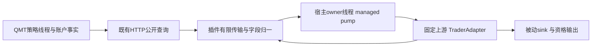

# QMT HTTP 到原生 TraderAdapter 的只读初始化

> 源码交付范围：本页标注的外部历史/待归仓路径用于追溯原记录，未随本次源码提交。其旧通过记录不授当前入口可复现资格；当前构建与运行以对应永久源码及正式安装手册为准。

类型：功能规格。状态：accepted，待实施。功能前缀：NQB。依据：用户确认完整观衡移植、WT 重合能力全部复用、HTTP 优先及核心修改逐项批准。本文限定下一只读开发切片；实现、隔离验收、真实来源验真和生产生效分别取得证据。

## 目标与原生复用

通过公开 `ITraderApi/ITraderSpi` 插件边界，把 QMT HTTP 的账户、持仓、委托和成交结果交给固定原生 `TraderAdapter`，由原实现完成持仓投影、活动 WT 委托管理、未完成数量、统计及资金通知。被动 sink 输出本次查询观察与资格，不接目标执行器、策略或真实交易路由。成功结果为可核实的四查询初始化与有界正常退出；原 `on_channel_ready` 只表示本次原生初始化阶段完成。

复用能力 WT-T01/T02/T08/T09，见[能力目录](../development/wondertrader-capabilities.md)、[原生执行模块](../modules/wondertrader-execution.md)、[交易执行模块](../modules/execution.md)。与[原生行情方案](../migration/native-market-integration-plan.md)一致，采用原接口和事实所有者；旧 QMT 重合持仓/执行设计退出目标架构，生产切换和历史事实交接保持独立验收。

新增范围为来源字段归一、有限传输、回调调度、只读生命周期与验收宿主。账户事实仍属于来源，Adapter 是原生运行投影，插件只保留单批有界结果和临时资格元数据。保持单一账户事实与命令所有者，不建立持仓、订单、成交或命令数据库，不实现第二套持仓归约器。

固定上游为 `08b230dd05facf6d650d949bfe51054115a2ecb1`。验收构建必须从该提交的原 blob 形成隔离源码快照，并核文件摘要。当前工作区 `TraderAdapter.h/.cpp` 含冻结 CORE-006，不能作为本切片的原生能力输入。`ManagedTrader/ManagedTraderAdapter` 的强四快照与 retained 恢复机制仍为独立候选，本切片不链接、调用或要求它们。

## 已核实接缝与入口选择

原查询链为 `run → connect → WTE_Connect → login → onLoginResult → queryPositions → onRspPosition → queryOrders → onRspOrders → queryTrades → onRspTrades → queryAccount → onRspAccount → ready`。原 Adapter 在 `connect()` 返回后写 `AS_LOGINING`；查询回调会同步触发下一 query。出处：固定上游 `src/WtCore/TraderAdapter.cpp:401–423,1397–1435,1506–1594,1714–1719,1798–1803`。

采用原正常 `init(id, params, BaseDataMgr, ActionPolicyMgr)` 和动态 `createTrader/deleteTrader` 工厂，显式 `savedata=false`。初始化配置、基础资料和插件二进制均属于本切片隔离目录；插件只接受显式 transport 配置，缺配置返回 unavailable。

原 `initExt` 会开启 savedata 且未设置 `_cfg`，原 `handleEvent(WTE_Connect)` 登录路径会解引用 `_cfg`；因此本规格选择有完整配置所有权的正常 init。模块查找仍沿原 `WtHelper` 规则，但隔离宿主必须确认实际加载 DLL 的绝对路径和摘要等于指定制品，避免同名其他插件进入测试。原源码保持。

## 职责与调用链



| 所有者 | 职责 |
|---|---|
| 原 QMT 来源 owner | QMT 原生调用、公开字段、账户/会话、交易日、查询范围、时间与错误语义；已有命令签名和幂等事实保持原 owner |
| 插件 transport | 请求/结果关联、请求预算、响应容量、取消/关闭；网络 worker 只交结果，不调用 SPI |
| 宿主唯一 owner | init/run/pump、插件API、SPI回调、被动sink、Adapter查询、停止状态与对象生存期 |
| 固定原 Adapter | 原四查询状态机、持仓与委托/成交统计、资金及ready/lost分发 |
| 被动 sink | 观察核验与中文诊断；记录本轮事实字段及可用性；无目标、补单、撤单、策略触发 |

## NQB 状态与回调所有权

宿主状态：`Created → Starting → Initializing → Observed → Closing → Closed`；任何初始化、来源身份、字段或回调失败转 `Failed → Closing → Closed`。`Observed` 定义为四批完整成功，原 Adapter 已发 ready，且被动 sink 完成核对。它只授予此实例、此来源、此轮的只读观察资格。

### run 返回后的 happens-before

1. owner 线程创建配置、基础资料、sink和正常 Adapter，调用 init，再调用 run。`connect/login/query*` 为非阻塞准入方法，负责排入有限工作；connect不得同步发送SPI事件。
2. run 返回成功后，owner 才打开 managed pump 的回调准入。初始化过程中 transport 可以完成请求，但其结果只进入互斥队列；在 pump 开启前 SPI 调用次数必须为0。
3. owner 程序顺序保证 `run` 中 `AS_LOGINING` 写入先于该线程之后的 pump 回调。worker 对结果队列的写入通过 mutex release/acquire交接到owner；禁止用 sleep、轮询plain bool或“线程通常稍后运行”充当同步保证。
4. pump 一次提取有限数量事件，解锁队列后调用SPI。所有SPI和sink回调与Adapter状态读写都在owner线程。下一query由SPI同步调用时只排任务，不嵌套完成下一回调，避免递归推进和持锁回调。
5. owner回调内stop只标记关闭请求、关闭新准入；当前回调栈退回后再执行解绑、join与销毁。worker或任意外部线程不得直接销毁Adapter/sink或调用原查询读方法。
6. 结果携带插件实例代际与原请求ID；关闭/失败后旧结果被丢弃并计数。队列不得无界增长，不自动跨实例或跨账户转送。

managed pump 是自有宿主扩展入口，保持 `ITraderApi/ITraderSpi` ABI。自有模块命名为`GuanhengQmtBootstrap`，插件为`TraderQMTReadOnly`，与既有TraderQMT候选分别构建。插件沿原createTrader/deleteTrader工厂导出，并附带自有C入口`pumpReadOnlyTrader(ITraderApi*, uint32_t max_events)`和`stopReadOnlyTrader(ITraderApi*)`：pump在owner线程交付至多max_events个已排队事件，返回实际数量，错误为负值；stop只请求停止，实际join沿原release执行。公共声明仅放自有模块头文件，禁止改核心接口；DLL和宿主使用同一工具链并记录导出签名/版本。两扩展入口都校验实例与owner，异常在DLL边界归一，保持唯一调度实现。原`ManagedRuntime`面向强基线候选，不直接复用其交易恢复部分。

### 自有 C 接缝与实例查找

正常 Adapter init 隐藏工厂返回指针，插件在自有模块维护仅供接线的非拥有注册表。公开声明固定为：

```cpp
extern "C" ITraderApi* findReadOnlyTrader(const char* instance_id);
extern "C" int pumpReadOnlyTrader(ITraderApi*, uint32_t max_events);
extern "C" int stopReadOnlyTrader(ITraderApi*);
extern "C" int inspectReadOnlyTrader(ITraderApi*, Diagnostics* out);
```

声明中的 ITraderApi 使用原 `wtp` 命名空间，Diagnostics 位于 `guanheng::bootstrap`。配置必须提供显式唯一 instance_id；同 DLL 存活实例重名初始化失败。find 只向创建实例的 owner 返回借用指针，未知/已注销 ID、空 ID 或异线程返回 null，不延长实例寿命。release 开始时先注销 ID，随后停止、解绑、join；注册表不承担账户状态或命令身份。

宿主在正常 init 前按绝对路径加载指定 DLL，并核对实际路径及 SHA-256；Adapter 按自身规则加载的工厂必须属于相同绝对路径和摘要。find/pump/stop/inspect 都从这个 DLL 取符号，禁止用另一份同名模块完成查找。工厂删除前，宿主保留该模块和依赖对象生存期。

Diagnostics v1 是固定宽度数字与定长中文错误字符串的值拷贝，调用方传 version=1、size=sizeof(Diagnostics)，版本或长度不符返回 -1。字段包含 phase、四批 delivered 位图、回调/查询/回查/拒写次数、worker_live/joined、排队/丢弃数、资金 presence、每批观察时间与行数、owner/worker 线程标识与错误原因；不返回内部容器、借用文本或可写账户事实。诊断输出本身须经 owner 获取；由调用方负责后续跨线程传递值副本。

错误码固定为 -1 参数/实例错误、-2 当前状态不可用、-3 owner 错误、-4 已关闭、-5 只读拒绝、-6 本轮失败、-7 pump 重入；容量错误归本轮失败并带原因。pump 的事件预算为 1..32，成功返回实际交付事件数。回调内 stop 只置标记，当前栈退回后完成关闭事件；回调内 release 请求 stop 后返回，由 owner 在 pump 退栈后再次 release。重复 stop/release 幂等。deleteTrader 同样拒绝异线程/回调栈内销毁；正常原 release 后由宿主持有的借用指针执行明确的工厂删除，再放弃指针。

fixture 首个实现的硬上限集中在自有模块：文件 1 MiB、单批 4096 条、队列 16、每阶段最多 16 个状态回包、文本按 WT 字段槽限制、JSON 深度 12。配置请求预算 1..30000 ms、整轮预算为请求预算..120000 ms、单批配置数量 1..4096。fixture 延迟等待可被 stop 唤醒。HTTP transport 与其关闭预算在后继受授权切片中实现；本阶段没有网络 transport。

## 四查询、错误与身份

### 公开 HTTP 输入

当前源码接缝为 `POST /internal/v1/operations/account.trade_detail`，arguments 使用 `account_type/datatype`，账户取自源绑定。来源依次接受 POSITION/ORDER/DEAL/ACCOUNT；具体大小写、账户类型、政策和预算以源公开契约为准，插件不硬编码真实账户。

其源链为 HTTP IOLoop→Gateway有限队列→QMT策略线程 `agent_tick`→`get_trade_detail_data`→JSON结果。查询API不得携带下单函数或触发下载、订阅。`state/sync/health` 可作为只读身份/快照辅助入口；`sync` 的事件序号不作为账户快照吸收水位。

HTTP响应只在 `ok=true`、请求ID匹配、类型与条数/字节预算有效、完整性成立且字段归一成功后交给SPI。202表示同一请求未完成，继续原request_id状态查询；预算耗尽转失败，不将202/null/错误转换成空数组，不重复创建新的请求冒充恢复。HTTP成功状态与业务结果成功分别核验。

### 查询完成与异常

- 插件每批收齐、校验完成后交付一次WTSArray；完整空POSITION/ORDER/DEAL是有效结果。账户最低必需资金与身份缺失时本轮失败。Adapter自身可接受null并推进状态，因此插件要在调用SPI之前隔离错误。
- 四批允许各自观察时间，报告保留每批时间与范围。身份/代际变化使当前轮失效；不能声称四查询是共同事务，也不要求共享 `CoherentBaseline`。
- 查询失败记录中文原因、阶段、可恢复条件，通知宿主失效；原 `onTraderError` 只是通知，不能单独当撤销资格。已发ready后的关闭须发原WTE_Close给被动sink；宿主状态始终是此切片是否可用的判据。
- `onRspTrades` 只交历史成交集合，利用原Adapter统计路径；禁止再投 `onPushTrade`。本切片不把持续events归约到Adapter，后继连续回报须另定查询交接、重复/缺口和恢复契约。
- 原Adapter订单统计覆盖查询记录，活动订单只接纳可信WT usertag。手工/旧命令记录保留原来源；测试可构造明确标注的合成 `otp.<adapter-id>.<localid>` 以验证原路径，真实来源不得借此伪造WT归属。

### 只读投影中的来源归属与记录等价

fixture 配置显式给出 adapter_id，宿主必须验证它与传给原 Adapter::init 的 id 完全一致；ITraderSpi 不提供反查适配器 id 的接口。ID 使用 1..24 个 ASCII 字母、数字、下划线或连字符，大小写精确匹配。

本切片管理资格要求同时满足：来源为显式 fixture；user_tag 完整符合 `otp.<adapter_id>.<localid>`；localid 为无前导零的十进制 `1..4294967294`；记录附 `ownership={kind:"fixture_wt", adapter_id, order_id, local_id}`，各值与该行broker ID、配置和标签精确一致。该范围是自有接缝的保守约束：固定原 `TraderAdapter::doEntrust` 使用 `UINT_MAX` 返回失败，本切片保留该哨兵；不把这项约束写成所有原生插件的通用要求。证明仅为合成fixture资格，实际HTTP返回的自述布尔值或对象都不能自行成为生产归属证明，后继必须通过来源owner已有命令/身份契约验真。

缺失/空标签、外部或相似前缀、大小写不同、格式非法、溢出或缺乏合成证明时，记录仍进入本批事实和原生统计，向原 WT 管理标签槽传空串。该操作不制造、修复或借用 WT 标签；原始来源标签参与本批语义比较。合法本实例localid在整批内必须唯一绑定broker order ID；两个broker ID占同一个localid，整批在SPI前失败，保持原订单map和未完成量一致。该索引仅在单批校验期间存在，不成为命令账本。

同broker order ID（成交使用order ID与trade ID二元组）的重复记录，在完整字段校验后比较规范化业务事实：证券/市场、方向、来源标签与实际管理资格、日期/时间、量价以及订单状态/各数量分量或成交金额。键顺序、等值整数/浮点/指数写法、未知扩展字段不改变这些事实；缺失与空user_tag均表示空来源标签。等价重复只交付一条，真实业务字段或管理资格冲突使整批失败。

JSON字节上限保持1 MiB。进入DOM前使用常数调用栈的迭代SAX：根深度0、值深度最大12、每数组最多4096项、每对象最多4096成员、字段名最多256字节且无NUL、总值节点最多65536，同时拒绝重复键和无效UTF-8。只有通过该边界的数据才进入迭代DOM解析；解析后递归检查不能替代这道保护。极深但小于1 MiB的输入必须正常返回初始化失败并正常退出子进程。

## 字段契约与缺口归属

每个查询结果的自有边界只保存 `request_id/instance_generation/source_identity/observed_at/completeness/field_presence` 及本批记录。它们为暂存与验证元数据，不是额外账户账本。source_identity含来源、账户、environment、session/generation、交易日；具体来源缺少的字段标unknown并阻止需要该字段的资格。前后health可以筛选明显漂移，不能证明单批结果的账户绑定或跨查询原子性。

| 类别 | 最低映射/检查 | 源公开缺口及处理owner |
|---|---|---|
| 证券 | instrument、exchange→原BaseDataMgr合约，SH/SZ到SSE/SZSE显式映射；币种/制度取原基础资料 | 合约或市场未知时该批失败，插件负责映射，基础资料owner负责制度 |
| 持仓 | 只读合计资格必需总量V与当前可卖A，按股/份保持且0≤A≤V；精确今昨及分项可卖为独立字段资格 | 固定原Adapter合计接口对两槽求和。仅有合计时可采用下述明确标识的ABI投影；`m_nYesterdayVolume`的“昨夜拥股”不能直接证明当前剩余昨仓。真实拆分不足不阻断合计只读观察，继续阻断依赖精确拆分的消费者 |
| 账户 | CNY、当前总资产、可用资金为本次必需；其他WT资金字段带presence/适用性 | raw白名单缺完整总资产/冻结；state有total_asset/cash/frozen_cash。preBalance与day_start_asset语义分别核准，total_asset含盈亏时禁止重复加dynProfit |
| 委托 | broker ID、证券/方向、总量、累计成交、活动剩余/撤拒数量、价格、原始状态、交易日与委托时间 | raw对象白名单缺原始数量、方向别名、价格及日期时间；state仍缺价格。源公开投影owner补schema后才能授对应真实映射资格 |
| 成交 | broker order/trade ID、证券/方向、单笔数量/价格、交易日/源时间 | raw对象白名单缺trade ID、量价时间部分字段；state已有较多字段。源owner明确别名、原生时间/时区，插件按身份检查重复/冲突 |
| 身份/完成 | 每批完整性、结果账户/会话/代际、观察时间、分页/截断、查询范围 | operations结果当前未逐批绑定全部身份；source owner提供明确契约，插件不得从completed_at或事件序号猜测 |

本切片被动sink只对presence成立的资金字段作事实断言/输出，最低必需字段缺失则失败。交给原Adapter的对象必须显式初始化其实际读取的每个数值槽；固定版本WTSAccountInfo构造函数没有初始化margin，插件须调用setMargin。缺少源事实的可选槽使用明确的中性值，输出按presence标为不可用，不展示成已确认零，不能用于风控或执行资格。适用性已证明的结构性零单独标明来源依据。完整资金字段fixture须逐项提供已知值，真实来源缺证据时保留限定资格。原总资产已包含盈亏时，balance取总资产、dynProfit取投影中性0，以保持原sink的balance+dynProfit等于源总资产；源盈亏可作为独立事实保存，不能再次叠加。

### 合计只读与精确拆分的不同资格

固定上游XTP、HuaX与OES插件已有把合计可卖量放入一个可用槽的实现，原getPosition仅对今昨槽求和。详见[原生股票查询映射核查](../evidence/2026-10-22-native-stock-query-mapping.md)。因此来源只有经核准的V/A时，自有只读边界可明确选择pre=V、new=0、availPre=A、availNew=0；这四个数是保证合计的ABI投影约定，pre/new不作为券商真实今昨事实。元数据与展示必须标明aggregate-only；精确今昨、分项可卖、委托冻结和成本各自按来源presence输出。V-A表示当前不可用数量，其中可能包含T+1限制，不能代替真实委托冻结。

该约定只授新实例首次四查询、被动sink与合计读取资格。使用该约定的宿主不连接执行器、策略或实时成交push；原onPushTrade会按今昨分量更新，后续接线须先核定真实制度、数量与事件交接。原fixture精确拆分场景和已归档证据保持原资格。此处修订明确下一HTTP消费者的最低要求，尚未实现或验证HTTP投影，也未改变Diagnostics v1 ABI；实现前须在后继HTTP规格冻结可用性/粒度输出接缝。

QMT `broker/encoding.py` 对字典递归原样转换，对原生对象仅输出 `QMT_PUBLIC_FIELDS`；必须用脱敏原生对象形状fixture经现有编码器验证缺项，不能只用字典证明真实回包覆盖。不得通过私有日志、凭据、原生内存或源数据库绕过公开投影。本任务保持原QMT只读，字段补充由源owner在其授权工作中实施。

## 只读与生命周期

`orderInsert/orderAction` 固定返回明确不支持/拒绝，transport层只注册查询操作；被动sink无任何调用执行器的引用。即使原ready后也没有写能力。隔离测试应证明下单、撤单、命令提交、下载与订阅下游调用数均为0。

源已有签名、原command_id、受理去重与未知提交核查保持；后继拆单、追单和撤单的每次动作另验授权，不由WT localid代替原命令身份。本切片不新增模拟签名或命令日志。

### 关闭顺序

1. owner将宿主设为Closing并关闭API/pump新准入，通知transport停止接收新任务；stop重入仅置请求。
2. 当前SPI/sink调用返回后，owner按需发送一次WTE_Close；回调异常记录应用未知，停止继续查询交付。
3. 调用原Adapter::release，其原顺序为registerSpi(NULL)→plugin.release。插件registerSpi(NULL)必须同步撤销owner端回调目标；worker始终不得持SPI引用。
4. plugin.release通知transport取消、唤醒所有等待，终结有限在途I/O，join实际worker，再清理结果队列。join完成前保持插件、配置、sink、BaseDataMgr等对象存活。release不能在worker自身join自己。
5. 宿主核实worker已结束、SPI已解绑、队列已排空，再清理自有对象并正常退出子进程。重复stop/release返回一致终态；晚到结果只记丢弃，不能调用已解绑对象。

任何阻塞I/O必须由传输实现提供可结束条件；客户端超时不等于worker退出。关闭预算超限时报告关闭失败并保留对象所有权，禁止detach后销毁对象。进程监管终止仅是故障清理结果，不计正常退出通过；实际正常退出时长与线程数必须测量。

原Adapter::release只调用插件release，原析构当前只释放stat_map；配置引用、订单容器、动态库/插件实例等释放覆盖须按实际测试记录。本切片用“一次初始化、一次正常关闭”的独立子进程限定资源资格；第二次初始化在全新子进程完成。它不授予长驻进程无限重建、热卸载、同实例重连或生产未决命令恢复资格。发现原生资源缺口时先记录具体触发和影响，再由主任务评估，保持核心冻结边界。

## 配置、预算与输出

候选启动配置由唯一宿主owner持有：enabled默认false、只读模式固定、source显式选择fixture或已授权HTTP、插件制品/基础资料路径、账户类型和预期身份、每请求/整轮/关闭预算、队列上限、各查询最大记录数、响应字节及字段文本长度。启用时必填并校验正值和有界上限；首个验收实现将常量集中登记，测试值明确标记为测试配置。没有真实来源或凭据配置时禁止自动探测端口/账户。

本阶段只使用fixture transport和隔离测试进程。实际HTTP实现可以另在自有边界开发，但真实网络探针、来源身份取得和现场验真继续按具体授权。日志输出阶段、错误码、中文原因、request ID、耗时、条数、字段可用性、线程/代际与制品摘要；脱敏处理账户身份，不打印签名字节、凭据或未授权原始账户明细。

## 验收分解

| ID | 要求与预期 | 验证入口/证据 |
|---|---|---|
| NQB-R1 | 固定原生blob+正常init+指定动态工厂，savedata=false；CORE-006及自有强基线零依赖 | 隔离源码/编译输入清单、DLL路径/hash、原核心摘要比对；原/当前来源区分 |
| NQB-R2 | run返回前SPI=0；run后owner pump按原四查询推进并只ready一次 | 快速worker先完成、延迟结果、错误线程调用、同步query重入；记录thread ID与状态顺序，无sleep同步 |
| NQB-R3 | 完整非空四查询与独立oracle一致；历史成交只更新原查询统计，不重复增加持仓 | 真原Adapter、被动sink、getPosition total/valid、合成可信WT订单/undone和成交对照 |
| NQB-R4 | 合法空持仓/委托/成交可推进；失败/null/202/缺页/超预算/字段缺失不能伪造空或ready | 分阶段transport错误、结果回查、malformed/schema/容量、未知合约、必需账户字段失败 |
| NQB-R5 | 合计只读以总量/可卖和明确aggregate-only资格映射；精确今昨、分项可卖及真实委托冻结分别按源定义与presence授予；量价时间/身份保持 | 独立合计oracle、0≤A≤V边界、V-A与委托冻结不同、缺拆分仍可合计只读且执行/push关闭；原fixture昨仓部分卖/当日买/T+1矩阵、跨日/时区、重复/冲突及原生对象编码继续验证 |
| NQB-R6 | stop关闭准入、当前回调退栈、原release解绑、插件实际join；晚包零回调 | 每阶段停止、stop重入、回调异常、SPI解绑、重复关闭、I/O取消、正常退出码/线程数/耗时 |
| NQB-R7 | 新进程独立初始化得到相同观察；旧代际/同实例重查不会获得本切片恢复资格 | 两个独立进程对照、会话切换/旧结果、原统计累加与省略归零条件的限制证据 |
| NQB-R8 | ready始终只读，无执行器、命令或交易副作用；资金未知值不显示为零 | API拒绝、transport调用白名单/计数、presence输出、无真实网络fixture验收 |
| NQB-R9 | 字段缺口/源码与部署/合成与真实资格分别记录 | 公开schema覆盖矩阵、源owner缺口列表、输入摘要、独立full审查与关闭证明 |

验证按字段/错误单元→固定原Adapter整链→动态工厂子进程→异常关闭→独立full审查推进。实现通过后才登记开发资格；真实HTTP账户字段、持续事件/重连、执行器、页面与生产验收另附匹配证据，不扩大本切片完成含义。

## 实施顺序与兼容性

1. 已完成技术自查并收敛accepted；按上述自有扩展声明与模块归属实施。
2. 在自有独占模块/测试目录实现只读插件和fixture transport，隔离构建固定原Adapter；复用原基础资料和日志接口，解决构建兼容仅在构建侧，不改核心。
3. 完成NQB-R1–R8并输出原生行为与资源边界；按NQB-R9送独立full审查。
4. 源owner公开字段补充后再接实际只读HTTP，核源码/部署身份；该步骤有独立验真证据。

现有TraderQMT候选、CORE-006、SDK发行输入和图表保持原件；新的隔离验收入口显式选用本路径，不静默fallback。回退为停用新入口/正常退出子进程，保留来源事实与既有命令记录，不删除账户数据。

## 待核事实及分工

- 源公开字段和会话/查询范围语义：源owner提供；缺项阻断对应真实来源资格，合成字段及原生链开发可继续。
- 精确股票/ETF今昨与可卖定义：基础资料与源契约共同核准；插件不以证券名称猜制度。
- 原生release剩余资源与动态库所有权：实施中通过独立进程测量并记录；保持本次一次性进程范围，核心改动另议。
- managed pump扩展声明及模块命名已固定；声明、宿主与DLL调用一致性在实施中核验，保持同线程owner与原ABI边界。

## 依据

- 只读源码调查：调查报告（外部历史/待归仓路径：`../../build/native/capability-audit/native-qmt-execution-seam/ce363529-37b0-4839-929b-9edada5a13cb/research.md`），包含两仓库HEAD、源码符号/行号、字段覆盖及冻结摘要。
- 上游固定源码 `src/Includes/ITraderApi.h:125–274`；`src/WtCore/TraderAdapter.cpp:90–114,160–231,401–423,1397–1435,1506–1803,2134–2251`。这些引用按上游提交行号，当前工作区差异另列。
- QMT HEAD `2083e96ac7134ad808d6bfddcdfe19aaa11a64fd`：`qmt_agent/broker/adapters.py:550–592`、`broker/encoding.py:53–81,125–170`、`gateway/core.py:714–779,972–1002`、`gateway/operation_queue.py:357–450`、`qmt_strategy.py:493–535`、`native_observation.py:50–269,365–445`。源码身份须在实施时重核。
