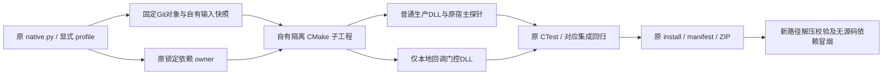

# 原生只读插件固定来源构建与开发包

类型：历史功能契约。状态：superseded；外部旧QMT运行与CI要求已退役。前缀：NQP。依据：用户要求原生编译、二进制版本、自动化测试、独立发布与可控上游差异；本切片将已隔离开发的[NQB](native-qmt-readonly-bootstrap.md)/[NQH](native-qmt-http-bootstrap.md)/[QRT](qmt-shared-read-transport.md)接入[原构建流程](native-build-automation.md)。开发包、真实来源、正式运行与生产分别验收。

## 适用范围与后继要求

[GBW-R1/R7](guanheng-business-workspace.md)明确旧QMT仅静态只读参考，禁止跨仓导入、测试或集成旧工程。因此本契约下文的`qmt-readonly-fixed`、外部旧QMT来源执行及NQP-R7托管CI要求保留为历史规则，不再指导当前开发、构建或发布。CI撤下对应job/source输入并清空遗留外源选择；工具历史源码、旧包和原始报告保留，不追改旧结论。

默认native和本仓独立Python生命周期入口分别按[构建手册](../runbooks/build.md)、[测试手册](../runbooks/testing.md)执行；新共享内存账户及其他来源按各自现行规格取得同版编译、安装、搬迁及实际链资格。历史NQP通过结果不覆盖新协议或当前产品。

## 目标、复用与调用链

复用原`scripts/native.py`的工具链发现、锁定依赖、受管子进程、CTest、安装、manifest、ZIP及校验所有者，增加显式`qmt-readonly-fixed` profile。默认`native` profile保持当前命令和资格；二者使用独立work/CMake缓存。原生API/SPI、TraderAdapter和基础资料沿WT-T01/T02/T08/T09接缝，见[能力目录](../development/wondertrader-capabilities.md)与[原生执行](../modules/wondertrader-execution.md)。

新profile使用固定上游Git blob、自有源快照与依赖锁，生产插件和验证宿主分别声明输入/库。已有original-build库只作历史对照，本profile从源码fresh构建宿主所需原库。插件不修改WT核心、公共虚接口、账户事实或原持久格式，不读取运行终端、凭证、本机配置、数据库或下载目录。

## NQP-R1 入口与配置身份

沿原CLI增加`--profile native|qmt-readonly-fixed`，省略为native。doctor/deps/configure/build/test/package/verify/all沿同一入口。固定profile使用显式外部受控QMT源输入；test/package/all要求该输入可解析到唯一固定QMT提交`34777db5eab144d6fe8a2f259b9f2c0de167435a`，没有输入则明确不可用/失败，不能把stub或跳过记作该调用链通过。不得使用硬编码工作树路径或隐式回落到运行终端。

configured/built/receipt身份含profile、固定WT/QMT提交、快照内容、锁和工具链。跨profile缓存、外部源身份变化、固定对象缺失、编译前后输入变化及旧产物均拒绝；离线缺对象/依赖时失败并保留日志。正整数jobs等沿原参数约束，配置路径与缓存归独占work。

## NQP-R2 固定源及实际输入

WT固定`08b230dd05facf6d650d949bfe51054115a2ecb1`，按明确路径/对象清单使用git cat-file取得原blob字节，核对象类型与Git对象摘要。Includes/Share/FasterLibs、宿主四个WtCore源及WTSTools/WTSUtils的实际传递源码/头均来自该固定快照。固定源与自有源根分列，禁止回落到当前脏核心、当前公共头或历史.lib。

自有生产源、探针、Python测试及实际导入helper在执行前快照并记录摘要，执行后核稳定。QMT合成服务使用固定提交的原Core/Queue/Journal/认证/编码/契约，导出清单核实际blob。测试选择使用显式源/fixture根；QMT私有源码只作受控验证输入，由原源owner独立发布，不纳入WT仓库或WT ZIP。记录实际编译TU、头依赖、对象、链接输入、工具和最终DLL/probe，库搜索与实际动态依赖分列。

## NQP-R3 编译目标与依赖

自有CMake子工程在独立target命名空间/配置中原样编译固定WTSTools/WTSUtils及四个原Adapter宿主源。依赖版本、源码校验和许可沿现有lock owner；已有校验缓存可复用，历史编译库不可作为成功前提。生产DLL仅含其四个自有生产TU；生产链接的最小依赖由实际fresh link、PE依赖及回归证明。MSVC C++17、运行库、头路径及编译设置明确固定，必要兼容设置置于自有wrapper。

普通DLL与GH_QMT_HTTP_DRAIN_TESTING产物分开。主生产DLL不得导出测试门控符号，测试DLL不得安装或进入ZIP。包中保留允许分发的CRT及许可证，系统DLL保持OS前提。当前native默认目标选择及其运行行为保持。

## NQP-R4 自动验收

CTest沿原测试执行器登记NQB fixture/根因/补充、当前NQH签名HTTP→原tick/Journal→QRT→原Adapter、v1/v2/wait、真实回调drain及关闭、未connect/失败init等适用检查。原F1–F3关闭以实际后继NQH资格为准，不以旧227总数替代。检查与进程数、复用断言、disabled/skipped及未覆盖行为分别记录。

配置显式传递probe、普通/门控库、自有测试根、固定QMT来源及独占work，清除本机硬编码及原源码隐式查找。用例使用临时SQLite原Journal和loopback合成服务，无真实QMT、写委托、下载、订阅或外部DB。等待和子进程沿原预算/Job清理，失败阻止安装/资格。

## NQP-R5 开发包与搬迁

沿原CMake install、artifact owner与ZIP提供`app/traders/TraderQMTReadOnly.dll`、普通验证宿主、自有合成验证工具/样例、脱敏来源收据、许可及默认关闭的示例；不伪造本profile不提供的Runner、wheel或历史worker资格。manifest明确profile、development、固定源与自有候选身份、依赖/工具链和真实测试收据。资格校验继续要求本profile适用CTest/pipeline-tests确实通过，默认包校验保持兼容。

在新绝对路径解压，独立进程CWD/PATH不依赖原源码、旧编译缓存或QMT安装。自包含二进制冒烟核实际加载DLL路径/SHA、工厂、版本化ABI、fixture正常/空/错误与有界停止；原Git仓库和旧测试work不作其前提。原Core的合成HTTP搬迁验证另外显式传入已核固定QMT fixture，由受控源复制到新隔离验证路径并核摘要；它是外部验证依赖，不宣称随WT ZIP分发或无外源。缺该输入的独立verify保留归档/二进制冒烟范围，完整all须取得该搬迁HTTP证据。外部最终receipt绑定包摘要、受控源与包后结果。门控回调在本地CTest验收，搬迁包不因未分发测试DLL虚报其在包内运行。

## NQP-R6 失败与兼容回归

沿原pipeline测试补固定对象/源快照篡改、当前头污染、锁/profile/外部源变化、产物变化、跨profile缓存、普通/测试DLL混包、缺失/额外文件、ZIP路径与摘要、缺源码路径搬迁等负向。原默认profile参数、依赖/执行/归档与身份拒绝回归继续有效；本profile失败与原失败资源互不清理。无需为版本升级删除数据、容器或已有开发包。

## NQP-R7 CI与运行文档

CI调用同一入口并保存profile对应receipt、CTest/JUnit、日志与ZIP。明确取得固定Git对象及受控外部QMT源的方式，权限仅覆盖读取；缺受控输入则保持该job不可用，不能授通过。实际托管执行与本地可执行配置分列。更新构建、发布/回滚手册及模块说明，给出新机器/offline步骤、必要工具链、来源身份与错误处理；不安装系统工具或修改全局环境。

开发包不执行安装生产服务、终端重启或策略启用。真实版本切换仍按具体待发布输入、已审计划和运行授权完成；rollback保留原包/配置，不改账户或订单。

## NQP-R8 证据与完成条件

当前源完成fresh原库/普通DLL/门控DLL/宿主编译，适用CTest和pipeline-tests通过，实际开发ZIP与新路径运行通过，实际输入和前序冻结核心文件边界核对，源码/规范/异常恢复经独立full审查。若外部CI、第二台机器或真实终端未验，则明确列未验范围，开发隔离资格不扩授。保留原失败、历史库及旧包身份。

需求与入口：R1/R2/R6由原pipeline回归与输入拒绝验证；R3由实际编译/依赖/链接及普通测试符号拒绝；R4由CTest；R5由原archive verify与隔离搬迁；R7由CI配置/实际运行及手册分别核；R8由绑定当前源码的证据和独立报告核定。

## 当前实施边界

需求与原构建 owner 已核；实现允许修改自有scripts/native_support、原native.py编排、自有CMake、测试参数化、CI和文档，不修改WT核心。NQH修正仍在执行时先推进独立helper/CMake与单测，原native.py和NQH测试公共文件由主任务协调后修改，避免变动在途工具身份。

来源：原生构建最终规格、native.py/CMake/artifact owner、固定Git对象，以及`build/native/qmt-http-bootstrap/packaging-research-001/research.md`静态研究。该研究的减库建议和旧build-011不是本profile运行证据。受控CI源交付及跨机器复现由构建维护者继续核实，不阻塞本地隔离实现。
