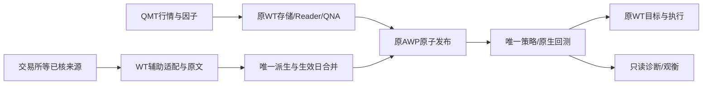

# 策略数据、业务诊断与运行日志

类型：跨模块最终规格。前缀：SDO。状态：accepted / implemented，当前正式运行及来源边界见[在线核验](../evidence/2026-11-06-mainline-online-acceptance.md)。依据：用户2026-11-05确认辅助数据持续更新、策略/回测诊断及发布日志检查，并按完整模块并行实施。架构沿[系统架构](../architecture/overview.md)，唯一策略沿[RR112](retained-resonance.md)，分工见[实施方案](../migration/mainline-data-observability-20261105.md)。

## SDO-R1 目标与复用

目标为真实数据持续到达、原策略计算、WT标准通道自动执行及独立观衡正确展示。按[原生能力目录](../development/wondertrader-capabilities.md)复用[行情](../modules/market-data.md)、[策略/回测](../modules/wondertrader-strategy-capabilities.md)、订单和运行日志。ETF份额、市场成交额与融资余额的外部取得和策略特有派生属于自有适配；由WT统一托管，观衡只读。关闭观衡后，数据和自动交易持续运行。不新增行情数据库、金融账本、日志服务器、Grafana、Windows定时任务或人工上线审批。

来源优先级：优先核查国信QMT内置API及已下载数据，经真实样本确认字段、统计日期、单位和历史覆盖后，通过现有共享内存通道交WT适配。旧QMT项目只读参考其来源定义、解析和公式；交易所等已核来源用于QMT尚未提供或覆盖不足的字段。逐字段选择来源，不要求所有字段来自同一个接口。当前证券资料、PCF申赎清单和IOPV须按各自含义使用；ETF历史总份额和沪深全市场融资余额分别验证。新来源沿用下面的统一字段及时间合同，来源切换保留身份与口径，QMT策略内继续遵守无外部文件读取和无网络连接的运行要求。

## SDO-R2 字段、公式与时间

现有种子接口为`guanheng_strategy_v1.auxiliary.AuxiliaryPublication`、`merge_auxiliary(observations, publications)`，采集接缝为`guanheng_analysis_window_producer.official_auxiliary`。普通发行、完整消费者与线上资格分别验证。

| 字段 | 定义 |
|---|---|
| kind | shares为ETF总份额，turnover为沪深股票成交额，margin为沪深融资余额 |
| symbol | shares所属实际ETF；市场汇总为空。角色替换使用新ETF自身来源 |
| statistic_date | 来源统计日，区别于知晓日、实际取得日和策略生效日 |
| value | 有限正数，shares单位亿份，其余单位亿元；缺失与零值分别处理 |
| available_at | 有依据、带时区的可获知时刻；历史首次未知时保留未知，以实际首次取得作为当前运行已知上界 |
| received_at | 带时区的实际采集时刻；历史补采不回填为历史取得时间 |
| source_sha256 | 原文或完整来源清单摘要，绑定日期、单位及派生身份 |

保持旧causal-v3：份额净变化为相邻统计日总份额差；概率沿原分段映射；成交热度为沪深成交额5日均值的60点midrank分位；融资分位为沪深融资余额60点midrank分位，均至少20点。原不足5日的初始化语义保持。5日平滑和60日分位的完整前缀最多64个来源日；输入和消费者共同支持。十进制份额先精确求差再交原信号机，保护5/10亿份阈值。

成交量、净资产、融资融券合计和其他ETF份额不能替代原字段。未取得值保持None。数值、来源日期、知晓时刻和来源摘要共同参与身份。

## SDO-R3 持续更新、存储与恢复

启动检查已有原件与缺口，长历史使用有限可续接任务；常驻owner持续增量取得新日期和必要修订。缓存按来源/日期/原文身份复用；来源修订探测及归档策略明确记录，不能永久缓存首次值。失败保留精确日期/原因；正常停止和重启保持原状态。

区分未发布、请求失败、日期不符、字段/单位变化、历史首次未知、预热不足和已确认零。逐来源/日期/证券记录应有/已有数量、尾日及缺口；五来源齐全日期数不代替逐字段可用性。原文捕获、派生成功、合并生效与策略消费分别验真。

晚于历史收盘才获知的事实不能回填该行。历史重建/知晓时间假设显式声明，与真实逐时点资格分开；历史预热的适用方式需核原合同，不能默默把未知变已知。采用有界并发、截止、退避和停止检查。原文压缩留存，缓存/临时文件按仍引用、可重建及业务原件区分；保留金融状态和未知委托责任。

历史行边界：默认采用actually-received，收盘后才取得的辅助值只能进入之后真实可用的收盘行；过去记录保留未知。历史数值可构成分位前缀，其真实取得时间保持。受影响历史回测可另选明确命名的研究模型`research-next-common-session-0925-v1`，沿旧辅助模型把统计值假设为下一共同交易日09:25可用，实际received_at与历史首次未知分别留存。研究模型绑定数据/派生/策略及模型身份，报告明确假设；默认不启用，不能进入实时输入或声称历史因果实证。不修改原信号数学；逐历史行继续要求auxiliary_available_at不晚于该行收盘。当前盘中决策另沿下述独立视图，不以历史收盘时间替代实际决策时间。

### SDO-R3-current 当前决策辅助视图

AWP在原发布协议上增加可选、独立的当前辅助视图，复用原事实存储和唯一派生函数。字段保留实际证券、统计日、完整依赖日期、真实知晓上界及来源/派生身份；未知值保持未知。当前视图只接纳决策截止前已实际取得并可知的事实，依赖完整性和统计日资格沿原口径。原历史行、行情日期和价格保持原样，生产者不为承载辅助值构造新的行情行。

当前实时求值将真实decision_cutoff与最近真实行情基准日分别表达：历史状态重放沿原逐行因果合同，最终当前决策才采用独立辅助视图。纯核复用原信号机、公式、阈值和退出规则；Runtime只交付冻结输入，读取层只投影实际结果。当前辅助事实不得向前传播到历史重放帧；普通历史回测保持原输入语义，命名研究模型维持隔离。

辅助值、统计日、知晓时刻、来源/派生版本及实际行情基准参与当前输入身份；纯轮询时间变化不构成新的业务数据修订。保留同日幂等和原周期/目标身份，重复读取相同事实不得重新开仓或重复记账；当天真实事实修订与真实行情变化沿原决策/执行收口处理。旧发布缺少当前视图时保留原行为和明确缺口，新增模型字段逐项中文注释，不引入新账本或人工上线卡点。

身份所有权保持分离：发布对象顶层input_sha256继续绑定原NATIVE-READ价格/因子输入，必须与其inputs.sha256一致；辅助合并不改写该字段。历史辅助沿references中的历史摘要、当前辅助沿current_auxiliary.sha256保留身份；完整publication_sha256及纯核RetainedInput规范输入同时覆盖实际辅助内容。验收须经过已安装GuanhengRealtimeReader的原生身份校验，纯Python窗口解码不替代这一消费者。

验收先用已取得真实原件跑通AWP发布→已安装唯一纯核→Runtime结果→公开诊断：记录实际知晓截止、行情基准日、逐角色实际消费值/身份，核历史行完全保留及原公式不变。主链通过后补截止前后、历史重放隔离、旧输入兼容、同日重复/重启恢复回归。上线采用沿原100万元含持仓基准、金融状态和未知委托核查，新的自然计算消费收据与既有模拟成交证据分别登记。

历史补充的装配接缝：可选`producer.auxiliary_history_snapshot={path,sha256}`绑定不可变官方事实快照，沿原`AuxiliaryPublication`消费。快照协议`guanheng.auxiliary-history-publications.v1`包含`qualification=official_observed`、`historical_first_available=unknown`、`publications`、原件交付摘要和实际生成时刻；每事实保留kind、statistic_date、symbol、value、received_at、source_sha256，available_at固定为空。有限离线导出由已核历史来源模块产生，生产者核完整字节、固定协议、容量、字段及时间，并把引用纳入原配置身份。此接缝只填当前持续来源缺少的(kind,symbol,statistic_date)，当前来源完整事实及修订保持优先；研究材料拒绝进入。原派生、真实时钟和AWP发布共用唯一实现，不构造伪交易所响应或新行情行。覆盖状态分别列出导入事实与当前来源，快照不授持续来源已经更新的资格。

## SDO-R4 策略与回测诊断

增加版本化只读诊断，逐角色声明实际必需字段；每字段记录完整输入/评估范围的应有数、非空数、覆盖范围、尾日和缺失原因。沪深300依赖份额概率/成交热度/融资分位，上证50与科创50买入、科创角色部分路径依赖份额变化；其他角色按代码核实，不要求每个ETF都具备四字段。

区分未调度、行情未就绪、预热、输入缺失、条件未触发、目标未变、产生目标及执行失败；保留逐角色BUY/SELL次数、最近有效计算日和缺失导致的分支不可用。复用唯一数学/输入规则；诊断不改信号阈值、目标、资金、持仓和缺失分支。无交易可为正常结果，不增加人工审批。

实时和回测使用同一诊断语义。旧报告/输入/原生输出保持可读；受影响回测以新版本记录重跑，不覆盖归档。观衡读取同一公开结果；界面布局改动先设计，不能在本任务随意改UI。

实时公开读取沿原`/v1/ui/strategy-runtime`及`/v1/ui/strategy-details.calculation`共享`project_strategy`，在原策略投影上增加可空`diagnostics`。该值只取WT本轮`core_result.diagnostics`，调用V1唯一`validate_diagnostics`按本轮证券准入，并沿原`contextualize_diagnostics`投影NSQ执行阶段：无outcome为`not_requested`、原outcome确认`converged`为`completed`、其余已产生outcome为`pending`；与原回测逐日公开投影一致。目标变化、字段覆盖、信号次数及缺失分支保持原纯核结果，不在读取层重算或补造。

当前尚无计算结果或旧生产者没有诊断字段时，`diagnostics=null`；原`status`及`decision_at`分别表达等待与是否已有实际计算，不能将null填成成功、零缺口或零信号。附加诊断独立声明`diagnostics_state=available/absent/unavailable`及`diagnostics_reason`：可用时原诊断逐值保留且reason为null；未计算为absent/not_calculated；旧结果未记录为absent/not_recorded；诊断格式、版本、角色或投影错误为unavailable/invalid_diagnostics并将诊断值置null。此类错误不改变已通过原准入的资金、持仓、策略状态及时间，也不使整份核心读取失败。

v1读取合同采用可选新增字段：新浏览器接纳旧响应缺字段及显式null，并按原是否有决策时间补齐absent原因；提供诊断时严格核版本、字段、有限数量、日期及同轮证券。浏览器独立隔离直接读到的坏诊断或矛盾诊断元数据，保留已核核心字段；`strategy-details`复用并采用同一消费者的归一化结果。后端和浏览器每次投影最多各记录一条固定事件/异常类型的脱敏告警，不写原诊断、异常正文或账户信息，不增加持久诊断账本。真正核心字段错误继续沿原整份读取失败和同查询成功缓存保留规则处理。只扩展读取数据与类型，本模块保持已确认页面布局。

验收先以已安装的WT公开发布合同、冻结原报告/模型结果和实际V1诊断走原观察文件→运行引用→App正式路由→浏览器数据消费者，记录原诊断、执行阶段及逐角色缺口一致；真实现场仍在等待行情时如实保持等待。再覆盖旧无字段、无计算、诊断损坏/跨证券时仅诊断降级且核心保持、核心字段损坏时原失败保持及恢复；全过程零运行/交易owner、零正式数据写入，不将隔离模型重放记为新的现场自然计算。

浏览器所需的角色/证券映射、必需市场字段、辅助字段及分支结构由V1现有协议常量生成`strategyDiagnosticWire.generated.ts`，绑定诊断与角色声明源码SHA256；维护入口`python -B scripts/generate-strategy-diagnostic-wire.py`，`--check`核对当前源码身份。浏览器按此元数据核完整字段/分支集合、原角色归属、依赖顺序及日期范围，保留原验证器对历史可替换物理证券的读取语义，不手写另一套角色依赖或信号计算。覆盖首尾日期必须有序且落入所属输入/评估范围，角色计算日与完整依赖日落入实际评估范围。

显式absent原因与原`decision_at`一致：无决策时间仅接受not_calculated，有决策时间仅接受not_recorded；反向矛盾同坏诊断独立降级为unavailable/invalid_diagnostics。缺少旧可选元数据仍沿同一事实补齐。运行摘要与策略详情共同采用这份归一化，核心资金、持仓及状态准入保持。

### SDO-R4-current 当前辅助消费公开读取

两个原策略入口共享可选`current_auxiliary`，协议`guanheng.current-auxiliary-consumption.v1`，附带独立`current_auxiliary_state/reason`。读取层只取本轮V1a13结果，复用冻结`CurrentAuxiliaryView.from_dict/qualify`和原角色分支声明；校验原摘要、决策截止、行情基准、字段归属及已发布分区，不调用派生、生效日投影、信号机或重新计算目标。公开字段逐项保留decision_at、market_basis_date、data_revision、derivation_version、historical_rows_unchanged、required_fields、available_fields、consumed_fields、historical_effective_fields。每个原值保留symbol、field、value、statistic_date、known_by、source_dates、sources；输出没有运行路径或账户正文。

旧结果/未计算分别为absent/not_recorded、absent/not_calculated；附加字段无效为unavailable/invalid_current_auxiliary，告警只含固定事件与异常类型。错误仅降级当前附加信息，原历史diagnostics、资金、持仓、阶段和时间保持。浏览器沿同一可选语义独立归一化，类型、日期、知晓上界、有限值和完整字段归属严格核验；角色依赖及当前字段/派生版本由原V1生成元数据绑定源码SHA，不另写策略规则。历史逐行覆盖0保持0，不能将当前消费覆盖回历史。

已确认页面保持原卡片、段落与CSS；仅在原计算/运行状态行表达“当前辅助：必需7/7已消费（齐备）”，可用派生总数16及行情基准日放该行title，避免把7/16表达为缺9项。实际缺失如实表达，已在历史生效的值与本次当前消费分别表达。逐角色详细原值经两个公开投影及共同浏览器消费者交付，不新增表格或卡片。App118采用冻结V1a13读取快照、其原Corea8精确公共依赖及原read10非execution路径；生产V1/Runtime不改。验收覆盖真实main003纯核结果、实际新代自然结果、正式路由、浏览器原状态行、坏附加字段隔离、旧缺字段及五份真实旧/新归档读取兼容。部署由原运行owner执行。

## SDO-R5 有界持久日志

复用WT现有运行及委托/成交记录。自有组件覆盖来源更新、字段缺口、派生/发布、调度/计算、目标、执行查询/回报、启动/退出和恢复。建立覆盖表，逐项标识已记录、缺失、仅内存、未核实和路径。

结构化事件包括带时区时间、组件、版本/运行身份、策略/证券或数据日、事件/原因、业务影响和关联请求。保留脱敏异常类型、稳定原因及有限调用位置；凭据、完整配置和账户正文不进入公开日志。状态是当前投影，日志保留事件历史。stderr仅在内存并回收清空的路径补持久诊断，包含启动前失败。

按配置的大小/时间轮转，约束总磁盘及队列/内存。日志写入故障如实报告，保持原交易语义，不能为记录或恢复错误重新下单。日志轮转与业务证据删除分别授权。

### SDO-R5-Native 原生业务日志接线

自有 `NativeRuntimeLog` 通过原 `WTSLogger → ILogHandler → spdlog` 同步轮转链持有本代私有 `native.log`。原root等级固定info，执行器动态分类缺少独立pattern时沿原root回退；debug不进入文件。当前文件加数字备份共4份，每份1MiB；每条原始UTF-8正文最多8192字节，截断保留完整中文码点，时间及等级前缀另计。新代使用自己的私有控制目录，原交易事实、委托/成交文件和日志轮转分别管理。

公开接口保持 `start(directory)`、`status()`、`close()`。同一对象只启动一次，重复start及close后的start保持原代身份；owner在所有业务日志生产者停止后close，撤销原handler并调用原WTSLogger停止/刷新。原logger的内部机制继续复用，自有适配器不增加日志线程或队列。status表达初始化/曾打开、尝试条数、打开/追加/刷新失败数及截断数，日志失败不参与交易准入或重试业务。

Native failure旁证可选包含plugin_state与execution_queue：前者记录原生命周期枚举、写入保护及停止标记；后者记录原队列故障枚举、准入/在途标记、已接受/进入/交付前沿、拒绝数、排队条数及在途字节。字段只复制原owner的只读快照，用于区分查询等待、提交收口和队列首错；不会解除保护、改变原截止或复制账户及订单正文。旧失败记录缺少这些可选字段时保持原读取方式。

验收使用固定正式WTSTools/WTSUtils真实库及原ILogHandler，验证动态执行器原日志落盘、info门槛、4文件物理尺寸、8KiB正文与中文边界、打开失败和真实轮转写入失败后的业务控制流与后续日志恢复、正常关闭。原生模块证据与CtaProcess接线、完整product及真实运行资格分别授予。

## SDO-R6 验收与发布

先模块实际主链，再根因回归/必要异常和独立审查，Root唯一集成和现场启停。当前仅已确认模拟账户，新WT框架改动仍需批准/配置分流。观衡独立发布。

真实长回测出现负现金时，由原生资金/持仓/成交价/费用复算，保留失败档案和原负值拒绝。自有预算装配对每次实际目标按同一原WT费表计算新增买入费用，显式预留为最低值；回测单笔撮合与实时可能拆分分别声明估算模型，原实际记费不变。实时/回测共用装配函数，份数、权重和卖后再买阶段仍沿原NSQ；无法覆盖实际费用时使用原waiting_cash结果，不缩减权重、修改费率或把现金负值截成零。历史旧模板保留，修正后的新记录绑定费用输入和装配源码。此自有修正不涉及WT框架。

| ID | 完成依据 |
|---|---|
| R1 | 关闭观衡后WT采集/策略/执行继续，原生重合能力复用 |
| R2 | 真实来源按正确单位产生四字段，原公式/64日来源/阈值正确 |
| R3 | 启动、增量、缺源恢复、修订、重启可续接，真实尾日和字段覆盖可查 |
| R4 | 已知三角色无信号和份额退出缺口明确呈现；新输入可消费，旧报告兼容且受影响回测有新记录 |
| R5 | 输入缺失、启动失败和运行异常可沿有界持久日志定位，轮转/脱敏可验 |
| R6 | 发布后核新日志、退出码、真实计算→目标→模拟执行→账户/页面与正常恢复；旧有效交易证据按身份复用 |

exit0、HTTP200、空stderr、ready和其他标的成交分别只证明对应范围，不代替完整业务。发布记录列组件、时间范围、日志位置、发现/处置和未覆盖项。
