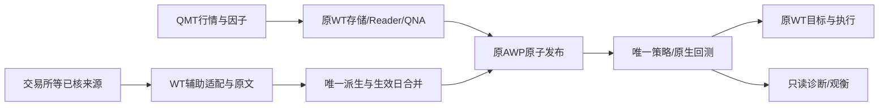

# 策略数据、业务诊断与运行日志

类型：跨模块最终规格。前缀：SDO。状态：accepted / implementing。依据：用户2026-11-05确认辅助数据持续更新、策略/回测诊断及发布日志检查，并按完整模块并行实施。架构沿[系统架构](../architecture/overview.md)，唯一策略沿[RR112](retained-resonance.md)，分工见[实施方案](../migration/mainline-data-observability-20261105.md)。

## SDO-R1 目标与复用

目标为真实数据持续到达、原策略计算、WT标准通道自动执行及独立观衡正确展示。按[原生能力目录](../development/wondertrader-capabilities.md)复用[行情](../modules/market-data.md)、[策略/回测](../modules/wondertrader-strategy-capabilities.md)、订单和运行日志。ETF份额、市场成交额与融资余额的外部取得和策略特有派生属于自有适配；由WT统一托管，观衡只读。关闭观衡后，数据和自动交易持续运行。不新增行情数据库、金融账本、日志服务器、Grafana、Windows定时任务或人工上线审批。

## SDO-R2 字段、公式与时间

现有种子接口为`guanheng_strategy_v1.auxiliary.AuxiliaryPublication`、`merge_auxiliary(observations, publications)`，采集接缝为`guanheng_analysis_window_producer.official_auxiliary`。普通发行、完整消费者与线上资格分别验证。

| 字段 | 定义 |
|---|---|
| kind | shares为ETF总份额，turnover为沪深股票成交额，margin为沪深融资余额 |
| symbol | shares所属实际ETF；市场汇总为空。角色替换使用新ETF自身来源 |
| statistic_date | 来源统计日，区别于知晓日、实际取得日和策略生效日 |
| value | 有限正数，shares单位亿份，其余单位亿元；缺失与零值分别处理 |
| available_at | 有依据、带时区的可获知时刻；历史首次未知时保留未知，以实际首次取得作为当前运行已知上界 |
| received_at | 带时区的实际采集时刻；历史补采不回填为历史取得时间 |
| source_sha256 | 原文或完整来源清单摘要，绑定日期、单位及派生身份 |

保持旧causal-v3：份额净变化为相邻统计日总份额差；概率沿原分段映射；成交热度为沪深成交额5日均值的60点midrank分位；融资分位为沪深融资余额60点midrank分位，均至少20点。原不足5日的初始化语义保持。5日平滑和60日分位的完整前缀最多64个来源日；输入和消费者共同支持。十进制份额先精确求差再交原信号机，保护5/10亿份阈值。

成交量、净资产、融资融券合计和其他ETF份额不能替代原字段。未取得值保持None。数值、来源日期、知晓时刻和来源摘要共同参与身份。

## SDO-R3 持续更新、存储与恢复

启动检查已有原件与缺口，长历史使用有限可续接任务；常驻owner持续增量取得新日期和必要修订。缓存按来源/日期/原文身份复用；来源修订探测及归档策略明确记录，不能永久缓存首次值。失败保留精确日期/原因；正常停止和重启保持原状态。

区分未发布、请求失败、日期不符、字段/单位变化、历史首次未知、预热不足和已确认零。逐来源/日期/证券记录应有/已有数量、尾日及缺口；五来源齐全日期数不代替逐字段可用性。原文捕获、派生成功、合并生效与策略消费分别验真。

晚于历史收盘才获知的事实不能回填该行。历史重建/知晓时间假设显式声明，与真实逐时点资格分开；历史预热的适用方式需核原合同，不能默默把未知变已知。采用有界并发、截止、退避和停止检查。原文压缩留存，缓存/临时文件按仍引用、可重建及业务原件区分；保留金融状态和未知委托责任。

## SDO-R4 策略与回测诊断

增加版本化只读诊断，逐角色声明实际必需字段；每字段记录完整输入/评估范围的应有数、非空数、覆盖范围、尾日和缺失原因。沪深300依赖份额概率/成交热度/融资分位，上证50与科创50买入、科创角色部分路径依赖份额变化；其他角色按代码核实，不要求每个ETF都具备四字段。

区分未调度、行情未就绪、预热、输入缺失、条件未触发、目标未变、产生目标及执行失败；保留逐角色BUY/SELL次数、最近有效计算日和缺失导致的分支不可用。复用唯一数学/输入规则；诊断不改信号阈值、目标、资金、持仓和缺失分支。无交易可为正常结果，不增加人工审批。

实时和回测使用同一诊断语义。旧报告/输入/原生输出保持可读；受影响回测以新版本记录重跑，不覆盖归档。观衡读取同一公开结果；界面布局改动先设计，不能在本任务随意改UI。

## SDO-R5 有界持久日志

复用WT现有运行及委托/成交记录。自有组件覆盖来源更新、字段缺口、派生/发布、调度/计算、目标、执行查询/回报、启动/退出和恢复。建立覆盖表，逐项标识已记录、缺失、仅内存、未核实和路径。

结构化事件包括带时区时间、组件、版本/运行身份、策略/证券或数据日、事件/原因、业务影响和关联请求。保留脱敏异常类型、稳定原因及有限调用位置；凭据、完整配置和账户正文不进入公开日志。状态是当前投影，日志保留事件历史。stderr仅在内存并回收清空的路径补持久诊断，包含启动前失败。

按配置的大小/时间轮转，约束总磁盘及队列/内存。日志写入故障如实报告，保持原交易语义，不能为记录或恢复错误重新下单。日志轮转与业务证据删除分别授权。

## SDO-R6 验收与发布

先模块实际主链，再根因回归/必要异常和独立审查，Root唯一集成和现场启停。当前仅已确认模拟账户，新WT框架改动仍需批准/配置分流。观衡独立发布。

| ID | 完成依据 |
|---|---|
| R1 | 关闭观衡后WT采集/策略/执行继续，原生重合能力复用 |
| R2 | 真实来源按正确单位产生四字段，原公式/64日来源/阈值正确 |
| R3 | 启动、增量、缺源恢复、修订、重启可续接，真实尾日和字段覆盖可查 |
| R4 | 已知三角色无信号和份额退出缺口明确呈现；新输入可消费，旧报告兼容且受影响回测有新记录 |
| R5 | 输入缺失、启动失败和运行异常可沿有界持久日志定位，轮转/脱敏可验 |
| R6 | 发布后核新日志、退出码、真实计算→目标→模拟执行→账户/页面与正常恢复；旧有效交易证据按身份复用 |

exit0、HTTP200、空stderr、ready和其他标的成交分别只证明对应范围，不代替完整业务。发布记录列组件、时间范围、日志位置、发现/处置和未覆盖项。
